# Labs64.IO :: Website

**labs64.io: the home of the Labs64.IO Ecosystem.**
*Part of the [Labs64.IO Ecosystem](https://labs64.io): positioning, product pages and the blog; technical documentation lives at labs64.io/docs.*

[](https://github.com/Labs64/labs64.io/actions/workflows/labs64io-ci.yml)
[](https://labs64.io)
[](LICENSE)
[](https://labs64.io/docs/)

<p align="center"></p>

[**Get started**](#get-started) · [Features](#features) · [Architecture](#architecture) · [AI agents](#using-website-with-ai-agents) · [Ecosystem](#the-labs64io-ecosystem) · [Documentation](https://labs64.io/docs/) · [labs64.io](https://labs64.io)

> [!NOTE]
> Module status, version and display name live only in `_data/modules.yml`. Never hand-write them into a page or the navigation.

## Why Website?

This repository is the public face of the platform: what it is, who it is for and where to start. It deliberately holds no onboarding steps, so there is one place to keep them current:

1. **Positioning, not procedures.** Product pages explain value and link to the docs for how.
2. **One source of truth for modules.** `_data/modules.yml` renders every status and name on the site.
3. **Readable by machines.** `llms.txt`, a sitemap and a feed are maintained with the content.

## Get started

Four ways in. Pick the one that matches what you have; each is complete on its own.

```
 1  install.sh             2  Kubernetes             3  Docker                 4  Source
┌───────────────────────┐ ┌───────────────────────┐ ┌───────────────────────┐ ┌───────────────────────┐
│ Skip the site: run    │ │ Read how to deploy    │ │ Run the website on    │ │ Write a post, change  │
│ the platform itself   │ │ in the docs, not      │ │ your machine while    │ │ a page, keep the      │
│ with one script       │ │ here: guides for your │ │ you edit a post       │ │ permalinks and        │
│                       │ │ own cluster           │ │                       │ │ redirects intact      │
├───────────────────────┤ ├───────────────────────┤ ├───────────────────────┤ ├───────────────────────┤
│ needs  a cluster,     │ │ needs  a browser      │ │ needs  Docker         │ │ needs  Docker, Git    │
│        kubectl, helm  │ │                       │ │                       │ │                       │
│ time   ~5 minutes     │ │ time   ~20 minutes    │ │ time   ~2 minutes     │ │ time   a few minutes  │
└───────────────────────┘ └───────────────────────┘ └───────────────────────┘ └───────────────────────┘
 try the product           plan a real install       edit the site             contribute back
```

Not sure? You probably want the [documentation](https://labs64.io/docs/) or the Quickstart, not this repository.

### 1. `install.sh`: the quick ecosystem start

The website explains Labs64.IO; the quickest way to see it is to run it. One script installs the gateway, AuditFlow and Payment Gateway on any Kubernetes cluster, then proves it with a real request. No cluster? A throwaway one on your laptop is enough:

```bash
k3d cluster create labs64io-demo -p "8000:80@loadbalancer" --k3s-arg "--disable=traefik@server:0"   # optional

curl -fsSL https://raw.githubusercontent.com/Labs64/labs64.io-helm-charts/master/install.sh -o install.sh
bash install.sh
```

Press Enter three times to take the defaults. You finish with a gateway you can `curl`, interactive API docs and a working token flow:

```text
  PASS  Obtained a demo access token from mock-oidc
  PASS  Published a demo audit event (HTTP 200) — first good request succeeded

 Labs64.IO is ready.
   Base URL:  http://localhost:8000
   API docs:  http://localhost:8000/swagger-ui/
```

Step-by-step onboarding lives in the [Quickstart](https://labs64.io/docs/getting-started/quickstart/), not on this site. The same script later runs `status`, `stop`, `start` and `uninstall`. This is an evaluation install with a demo identity provider: keep it on a local or private cluster. Details: [Quickstart](https://labs64.io/docs/getting-started/quickstart/) · [`install.sh`](https://github.com/Labs64/labs64.io-helm-charts/blob/master/install.sh).

### 2. Kubernetes: on your own cluster

Deployment guidance is owned by the documentation site: [Deploy to your Kubernetes cluster](https://labs64.io/docs/getting-started/deploy-to-kubernetes/) and [Choose a deployment path](https://labs64.io/docs/getting-started/choose-a-deployment-path/).

### 3. Docker: on your machine

Only Docker is needed:

```bash
git clone https://github.com/Labs64/labs64.io.git && cd labs64.io
docker compose up -d
```

Open <http://localhost:4000>. Stop it with `docker compose down`.

### 4. Source: build and change it

Posts are Markdown files in `_posts/` named `YYYY-MM-DD-slug.md`; pages, data and layouts follow Jekyll conventions. Before opening a pull request, build the site and check the permalinks:

```bash
docker compose run --rm labs64io bundle exec jekyll build --config _config.yml   # one-off production build
```

[`AGENTS.md`](AGENTS.md) lists the content guardrails, the redirect rules and the verification checklist.

### Where next?

Everything below is in the [Website documentation](https://labs64.io/docs/):

| I want to… | Read |
|---|---|
| Run Labs64.IO in five minutes | [Quickstart](https://labs64.io/docs/getting-started/quickstart/) |
| Read about each module | [Products](https://labs64.io/products/) |
| Write a post | [`AGENTS.md`](AGENTS.md) |
| Compare all the ways to run Labs64.IO | [Choose a deployment path](https://labs64.io/docs/getting-started/choose-a-deployment-path/) |

## Features

- **Jekyll site**: posts, pages, blog pagination and a module catalogue.
- **Module catalogue**: status and names rendered from `_data/modules.yml`.
- **SEO continuity**: legacy permalinks kept with redirect stubs and a permalink regression check.
- **Machine-readable context**: `llms.txt`, sitemap and feed.
- **Docker-first**: serve, build and link-check without installing Ruby.

## Architecture

```
  ┌──────────────────────────────┐   ┌──────────────────────────────────┐
  │ index.md · _posts/ · pages/  │   │ _data/modules.yml                │
  │ content                      │   │ module identity and status       │
  └──────────────┬───────────────┘   └────────────────┬─────────────────┘
                 │ Jekyll (layouts, includes)         │ module-status include
  ┌──────────────▼────────────────────────────────────▼─────────────────┐
  │ https://labs64.io                                                    │
  │   /docs  ──► labs64.io-docs (technical reference and onboarding)     │
  └─────────────────────────────────────────────────────────────────────┘
```

## Using Website with AI agents

The website tells agents what Labs64.IO is and where the authoritative pages are.

- **`llms.txt`.** A machine-readable summary of positioning and the service catalogue.
- **Facts are in one place.** Module status is data, not prose; an agent should read `_data/modules.yml` rather than infer it from a page.
- **Working on the site with an agent?** [`AGENTS.md`](AGENTS.md) and [`CLAUDE.md`](CLAUDE.md) describe guardrails and verification.

## The Labs64.IO Ecosystem

Website is one module of the [Labs64.IO Ecosystem](https://labs64.io); [every module is documented here](https://labs64.io/docs/).

| Module | What it does | Link |
|---|---|---|
| **AuditFlow** | Audit-event routing pipeline | [labs64.io-auditflow](https://github.com/Labs64/labs64.io-auditflow) |
| **API Gateway** | Authenticating, policy-enforcing edge for all modules | [labs64.io-authproxy](https://github.com/Labs64/labs64.io-authproxy) |
| **Payment Gateway** | One API over multiple payment providers | [labs64.io-payment-gateway](https://github.com/Labs64/labs64.io-payment-gateway) |
| **Checkout** | Embeddable, brandable checkout | [labs64.io-checkout](https://github.com/Labs64/labs64.io-checkout) |
| **Customer Portal** | Customer self-service UI | [labs64.io-customer-portal](https://github.com/Labs64/labs64.io-customer-portal) |
| **Commons** | Shared Java and Python libraries | [labs64.io-commons](https://github.com/Labs64/labs64.io-commons) |
| **Helm Charts** | Kubernetes deployment for every module | [labs64.io-helm-charts](https://github.com/Labs64/labs64.io-helm-charts) |
| **Workspace** | Dev container and multi-repo tooling | [labs64.io-workspace](https://github.com/Labs64/labs64.io-workspace) |
| **Tests** | Cross-module regression suite | [labs64.io-tests](https://github.com/Labs64/labs64.io-tests) |
| **Docs** | Published documentation | [labs64.io-docs](https://github.com/Labs64/labs64.io-docs) |
| **NetLicensing** | Licensing-as-a-Service: license and entitlement management | [netlicensing.io](https://netlicensing.io) |
| **GuideChimp** | Interactive guided product tours | [labs64.com/guidechimp](https://www.labs64.com/guidechimp/) |

## Contributing

Contributions of all sizes are welcome. Fork, branch, run the checks described in [`AGENTS.md`](AGENTS.md), and open a pull request. If you are unsure whether something fits, open an issue first.

## License

Following files, directories and their contents are copyright Labs64. You may not reuse anything therein without permission: `_drafts/`, `_posts/`, `img/`, `pages/`, `resources/`. All other files and directories are licensed under the [MIT License](LICENSE) unless explicitly stated.

---

<p align="center">
  <a href="https://labs64.io"></a><br>
  <sub>Made by the <a href="https://labs64.io">Labs64</a> team and community.</sub>
</p>
