# Labs64.IO :: Website

**labs64.io: the home of the Labs64.IO Ecosystem.** This repository holds the website: positioning, product pages and the blog, while the technical documentation lives at labs64.io/docs. Module status, version and display name live only in `_data/modules.yml`.

## The Labs64.IO Ecosystem

This repository is the website of the [Labs64.IO Ecosystem](https://labs64.io). The technical documentation is at [labs64.io/docs](https://labs64.io/docs/); [all modules are listed in the documentation](https://labs64.io/docs/services/).

---

   
  Made by the <a href="https://labs64.io">Labs64</a> team and community.

