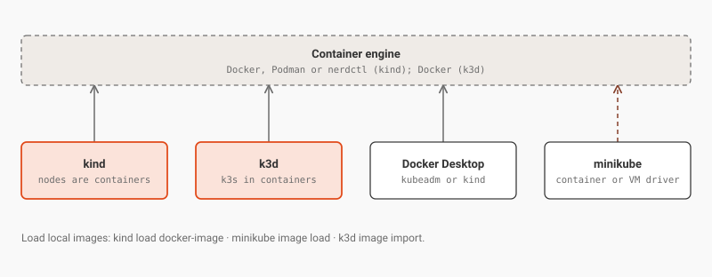

> **Update, 25 Nov 2026.** This post was first published in June 2025 and covered minikube and Docker Desktop. It now compares four tools, with facts taken from their current documentation. The URL has not changed.

At some point every team wants a Kubernetes cluster on a laptop: to try a Helm chart, to reproduce a bug, to run the whole stack before a pull request. The market has several tools for it, and they differ in how they run the cluster, what they need, and how you get your own images into it.

This post compares four common choices: **kind**, **minikube**, **k3d** and **Docker Desktop's built-in Kubernetes**. It is written for developers who need a local cluster and for architects and team leads who want a team default. We read the documentation of each tool (versions: minikube v1.39.0, kind v0.33.0, k3d v5.9.0, checked 25 Nov 2026) and installed k3d v5.9.0 locally; we did not create clusters with all four tools for this post, so resource numbers below are the documented minimums, not measurements.

**After reading, you will know:**

- how the four tools run a cluster and what each one needs,
- how to get a locally built image into each of them,
- what to check on Apple Silicon and x86 machines,
- whether you need Kubernetes at all for a local web project.

## Background: what "local Kubernetes" means

A local cluster is a real Kubernetes control plane and kubelet, usually in one process tree on your machine. Tools differ in where that cluster lives:

- **In containers.** kind runs each node as a container; k3d runs k3s, a lightweight Kubernetes distribution, in containers; Docker Desktop's cluster also runs inside Docker containers.
- **In a VM or a container, your choice.** minikube supports a list of "container or virtual machine managers", including Docker, QEMU, Hyper-V, KVM, Parallels, Podman, VirtualBox and VMware.

Because the nodes are containers or VMs, "your own image" is not automatically visible to the cluster. That is the most common first problem.

{:class="blog-center"}

## The problem: choosing without a shared yardstick

Teams pick by habit and then fight the differences: one person uses minikube, another uses Docker Desktop, a CI job uses something else, and the same chart behaves differently. A short, written comparison helps you choose once.

## The solution: compare on five questions

### Part 1: requirements and runtime

| | minikube | kind | k3d | Docker Desktop |
| --- | --- | --- | --- | --- |
| Runs the cluster as | Container or VM, per driver | Containers (docker, podman or nerdctl auto-detected) | k3s in Docker containers | Containers in Docker Desktop |
| Needs | 2 CPUs, 2 GB free memory, 20 GB free disk, internet | A container runtime; docs recommend 8 GB RAM for the Docker VM on macOS and Windows when building node images | Docker (k3d 5.x needs Docker 20.10.5 or newer) | Docker Desktop itself |
| Multi-node | Not checked in this review | Yes (kind docs list multi-node clusters among its uses) | Yes (README: "multi-node k3s cluster on a single machine") | Only with the `kind` provisioner |
| Choose the Kubernetes version | Yes | Yes, by node image | Yes, by k3s image | Only with the `kind` provisioner |

The numbers are from the minikube start page and the kind quick start; the kind page states that the values for the Docker VM are minimums for basic clusters, and that multi-node clusters or extra components may need more. For Docker Desktop, the documentation says `kubeadm` creates a single-node cluster whose version is set by Docker Desktop, and `kind` creates a multi-node cluster in which you set the version and the node count. It lists roughly one minute to provision for `kubeadm` against about 30 seconds for `kind`, and says the Docker image store is not supported with the `kind` provisioner (the containerd image store works with both).

### Part 2: get your image into the cluster

Each tool has a documented command. Without it, the cluster pulls from a registry and does not see your local build.

| Tool | Command | Source |
| --- | --- | --- |
| kind | `kind load docker-image my-app:latest` (add `--name <cluster>` for a named cluster) | kind quick start |
| minikube | `minikube image load <image>` | minikube `image` command reference |
| k3d | `k3d image import <image> -c <cluster>` | k3d command reference |
| Docker Desktop | No load command needed in the documentation we read; the provisioner table notes the containerd image store works with both provisioners and the Docker image store does not work with `kind` | Docker docs |

The kind documentation adds a detail that explains many "image not found" errors: the Kubernetes default pull policy is `IfNotPresent`, unless the tag is `:latest` or omitted, in which case it is `Always`. With a `:latest` tag, the cluster tries to pull from a registry even though you loaded the image. Use a specific tag for local images.

You can look inside a kind node with `docker exec -it kind-control-plane crictl images`, as the kind docs show.

### Part 3: Apple Silicon and x86

On Apple Silicon the Docker VM runs arm64 Linux, and an image built only for `linux/amd64` needs emulation. Docker's settings documentation lists an option, **Use Rosetta for x86_64/amd64 emulation on Apple Silicon**, available with the Apple Virtualization framework VMM and disabled by default, to accelerate amd64 binaries. Docker's multi-platform documentation covers building for several platforms with Buildx and QEMU emulation. The safest approach is to publish multi-architecture images, so that arm64 laptops and amd64 CI run the same tag natively. We did not benchmark emulation. If a pod fails with an exec format error, check the architecture of the image first.

### Part 4: exposing services

For kind, the documentation shows `extraPortMappings` in the cluster configuration to map a node port to a host port, and has separate guides for ingress and load balancers. We did not compare the other tools here. Check the project guide for your ingress controller before you pick a tool.

### Part 5: do you need Kubernetes locally at all?

Not always. If you develop one service and only need a database and a queue, a container Compose file starts faster and has fewer parts. Use a local cluster when what you are testing depends on Kubernetes itself: Helm charts, ingress or Gateway API rules, network policies, probes, operators, or the interaction of several services under the same manifests that you deploy.

## The outcome

| If you need | Use | Why (from the docs) |
| --- | --- | --- |
| A throwaway cluster in CI and for chart tests | kind | Nodes are containers; stable releases are recommended for CI |
| A beginner-friendly start with many driver options | minikube | Supports many drivers; 2 CPU / 2 GB / 20 GB minimum |
| Fast, multi-node, lightweight clusters | k3d | k3s in Docker; multi-node on one machine |
| Kubernetes without installing another tool | Docker Desktop | Built in; `kind` provisioner for multi-node and version choice |

For the Labs64.IO local stack we use k3d, which is also the tool installed on our development machines. That is a team choice, not a ranking: any of the four works for charts that avoid cluster-specific features.

## Trade-offs

- A tool you do not use in CI can behave differently from CI. Prefer one tool for both when you can.
- Docker Desktop's cluster is convenient, but its lifecycle belongs to the application: stopping the cluster removes the Kubernetes containers.
- Containers-in-containers clusters (kind, k3d) share the host kernel and the Docker VM's memory limit.
- Local clusters are not production. Storage classes, load balancers and security policies differ.

## Apply it to your own team

- Pick one default tool and write it down in the repository README.
- Use explicit image tags, and load the image with the tool's command.
- Publish multi-architecture images if the team mixes Apple Silicon and x86.
- Put the setup in a script or a `just` recipe, so a new colleague runs one command.
- Install metrics-server if you want `kubectl top` (see [kubectl top pod shows nothing](/blog/2025/07/07/pod-metrics-in-kubernetes/)).

## Key takeaways

- All four tools give you a real cluster; they differ in runtime, defaults and how you load images.
- Loading local images is the first thing to learn: `kind load`, `minikube image load`, `k3d image import`.
- Avoid the `latest` tag for local images; it defaults to an always-pull policy.
- On Apple Silicon, check image architecture before you blame the cluster.
- Choose one tool per team and use the same in CI.

## Related reading

- [Kubernetes cheat sheet](/blog/2025/06/07/kubernetes-cheatsheet/)
- [kubectl top pod shows nothing: metrics-server and the metrics API](/blog/2025/07/07/pod-metrics-in-kubernetes/)
- [What is a justfile?](/blog/2027/01/11/what-is-a-justfile/)
