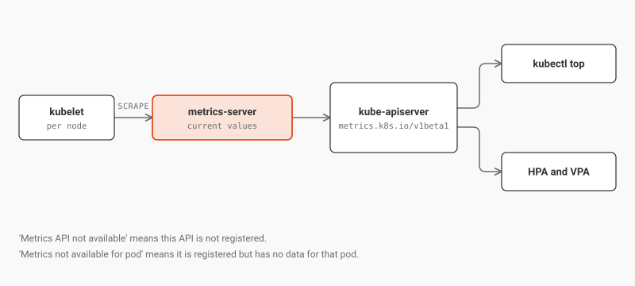

> **Update, 25 Nov 2026.** This post was first published in July 2025 as an overview of pod metrics. It is now organised around the problem people actually search for: `kubectl top` returns an error or nothing. The URL has not changed.

You run `kubectl top pod` to see which workload eats the memory, and the cluster answers with an error instead of a table. The cluster is healthy, the pods are running, and the one command that should show resource use does not work.

This post explains what `kubectl top` needs, why it fails, and how to fix it step by step. It is written for developers and operators of Kubernetes clusters, including local ones. Facts come from the kubectl source code, the metrics-server README and FAQ (v0.9.1, released 29 Oct 2026, checked 25 Nov 2026) and the kube-state-metrics and cAdvisor documentation. We did not run these commands against a cluster for this update, because no cluster was available in our environment; the error texts are quoted from the kubectl source.

**After reading, you will know:**

- what `kubectl top` reads, and why it needs metrics-server,
- the two error messages and what each one means,
- how to install metrics-server and which flags local clusters need,
- how to query the Metrics API directly to find the broken part,
- which PromQL queries answer the monitoring questions that `kubectl top` cannot.

## Background: where `kubectl top` gets its numbers

`kubectl top` does not measure anything itself. It reads the **Metrics API** (`metrics.k8s.io`), an aggregated API of the Kubernetes apiserver. The component that provides it is **metrics-server**: according to its README, it collects resource metrics from the kubelets and exposes them through the apiserver, for use by the Horizontal Pod Autoscaler and the Vertical Pod Autoscaler. The same API can be read by `kubectl top`.

{:class="blog-center"}

The README is clear about the purpose. It is meant only for autoscaling. It warns not to use it to forward metrics to monitoring solutions or as a source for them; for that, collect metrics from the kubelet's `/metrics/resource` endpoint directly, or use a monitoring system such as Prometheus.

## The problem: two different errors

The kubectl source defines both messages, and they point to different causes.

| Message | Where it comes from | Meaning |
| --- | --- | --- |
| `error: Metrics API not available` | kubectl checks the API groups of the server for a supported Metrics API version and finds none | metrics-server is not installed, or its APIService is not registered or not available |
| `Metrics not available for pod <ns>/<name>, age: <age>` | The Metrics API exists, but returned nothing for the pod, and the pod is older than 2 minutes | The pod is not being scraped; look at metrics-server logs and kubelet access |
| `metrics not available yet` | Same case for a new pod, younger than 2 minutes (the source uses a fixed two-minute delay) | Wait, then retry |

So the first question is simply whether the Metrics API exists.

## The solution: check, install, verify

### Part 1: is the Metrics API registered?

```bash
kubectl get apiservices | grep metrics
kubectl get --raw /apis/metrics.k8s.io/v1beta1/nodes
```

The metrics-server FAQ names the APIService `v1beta1.metrics.k8s.io`, and the compatibility matrix lists `metrics.k8s.io/v1beta1` as the API group and version for all current releases. If the first command prints nothing, metrics-server is not installed. If the APIService exists but is not available, the raw call returns an error that points to the cause, and the metrics-server pod logs are the next place to look. If the raw call returns a list of nodes with usage, the API works, and `kubectl top node` should too.

### Part 2: install metrics-server

The README gives the installation as a single manifest or an official Helm chart:

```bash
kubectl apply -f https://github.com/kubernetes-sigs/metrics-server/releases/latest/download/components.yaml
```

Check the **compatibility matrix** first: metrics-server 0.9.x supports Kubernetes 1.34 and newer, 0.8.x supports 1.31 and newer, 0.7.x supports 1.27 and newer. Use a version that matches your apiserver, and note that the README says the apiserver version must be within the supported range.

The **requirements** in the README are the usual reasons for a failed install:

- the kube-apiserver must enable the aggregation layer,
- kubelet certificates must be signed by the cluster certificate authority, or certificate validation must be disabled with `--kubelet-insecure-tls`,
- the control plane must reach the metrics-server pod on port 10250 (or the node IP and a custom port if `hostNetwork` is enabled),
- metrics-server must reach every node's kubelet address and port; it picks the first node address from the list given by `--kubelet-preferred-address-types`.

### Part 3: flags for local clusters

Local clusters often have kubelet certificates that are not signed by the cluster CA. The README documents the flag for this case:

- `--kubelet-insecure-tls`: do not verify the CA of the kubelets' serving certificates. The README says it is **for testing purposes only**, and the FAQ lists it among the insecure flags to avoid.
- `--kubelet-preferred-address-types`: the priority of node address types used to connect to a node. The README gives the default as `Hostname,InternalDNS,InternalIP,ExternalDNS,ExternalIP`, and the FAQ notes the manifests use `InternalIP,ExternalIP,Hostname`.

The FAQ also says the `v1beta1.metrics.k8s.io` APIService is installed with `insecureSkipTLSVerify: true`, and explains how to turn that off for production (set `insecureSkipTLSVerify: false` in the manifest, or `apiService.insecureSkipTLSVerify: false` with Helm).

Whether your local tool needs the flag depends on the tool. Some distributions ship metrics-server already; check with the commands in Part 1 before installing a second one. For a comparison of local cluster tools, see [Run Kubernetes locally in 2026](/blog/2025/06/04/local-k8s/).

### Part 4: use `kubectl top`

Once the API works:

```bash
kubectl top node
kubectl top pod -A
kubectl top pod my-pod --containers
kubectl top pod -A --sort-by=memory
```

From the kubectl source: `--containers` shows per-container usage, and `--sort-by` accepts only `cpu` or `memory`. Values are current usage, not history, and the README says it is not an accurate source of resource usage metrics for other purposes. The scrape interval is stated differently in two places: the README advertises collecting metrics every 15 seconds, while the FAQ gives 60 seconds as the default of the `--metric-resolution` flag and recommends nothing below 15 seconds, because that is the resolution the kubelet itself calculates. Check the flags in your own deployment.

### Part 5: when you need history, use PromQL

`kubectl top` shows a snapshot. For trends, alerts and restarts, use a monitoring system. The metric names below are from the cAdvisor and kube-state-metrics documentation; label names depend on your scrape configuration, so adjust them.

| Question | Query |
| --- | --- |
| CPU use per pod (cores) | `sum by (namespace, pod) (rate(container_cpu_usage_seconds_total{container!=""}[5m]))` |
| Memory per pod (bytes) | `sum by (namespace, pod) (container_memory_working_set_bytes{container!=""})` |
| Restarts in the last hour | `increase(kube_pod_container_status_restarts_total[1h])` |
| Pods by phase | `sum by (phase) (kube_pod_status_phase)` |
| Containers waiting, and why | `kube_pod_container_status_waiting_reason == 1` |

`container_cpu_usage_seconds_total` is documented as a counter of cumulative CPU time in seconds, which is why you apply `rate()`. `container_memory_working_set_bytes` is a gauge of the current working set. `kube_pod_status_phase` has the phases `Pending`, `Running`, `Succeeded`, `Failed` and `Unknown`, and `kube_pod_container_status_restarts_total` is a counter.

## The outcome

| Symptom | Check | Fix |
| --- | --- | --- |
| `Metrics API not available` | `kubectl get apiservices \| grep metrics` | Install metrics-server matching your Kubernetes version |
| APIService not available | metrics-server pod logs; port 10250 and kubelet access | Fix network paths and requirements |
| TLS errors scraping kubelets | Kubelet certificate and CA | Sign certificates properly, or `--kubelet-insecure-tls` for testing only |
| `Metrics not available for pod` | Pod age and metrics-server logs | Wait up to two minutes, then investigate scraping |
| Need history or alerts | n/a | Prometheus and the queries above |

## Trade-offs

- `--kubelet-insecure-tls` makes a local cluster work and removes certificate verification. Use it only where the README does: testing.
- metrics-server keeps current values in memory. Do not build dashboards or alerts on it.
- A monitoring stack (Prometheus, kube-state-metrics, cAdvisor) costs memory and care, and gives history.
- Metrics resolution is a trade between freshness and load on the kubelets.

## Apply it to your own cluster

- Run `kubectl get apiservices | grep metrics` before anything else.
- Pick the metrics-server version from the compatibility matrix.
- Keep the insecure TLS flag out of shared and production clusters.
- Add Prometheus queries for CPU, memory and restarts to your dashboards.
- Use HPA only after `kubectl top pod` works.

## Key takeaways

- `kubectl top` reads the Metrics API, which metrics-server provides.
- `Metrics API not available` means the API is not registered; `Metrics not available for pod` means it is registered but has no data.
- Match the metrics-server version to your Kubernetes version.
- `--kubelet-insecure-tls` is for testing only, according to the project.
- For history and alerts, use Prometheus; metrics-server is for autoscaling.

## Related reading

- [Run Kubernetes locally in 2026: kind vs minikube vs k3d vs Docker Desktop](/blog/2025/06/04/local-k8s/)
- [Kubernetes cheat sheet](/blog/2025/06/07/kubernetes-cheatsheet/)
- [metrics-server on GitHub](https://github.com/kubernetes-sigs/metrics-server){:target="_blank"}{:rel="noopener nofollow"}
