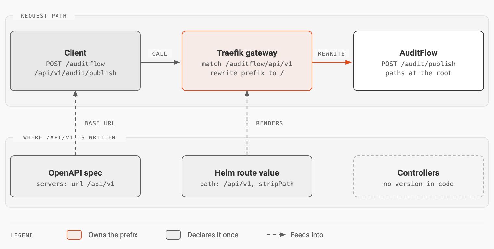

Most HTTP APIs carry a version in the URL: `/api/v1/orders`, `/v2/customers`. It looks harmless, but that short string ends up in many places: in every client, in the OpenAPI spec, in every controller annotation and in the routing rules in front of the service. When version 2 arrives, all of them have to move together, and anything that is missed returns a 404.

This post shows how the [Labs64.IO Ecosystem](/architecture/) keeps that cost low: **the API gateway owns the version prefix, and the service does not know it exists.** It is written for backend developers and platform engineers who run several HTTP services behind a gateway on Kubernetes.

**After reading, you will know:**

- the common ways to version an HTTP API, and why the URL path is still the usual choice,
- why it matters *which component* owns the version prefix,
- how to move the prefix out of your code and into the gateway, with OpenAPI, Helm and the Kubernetes Gateway API,
- what still needs checking after the move.

## Background: three ways to version an API

| Approach | Example | Good for | Cost |
|---|---|---|---|
| URL path | `/api/v1/orders` | Easy to see, cache, route and document | The version is part of every URL |
| Request header | `Api-Version: 2026-01-01` | Clean URLs, fine-grained versions | Harder to test in a browser; proxies must know the header |
| Media type | `Accept: application/vnd.acme.v2+json` | Versioning per representation | Most complex to implement and explain |

URL path versioning remains the most common choice for public APIs, because a human can read it and every proxy can route on it. So the interesting question is not *whether* the version goes into the path, but *who owns it*.

In the Labs64.IO platform, every module ([AuditFlow](/products/auditflow/), the Payment Gateway, Checkout and others) runs behind one shared Traefik gateway. Each module gets its own public prefix, for example `/auditflow/api/v1`.

## The problem: the version lives everywhere

When the service owns the prefix, the version is hard-coded in the application: in a `@RequestMapping("/api/v1")`, a servlet context path or a base-path setting. The gateway forwards the path unchanged. That has three costs:

- **Every version change is a code change** in the controller, the spec and the clients, released together.
- **Running v1 and v2 side by side** means two code paths inside the same service, or two deployments with different hard-coded paths.
- **The module must know its public name.** If the platform mounts AuditFlow under `/auditflow`, that name leaks into the service's configuration.

The root cause: a routing decision (which URL reaches which code) is made inside the application instead of in the routing layer.

## The solution: route-level prefix, root-mapped service

The fix moves the prefix into three places that are about routing, and out of the code entirely. The change came with the Traefik-owned API versioning work in the Helm charts repository ([pull request #2](https://github.com/Labs64/labs64.io-helm-charts/pull/2){:target="_blank"}{:rel="noopener nofollow"}).

1. **The spec** declares the prefix once, as a server URL.
2. **The Helm chart** names the route and asks the gateway to strip the prefix.
3. **The gateway** rewrites the path before the request reaches the service.

### Step 1: the spec puts the prefix in `servers`

AuditFlow's OpenAPI contract declares the prefix as a server URL and says who strips it:

```yaml
servers:
  - url: /api/v1
    description: Via API Gateway (Traefik strips the module prefix)
paths:
  /audit/publish:
    post:
      operationId: publishEvent
```

No key under `paths` contains `/api/v1`. Code generators that read `servers` put the prefix into the client's base URL, so generated clients still call the full public path.

### Step 2: the chart declares the route

In the AuditFlow Helm chart, the route that carries the API names the prefix and asks for it to be stripped:

```yaml
gateway:
  routes:
    # AuditFlow API (protected; strips '<prefix>/api/v1' — backend is root-mapped)
    - path: /api/v1
      port: 8080
      stripPath: true
```

The module prefix defaults to `/<chart-name>`, so the full public path becomes `/auditflow/api/v1`.

### Step 3: the gateway rewrites the path

The shared library chart, `chart-libs`, turns that value into a Kubernetes Gateway API `HTTPRoute`. Rendered (other filters trimmed), the rule looks like this:

```yaml
rules:
  - matches:
      - path:
          type: PathPrefix
          value: "/auditflow/api/v1"
    filters:
      # ... header, auth, rate-limit and compression filters ...
      - type: URLRewrite
        urlRewrite:
          path:
            type: ReplacePrefixMatch
            replacePrefixMatch: /
    backendRefs:
      - name: af-auditflow
        port: 8080
```

`URLRewrite` with `ReplacePrefixMatch` is part of the standard Gateway API, so this works with any conforming gateway. Labs64.IO uses Traefik, which also runs the shared auth, rate-limit and compression middlewares on the same route (see [Configuring Traefik Middleware for Kubernetes](/blog/2025/08/01/configuring-traefik-middleware-for-kubernetes/)).

## The outcome

{:class="blog-center"}

A client calls `POST /auditflow/api/v1/audit/publish`. The gateway matches the prefix, replaces it with `/`, and AuditFlow receives `POST /audit/publish`, exactly the path in its spec. The public OpenAPI document uses the same mechanism: `/auditflow/v3/api-docs` reaches the service as `/v3/api-docs`, without authentication.

| | Service owns the prefix | Gateway owns the prefix |
|---|---|---|
| Version string in controllers | yes | no |
| Places that name `/api/v1` | client, spec paths, controllers, route | spec `servers`, chart route |
| Adding v2 next to v1 | code change in the service | a second route |
| Service knows its public name | yes | no |

## Trade-offs

- **The prefix is still written twice:** in the spec's `servers` entry and in the chart's route. If they disagree, generated clients call a path the gateway does not route. A test that calls the service through the gateway, like those in the [Labs64.IO regression suite](https://github.com/Labs64/labs64.io-tests){:target="_blank"}{:rel="noopener nofollow"}, catches that.
- **Links the service builds itself need care.** A service that returns absolute URLs (pagination, `Location` headers) does not know its public prefix. Return relative links, or pass the public base URL in configuration.
- **Local runs without a gateway use root paths.** Convenient for development; just remember it when you copy a URL from a log.

## Apply it to your own service

1. Move the version out of every key under `paths:` and into `servers[].url`.
2. Make your controllers serve the root paths.
3. In your gateway route, match the public prefix and rewrite it to `/` (`URLRewrite`, `ReplacePrefixMatch: /`).
4. Add one end-to-end test that calls the service through the gateway.

To see the rendered route yourself:

```bash
git clone https://github.com/Labs64/labs64.io-helm-charts.git && cd labs64.io-helm-charts
helm template af charts/auditflow --set gateway.enabled=true \
  --api-versions gateway.networking.k8s.io/v1 --api-versions traefik.io/v1alpha1
```

## Key takeaways

- **Versioning is a routing decision.** Where a URL leads belongs in the routing layer, not in application code.
- **Root-mapped services are version-neutral.** The service serves `/audit/publish`; the gateway decides that the world sees `/auditflow/api/v1/audit/publish`.
- **OpenAPI already has a place for the prefix:** `servers[].url`. Keep `paths` free of it, and generated clients still call the right URL.
- **The Gateway API can do the rewrite natively** with `URLRewrite` and `ReplacePrefixMatch`, so the setup is portable across gateway implementations.
- **Two declarations need one test.** The spec and the route must agree; an edge test makes sure they do.

The charts are in [labs64.io-helm-charts](https://github.com/Labs64/labs64.io-helm-charts){:target="_blank"}{:rel="noopener nofollow"}, and the AuditFlow contract (`openapi-audit-v1.yaml`) is in [labs64.io-auditflow](https://github.com/Labs64/labs64.io-auditflow){:target="_blank"}{:rel="noopener nofollow"}. See also [API-First / Contract-Driven](/platform/api-first/) and [Modules, not a monolith](/blog/2025/11/29/ecosystem-architecture/).
