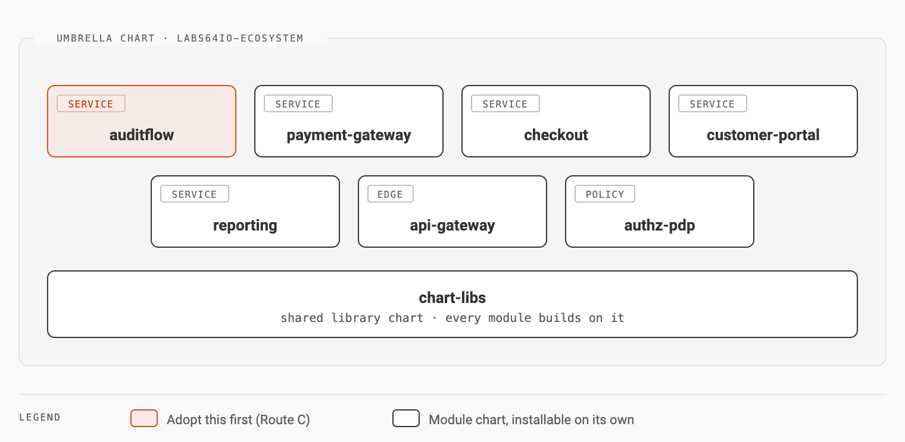
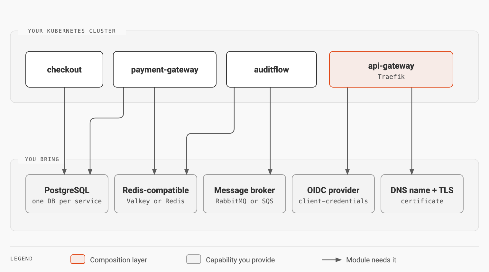
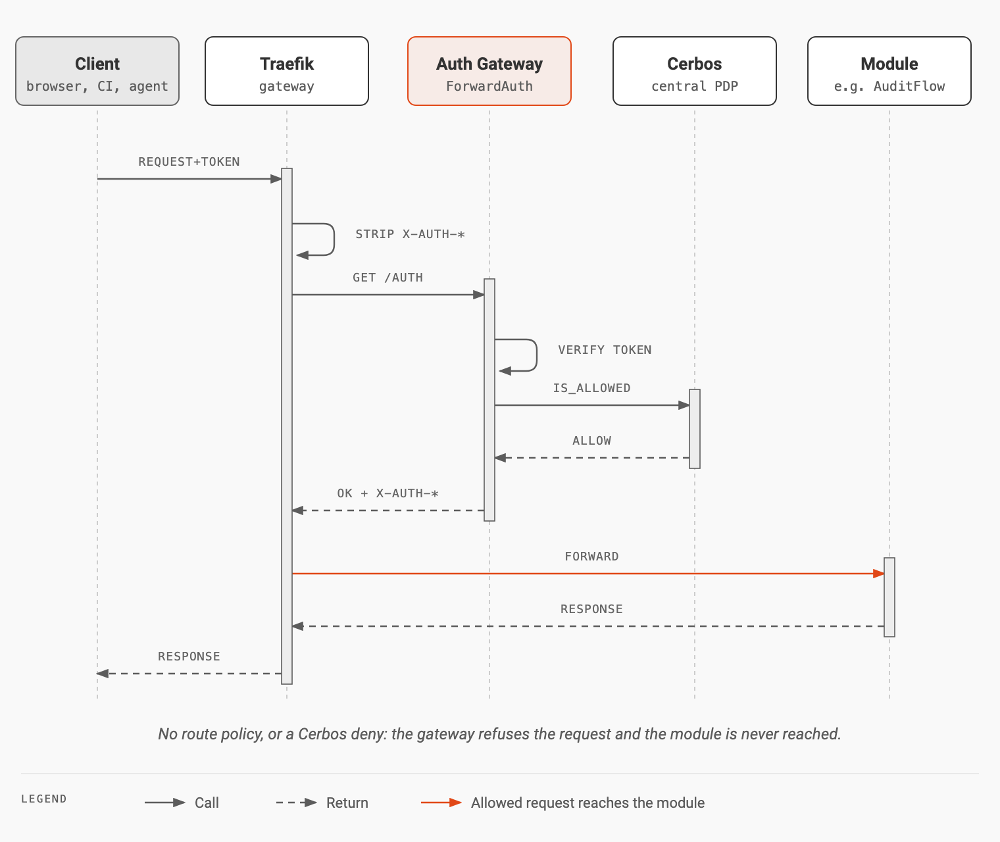
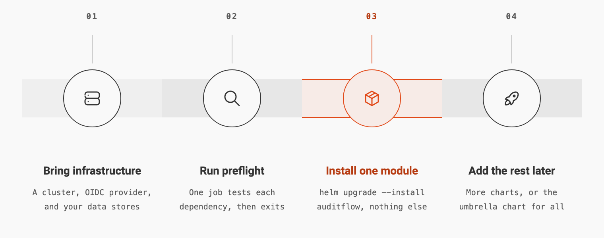

"Platform" is an overloaded word. For some vendors it means a monolith with feature flags: you take all of it or nothing. For others it means a pile of microservices that you wire together yourself, paying for authentication, routing and configuration again for every service. Neither is a good deal if you only need one capability today and want to add more later.

This post explains the middle path that the [Labs64.IO Ecosystem](/architecture/) takes, and how it is built with Kubernetes and Helm. It is written for architects, CTOs and integrators who are deciding how to adopt a platform, and for platform engineers who want to build one the same way.

**After reading, you will know:**

- how a *modular platform* differs from a monolith and from plain microservices,
- how standalone Helm charts and one shared library chart make modules independently installable,
- what infrastructure you bring yourself, and how to check it before installing,
- how a shared gateway turns independent modules into one platform, and what that costs.

## Background: monolith, microservices or modules?

A **monolith** is one deployable unit. It is simple to run, but you adopt all of it, and every team ships on the same schedule.

**Microservices** split the system into many small services. Each can ship on its own, but the cost moves to the integration: every service needs authentication, routing, configuration and monitoring, and every customer has to connect them.

A **modular platform** sits in between. Each module is a complete business capability that is useful on its own: audit logging ([AuditFlow](/products/auditflow/)), payments, checkout. What the modules share (the gateway, the identity contract, the deployment conventions) is built once and reused.

## The problem: adoption should not be all-or-nothing

For an integrator, two questions decide whether a platform is worth it:

1. **Can I adopt one capability without adopting everything?** A company that only needs an audit trail should not have to run a payment system.
2. **Is the second module cheaper to add than the first?** If every module brings its own login, routing and configuration style, the platform is just a collection of products.

Answering both with "yes" needs three things: modules that install independently, infrastructure that plugs in rather than being bundled, and one shared place where the modules meet.

## The solution in three parts

### Part 1: every module is its own Helm chart

Each module is published as a Helm chart of its own: `auditflow`, `payment-gateway`, `checkout`, `customer-portal`, `reporting`, the `authgateway`, and `authz-pdp` for the central Cerbos policy decision point. An umbrella chart, `labs64io-ecosystem`, installs the whole platform when you want it.

All of them depend on one shared **library chart**, `chart-libs`. A Helm library chart contains only templates (deployments, services, routes, network policies, probes) and renders nothing by itself; each module chart calls those templates with its own values. A fix to the shared route template reaches every module with a version bump instead of seven separate edits.

{:class="blog-center"}

You can start with just one:

```bash
helm repo add labs64io https://labs64.github.io/labs64.io-helm-charts
helm repo update
helm upgrade --install auditflow labs64io/auditflow -n labs64io -f auditflow-values.yaml
```

The [Kubernetes deployment guide](https://labs64.io/docs/getting-started/deploy-to-kubernetes.html) calls this Route C: adopt one capability, add the rest later.

### Part 2: you bring the infrastructure, and check it first

The module charts bundle no production data stores. Each one connects to infrastructure through configuration:

| You provide | Needed by |
|---|---|
| A Kubernetes cluster (routes use the Gateway API; the gateway is Traefik) | Everything |
| An OIDC identity provider that supports the client-credentials grant | The gateway |
| PostgreSQL, one database per service | Payment Gateway, Checkout |
| A message broker: RabbitMQ (AMQP 0-9-1) or Amazon SQS | AuditFlow |
| A Redis-compatible store (Valkey or Redis) | AuditFlow, Payment Gateway |
| A DNS name and a TLS certificate | The gateway |
| A place to keep secrets (Kubernetes Secrets or External Secrets Operator) | Everything |

That is a list of capabilities, not products. The platform plugs into the databases, brokers and identity provider your operations team already runs, backs up and monitors. For evaluation, the umbrella chart can run PostgreSQL, RabbitMQ and Valkey inside the cluster until you move to managed services.

{:class="blog-center"}

The most common first-install failure is not a software bug but a closed firewall port, a wrong password or a DNS name that does not resolve inside the cluster. The `preflight` chart catches those first. It runs one short job that tries each dependency (a TCP connection to the broker, a PostgreSQL login, a Redis `PING` and an OIDC token request) and completes only if every check passes:

```bash
helm install preflight labs64io/preflight -n labs64io --create-namespace -f my-endpoints.yaml
kubectl wait --for=condition=complete job/preflight -n labs64io --timeout=120s \
  || kubectl logs job/preflight -n labs64io --all-containers
helm uninstall preflight -n labs64io
```

### Part 3: the gateway is the composition layer

Independent services become one platform at the edge. Each module chart publishes its routes as a Gateway API `HTTPRoute` under its own prefix, such as `/auditflow/api/v1`. The shared gateway applies the same behaviour to all of them: it strips incoming `X-Auth-*` headers, calls the [Auth Gateway](/products/auth-gateway/) to verify the token, and applies rate limiting and compression. The central Cerbos service decides what each caller may do. No module implements any of that itself.

{:class="blog-center"}

The identity provider is a plug as well: any OIDC provider with the client-credentials grant works (Keycloak, Microsoft Entra ID, Auth0 and Okta are documented examples), and the token claims for scopes and tenant are configurable.

## The outcome

{:class="blog-center"}

| Question | Monolith | Plain microservices | Labs64.IO modules |
|---|---|---|---|
| Adopt one capability alone? | no | yes | yes |
| Authentication and routing per module? | shared | built each time | shared gateway |
| Uses your existing databases and broker? | usually bundled | varies | yes, by configuration |
| Second module cheaper than the first? | n/a | no | yes |

## Trade-offs

- **You operate the infrastructure you bring.** Backups, upgrades and monitoring of PostgreSQL, the broker and the Redis-compatible store are your team's job.
- **You choose a deployment path.** The docs [compare four](https://labs64.io/docs/getting-started/choose-a-deployment-path.html), from a quick evaluation to a local build from source, and are explicit that local defaults use well-known passwords.
- **Going live needs a checklist.** The "Before you go live" section of the deployment guide covers identity, backups and the rest.

## How to start

1. Run the [Quickstart](https://labs64.io/docs/getting-started/quickstart.html) on a laptop to see the gateway, AuditFlow and the Payment Gateway together.
2. Pick the one module you need first and list the infrastructure it uses.
3. Run `preflight` against your endpoints.
4. Install the module chart, then add the next module when you need it.

## Key takeaways

- **A modular platform is defined by two tests:** one capability can be adopted alone, and each further module is cheaper than the first.
- **Helm library charts keep modules consistent.** Shared templates for routes, probes and policies mean one fix reaches every chart.
- **Bring-your-own infrastructure means capabilities, not products:** "a broker", "a Redis-compatible store", connected by configuration.
- **Check infrastructure before installing.** A preflight job turns firewall and credential mistakes into a clear failure instead of a crashing service.
- **The gateway is where modules become a platform.** Authentication, authorization, routing and rate limiting live there once, not in every module.

The charts are in [labs64.io-helm-charts](https://github.com/Labs64/labs64.io-helm-charts){:target="_blank"}{:rel="noopener nofollow"}. The [Architecture overview](/architecture/) and the [Cloud-Native Kubernetes](/platform/kubernetes/) page give the bigger picture, and [Let the gateway own your API version prefix](/blog/2025/11/15/auditflow-traefik-versioning/) shows how one of those routes works in detail.
