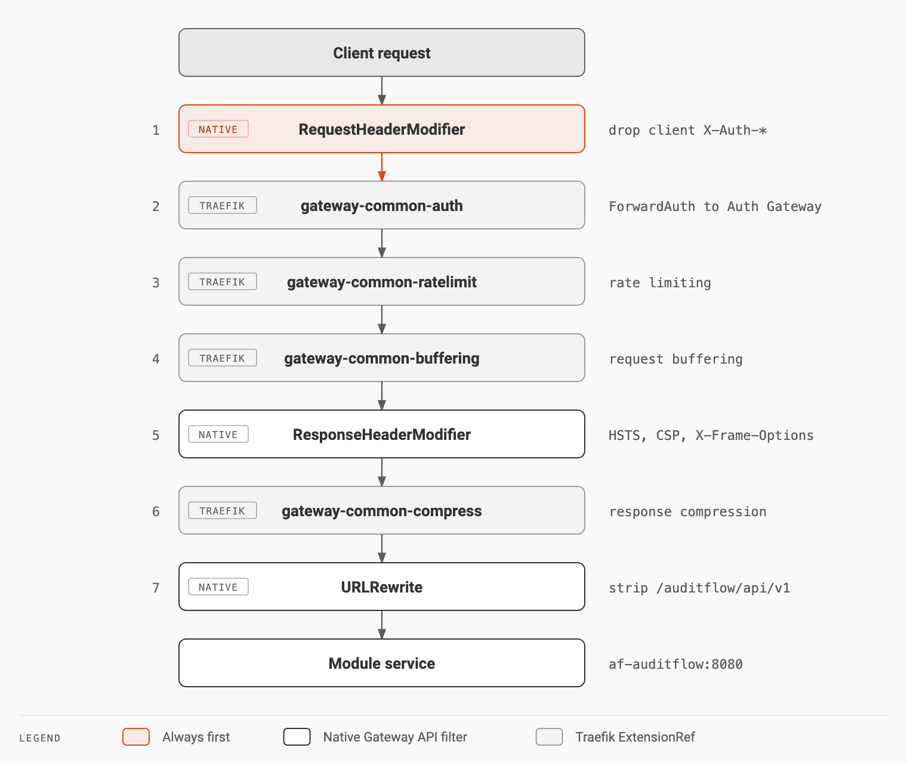

For years, getting HTTP traffic into a Kubernetes cluster meant choosing an ingress controller and then writing its own YAML dialect. Every Helm chart that shipped such routing rules was tied to that one controller, and moving to another meant rewriting every chart.

This post explains how the [Labs64.IO Helm charts](https://github.com/Labs64/labs64.io-helm-charts) moved from Traefik's own `IngressRoute` resource to the standard **Kubernetes Gateway API**, what that changed, where Traefik is still needed, and one ordering rule that turned out to be a security requirement. It is written for platform engineers and chart authors who are planning the same move.

**After reading, you will know:**

- what the Gateway API is and why it is the successor to `Ingress`,
- how a shared Helm template can give every module one standard `HTTPRoute`,
- which gateway features are portable today and which still need vendor extensions,
- why the filter that removes identity headers must run before authentication.

## Background: what the Gateway API changes

The Gateway API is the official successor to the `Ingress` resource. Instead of one object with vendor annotations, it splits edge routing into roles:

- **`GatewayClass`**: which implementation runs the gateway (Traefik, Envoy Gateway, Istio, NGINX Gateway Fabric and others). Owned by the infrastructure provider.
- **`Gateway`**: the listeners (ports, hostnames, TLS). Owned by the platform team.
- **`HTTPRoute`**: the rules that send traffic to services. Owned by the application teams.

It also standardises filters that used to be vendor annotations: header changes, redirects and URL rewrites. Features it does not cover yet, such as calling an authentication service, remain available through `ExtensionRef`, which points at an implementation-specific resource.

## The problem: routing tied to one vendor

In the Labs64.IO platform every module ([AuditFlow](/products/auditflow/), the Payment Gateway, Checkout and others) ships its own Helm chart. Each chart used to declare a Traefik `IngressRoute`, a custom resource that only Traefik understands. That meant:

- the routing intent of every module was written in a vendor dialect,
- the shared rules (authentication, rate limits, security headers) were repeated in each chart's YAML,
- switching gateway implementations would mean rewriting every chart.

## The solution in three parts

### Part 1: one `HTTPRoute` per module, from one template

Each module chart now renders a single `HTTPRoute`, built by a shared helper in the `chart-libs` library chart. No chart declares an `IngressRoute` any more. The route attaches to the platform's shared `Gateway`, `labs64io-gateway` in the `tools` namespace, and the module only provides values:

```yaml
gateway:
  enabled: true
  parentRefs:
    - name: labs64io-gateway
      namespace: tools
  routes:
    - path: /api/v1
      port: 8080
      stripPath: true
```

### Part 2: native filters where possible, Traefik where needed

The rendered rule for a protected AuditFlow route runs these filters, in this order:

{:class="blog-center"}

- **Native Gateway API filters:** `RequestHeaderModifier` removes incoming `X-Auth-User`, `X-Auth-Scopes` and `X-Auth-Tenant`; `ResponseHeaderModifier` sets security headers such as `Strict-Transport-Security` and `Content-Security-Policy`; `URLRewrite` strips the version prefix (see [Let the gateway own your API version prefix](/blog/2025/11/15/auditflow-traefik-versioning/)).
- **Traefik middlewares via `ExtensionRef`:** `gateway-common-auth` (forward authentication to the [Auth Gateway](/products/auth-gateway/)), `gateway-common-ratelimit`, `gateway-common-buffering` and `gateway-common-compress`.

### Part 3: strip identity headers first, then authenticate

The Auth Gateway answers each request with `X-Auth-*` headers that tell the services who the caller is, and the services trust them. If a client could send its own `X-Auth-User` and it survived to the service, the client could impersonate anyone.

So the first filter of every rule, public routes included, removes those headers. Only then does the authentication call run, and only its answer can set them again. This used to be a Traefik middleware too; the native `RequestHeaderModifier` replaced it after a live test proved that native filters run before the `ExtensionRef` authentication call. A comment in the `api-gateway` chart records the decision so nobody reintroduces the old middleware.

## The outcome

| | Before (`IngressRoute`) | After (`HTTPRoute`) |
|---|---|---|
| Routing resource | Traefik-only custom resource | standard Kubernetes Gateway API |
| Where routes are defined | per chart, vendor YAML | one shared template, module values |
| Header changes, rewrites, security headers | Traefik middlewares | native filters |
| Auth, rate limit, buffering, compression | Traefik middlewares | Traefik middlewares via `ExtensionRef` |
| Switching gateway implementation | rewrite every chart | replace four middlewares |

To read the filter order yourself:

```bash
git clone https://github.com/Labs64/labs64.io-helm-charts.git && cd labs64.io-helm-charts
helm template af charts/auditflow --set gateway.enabled=true \
  --api-versions gateway.networking.k8s.io/v1 --api-versions traefik.io/v1alpha1 \
  | grep -n "type: \(RequestHeaderModifier\|ExtensionRef\|ResponseHeaderModifier\|URLRewrite\)"
```

On a cluster, the Gateway API and Traefik CRDs must exist first; `just install-crds` in the chart repository installs the Gateway API standard channel (v1.6.3) and the Traefik CRDs before Traefik itself.

## Trade-offs

- **Portability is partial.** Four features still depend on Traefik. That is the honest boundary today, but it is now a short list instead of every chart.
- **Filter order is a contract.** Because security depends on it, order changes in the shared template need a test, not only a review.

## Apply it to your own charts

1. Move routing into one shared Helm template that renders an `HTTPRoute` from simple values.
2. Use native filters for headers, redirects and rewrites; keep vendor features behind `ExtensionRef`.
3. Make "remove client-supplied identity headers" the first filter of every rule, public routes included.
4. Verify the filter order on a real gateway once, and pin it with a rendering test.

## Key takeaways

- **The Gateway API separates roles:** infrastructure owns the `GatewayClass`, the platform owns the `Gateway`, applications own their `HTTPRoute`.
- **Standard routes, vendor extensions:** native filters cover headers, redirects and rewrites; `ExtensionRef` keeps the rest without giving up the standard resource.
- **One template, many modules.** Generating every module's route from shared Helm templates keeps cross-cutting rules identical everywhere.
- **Strip before you trust.** Identity headers from clients must be removed before authentication runs, on every route.
- **Know your lock-in.** Listing what still depends on the vendor turns "we use Traefik" into a concrete, bounded migration task.

See the [Cloud-Native Kubernetes](/platform/kubernetes/) and [Zero Trust](/platform/zero-trust/) pages for the platform view, and [Verify once at the edge](/blog/2026/02/25/trusted-header-contract/) for what services do with the headers the gateway sets.
