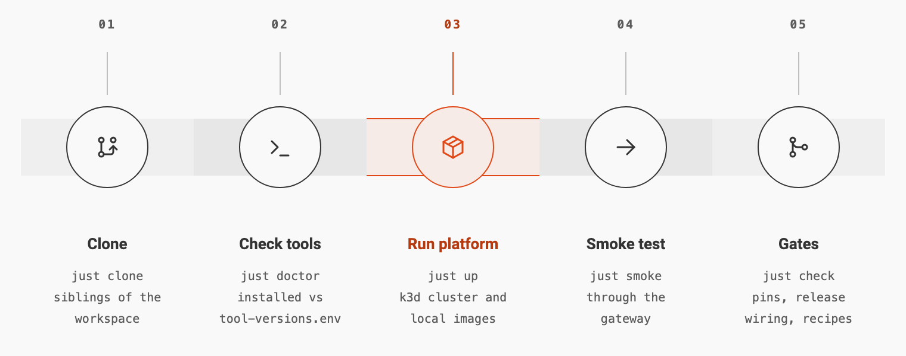

Every platform team eventually has the "monorepo or multi-repo" debate. A monorepo gives you one checkout, one toolchain and atomic changes. Separate repositories give each module its own history, release cycle and access rules, which is what you want when modules are adopted and released independently. The price of separate repositories is paid by every new contributor on day one.

This post shows how Labs64.IO pays that price once, with a small **workspace repository**, so that a contributor goes from nothing to a running platform with a handful of commands. It is written for engineering leads and developers who run, or are about to run, a platform split across many repositories.

**After reading, you will know:**

- what makes multi-repo onboarding painful, concretely,
- how a task runner with *modules* gives multi-repo projects one entry point,
- how one file of pinned tool versions keeps laptops and CI identical,
- how to check consistency *across* repositories automatically.

## Background: why Labs64.IO is multi-repo

The Labs64.IO platform is a set of modules that customers can adopt one at a time (see [Modules, not a monolith](/blog/2025/11/29/ecosystem-architecture/)). Each lives in its own Git repository: the auth gateway, payment gateway, checkout, AuditFlow, reporting, customer portal, shared libraries, Helm charts, tests, docs and the website. Eleven repositories, released independently.

## The problem: eleven clones, eleven toolchains

Without help, a new contributor has to:

- find and clone eleven repositories into the right folder layout,
- learn eleven sets of build commands,
- install Helm, Helmfile, k3d, Maven, Java, Node and more, in versions that match CI,
- figure out how to run the whole platform locally, with gateway and authentication in front.

And once everything runs, the repositories still drift apart quietly: one pom pins a library at a different version, a newly released image never reaches its chart. Nobody notices until something breaks.

## The solution in four parts

The [labs64.io-workspace](https://github.com/Labs64/labs64.io-workspace) repository is the contributor entry point. It adds glue, not code.

{:class="blog-center"}

### Part 1: one entry point with `just` modules

[`just`](https://github.com/casey/just) is a command runner: a `justfile` lists named recipes, like a `Makefile` without the build-system baggage. Its key feature here is **modules**: a `justfile` can mount another repository's `justfile` under a name, so its recipes run from the workspace. Optional modules (`mod?`) simply disappear when a repository is not cloned:

```just
# The other repositories, mounted as modules named after the repository without `labs64.io-`
mod? helm-charts '../labs64.io-helm-charts/justfile'
mod? tests '../labs64.io-tests/justfile'
```

`just clone` fetches every repository as a sibling folder, `just pull` updates them, `just show-repos` shows Git status across all of them and `just list-prs` lists their open pull requests.

### Part 2: one pinned toolchain

The versions of Helm, Helmfile, k3d, just, Terraform, Maven, Java and Node are written once, in `tool-versions.env`. That file is read by the dev container (which installs every tool at that version), by CI (which exports and installs the same values), and by the Helm chart repository; Renovate bumps it through annotations in the file.

Outside the dev container, `just doctor` compares what is installed with the pins:

```text
✅ Docker: Docker version 29.4.0, build 9d7ad9f
✅ k3d: k3d version v5.9.0
⚠️  Helmfile: helmfile version v1.8.3 — tool-versions.env pins 1.8.2
```

A mismatch is a warning, so you see drift without being blocked.

### Part 3: one local platform

`just up` runs four steps: it generates local secrets, starts a k3d cluster (Kubernetes in Docker) with a local image registry, builds the first-party images in a builder container, and deploys every module from the Helm overrides. `just smoke` then runs fast tests through the gateway; `just status`, `just logs <app>` and `just down` cover daily work, and `just up-otel` adds monitoring.

The local platform has the gateway, authentication and authorization in the request path, like production, so the [regression suite](https://github.com/Labs64/labs64.io-tests) runs against it. Through the modules, a repository's recipes are one command away:

```bash
just helm-charts install-app auditflow    # reinstall one module after a change
just tests test-module auditflow          # run its regression suite
```

### Part 4: gates that span repositories

`just check` runs checks over the sibling clones that no single repository can run on its own:

- `check-pins`: version pins agree across files and repositories, and no pom hard-codes a version;
- `check-release-wiring`: every released image is wired to its chart;
- `check-renovate-wiring`: Renovate watches every pin;
- `check-just`: every `justfile` follows the shared convention.

`just ci` runs the same set that the workspace's CI runs.

## The outcome

| Task | Without the workspace | With the workspace |
|---|---|---|
| Get all sources | eleven manual clones | `just clone` |
| Check tool versions | compare by hand with CI | `just doctor` |
| Run the whole platform | read eleven READMEs | `just up` |
| Test a change end to end | set up gateway and tokens yourself | `just smoke`, `just tests test-module <name>` |
| Catch drift between repositories | after something breaks | `just check` in CI |

## Trade-offs

- **The workspace is one more repository to maintain.** Keep it small: cloning, pins, local platform and cross-repository checks, nothing else.
- **It does not replace per-repository tooling.** Each repository still builds and tests on its own; the workspace only connects them.
- **Local Kubernetes needs resources.** Running every module with databases and a broker needs a reasonably sized laptop.

## Apply it to your own multi-repo platform

1. Create a workspace repository with a task runner that supports modules (`just` works well).
2. Add one recipe to clone everything into a fixed sibling layout.
3. Put every tool version into one file, and read it from the dev container, CI and a `doctor` command.
4. Add one command that runs the whole platform locally, with the real gateway in front.
5. Write the cross-repository checks you wish you had last time something drifted.

To try it: clone `https://github.com/Labs64/labs64.io-workspace.git` and follow the [guide to run the full ecosystem locally](https://labs64.io/docs/getting-started/run-the-full-ecosystem-locally.html). If you only want to *use* Labs64.IO, the [Quickstart](https://labs64.io/docs/getting-started/quickstart.html) installs published images instead.

## Key takeaways

- **Multi-repo is a trade:** independent releases in exchange for onboarding and consistency work. A workspace repository pays that once.
- **Task-runner modules give one vocabulary** across repositories without merging them.
- **One file of tool versions,** read everywhere and bumped automatically, ends "works on my machine" for tooling.
- **A local platform with the real gateway** lets every contributor test the same request path as production.
- **Some checks only exist across repositories.** Automate them, or drift will find you first.

The [Cloud-Native Kubernetes](/platform/kubernetes/) page describes the platform the workspace builds.
