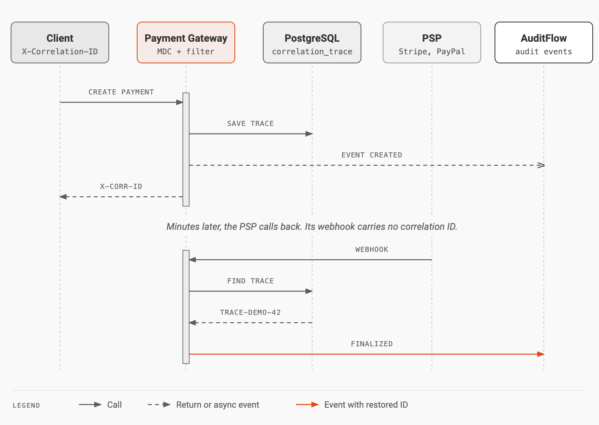

When a payment goes wrong, the first question from support is rarely "what broke?". It is "where is this payment now, and what happened to it?". Answering that means following one payment across several separate requests: the API call that created it, the call that paid it, and the webhook the payment provider sends minutes later. If each of those has its own ID in the logs, the story falls apart.

This post explains how the [Labs64.IO Payment Gateway](/products/payment-gateway/) keeps one correlation ID across all of them, including the webhook that arrives without it. It is written for backend developers and operators of systems that react to callbacks from third parties: payments, shipping, identity verification, any webhook-driven integration.

**After reading, you will know:**

- what a correlation ID is and how the usual approach works,
- why provider webhooks break that approach,
- a simple pattern to store and restore the ID across asynchronous callbacks,
- how to carry the same ID into audit events without letting auditing block payments.

## Background: what a correlation ID does

A correlation ID is a value that travels with a unit of work, so that every log line, event and downstream call about that work can be found together. The usual recipe:

1. Read the ID from an incoming header, or create a new one if it is missing.
2. Put it into the logging context, so every log line carries it.
3. Send it on with every outgoing call, and return it to the caller.

## The problem: webhooks arrive without your ID

That recipe assumes the work happens inside a request you control. Payments break the assumption. The payment service provider (PSP) confirms a payment in a separate HTTP call, a webhook, which arrives when the provider decides. It carries the provider's identifiers, never yours. Treated like any other request, the webhook gets a brand-new correlation ID, and the trail of one payment splits in two: the creation under one ID, the confirmation under another.

## The solution in four steps

{:class="blog-center"}

### Step 1: one ID per request, in a header

Every request passes through `CorrelationIdFilter`. It reads the `X-Correlation-ID` header, generates a UUID if there is none, stores the value in the logging context (SLF4J's MDC) and returns it in the response:

```java
String correlationId = request.getHeader(CORRELATION_ID_HEADER);
if (StringUtils.isBlank(correlationId)) {
    correlationId = UUID.randomUUID().toString();
}
CorrelationContextHolder.set(correlationId);
response.setHeader(CORRELATION_ID_HEADER, correlationId);
```

The gateway writes structured JSON logs with a `correlationId` field, so one search finds every line of a request.

### Step 2: remember the ID when something is created

Because the webhook will not bring the ID back, the gateway writes it down. A `correlation_trace` table links an entity type (`PAYMENT` or `PAYMENT_TRANSACTION`), the entity's ID and the correlation ID that was active when it was created:

```text
     entity_type     |            correlation_id
---------------------+--------------------------------------
 PAYMENT             | trace-demo-42
 PAYMENT_TRANSACTION | 46beabe8-b271-42b2-8094-a5e19292fdd6
```

### Step 3: restore the ID when the webhook arrives

When a webhook arrives, the gateway verifies it, finds the transaction it refers to, and looks up the most recent trace for that transaction (falling back to the payment). It puts that ID into the logging context before doing any further work:

```java
correlationTraceRepository
        .findFirstByEntityTypeAndEntityIdOrderByCreatedAtDesc(
                CorrelationEntityType.PAYMENT_TRANSACTION, transaction.getId())
        .or(() -> correlationTraceRepository.findFirstByEntityTypeAndEntityIdOrderByCreatedAtDesc(
                CorrelationEntityType.PAYMENT, payment.getId()))
        .ifPresent(trace -> MDC.put(CorrelationConstants.MDC_CORRELATION_ID, trace.getCorrelationId()));
```

From then on, everything the webhook triggers is logged under the payment's original ID.

### Step 4: carry the ID into audit events, safely

The gateway publishes three lifecycle events to [AuditFlow](/products/auditflow/): `payment.created`, `payment.finalized` and `payment.closed`, when `AUDITFLOW_ENABLED` is `true`. Each carries the tenant, an event ID, the event time and the correlation ID from the current context:

```java
AuditEvents.builder(type.eventType())
        .eventId(UUID.randomUUID())
        .eventTime(occurredAt)
        .sourceSystem(sourceSystem)
        .tenantId(payment.getTenantId())
        .correlationId(CorrelationContextHolder.get().orElse(null))
        .extra("eventVersion", EVENT_VERSION)
        .extra("payment", paymentMapper.toDto(payment));
```

An audit outage must never block a payment, so delivery happens only after the database commit, on another thread, and failures are logged rather than rethrown:

```java
@Async
@TransactionalEventListener(phase = AFTER_COMMIT, fallbackExecution = true)
public void send(final PaymentEvent paymentEvent) {
    try {
        auditFlowPublisher.publish(paymentEvent.auditEvent());
    } catch (RuntimeException exception) {
        log.error("AuditFlow event delivery failed | eventId={}, eventType={}", ...);
    }
}
```

The AuditFlow client retries with exponential backoff (three attempts by default, `AUDITFLOW_RETRY_MAX_ATTEMPTS`).

## The outcome

Creating and fetching one payment with `X-Correlation-ID: trace-demo-42` on the local stack produced eight log lines with `"correlationId":"trace-demo-42"`. A `payment.finalized` event caused by a webhook minutes later carries the same value, so AuditFlow shows the payment from creation to its final state under one ID.

| | Without stored traces | With `correlation_trace` |
|---|---|---|
| API calls of one payment | one ID | one ID |
| Webhook processing | new, unrelated ID | the payment's original ID |
| Audit events after a webhook | unrelated ID | same ID as creation |
| Support question "what happened?" | several searches, guesswork | one search |

## Trade-offs

- **Audit delivery is best effort.** The gateway keeps no outbox; after the retries are used up, it logs and moves on. If every lifecycle event must arrive, use a transactional outbox: write the event in the same transaction as the payment and send it from there.
- **One small table more.** `correlation_trace` grows with payments and transactions; it is cheap, but it belongs in your retention plan.

## Apply it to your own integrations

1. Accept and return `X-Correlation-ID` on every request; generate one if it is missing.
2. When you create something a callback will refer to, store the active ID next to it.
3. When the callback arrives, verify it, find the entity, and restore the stored ID before any work.
4. Send side effects such as audit events after commit, asynchronously, and never let them fail the main operation.

To try it, start the [Payment Gateway quick start](https://labs64.io/docs/modules/payment-gateway/#try-a-payment-with-docker), add `-H "X-Correlation-ID: trace-demo-42"` when creating the payment, then search the logs:

```bash
docker compose -f docker-compose.images.yml logs payment-gateway | grep '"correlationId":"trace-demo-42"'
```

## Key takeaways

- **A correlation ID only works if every hop keeps it.** Headers carry it through requests; something else has to carry it through time.
- **Webhooks are the weak spot.** They come from someone else, later, with someone else's identifiers.
- **Store and restore:** save the active ID next to the entity a callback will refer to, and put it back into the logging context when the callback arrives.
- **Audit events should carry the same ID,** so logs and the audit trail tell one story.
- **Side effects must not block the core operation.** Send them after commit, asynchronously, and decide consciously whether best effort is enough.

The events and their configuration are described in the [Payment Gateway docs](https://labs64.io/docs/modules/payment-gateway/); the code is in [labs64.io-payment-gateway](https://github.com/Labs64/labs64.io-payment-gateway). For the observability side of the platform, see [Telemetry](/platform/telemetry/).
