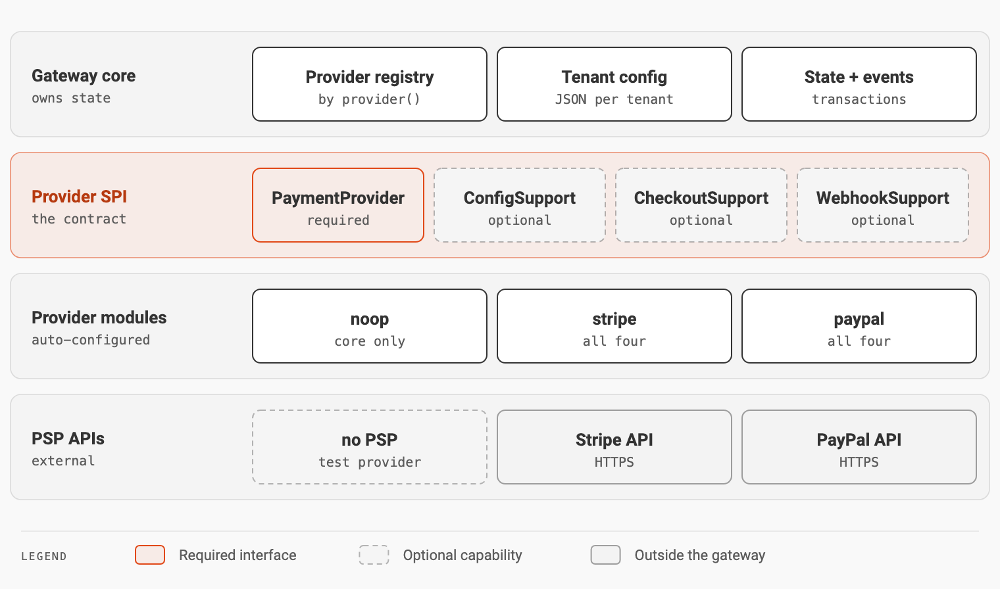

Almost every business that sells online ends up with more than one payment service provider (PSP): Stripe for cards in one market, PayPal because customers ask for it, a local provider for a specific country. If every new PSP means editing the payment core, the error handling and the tenant logic, each provider makes the next one harder, and the core slowly turns into a collection of special cases.

This post shows how the [Labs64.IO Payment Gateway](/products/payment-gateway/) avoids that with a small **service provider interface (SPI)**: the core defines a tiny contract, and each PSP is a plug-in module. It is written for architects and Java developers who integrate several payment providers, or any other family of third-party APIs.

**After reading, you will know:**

- what an SPI is and what makes a good one,
- how to keep the mandatory contract to two methods, with optional capabilities on top,
- where to draw the line between the payment core and a provider adapter,
- how providers register themselves and how tenants switch them on without code.

## Background: what an SPI is

An SPI is an interface that is meant to be *implemented* by others rather than *called* by them. JDBC drivers, logging back-ends and Java's `ServiceLoader` all work this way: the core knows the interface, and implementations plug in. For payments, the core keeps one payment model and one state machine; each adapter translates them into one PSP's API.

## The problem: every PSP is different

PSPs differ in almost everything except the basic idea of taking money:

- some take a payment in one API call, others redirect the customer to a hosted checkout page;
- some report results by webhook, some do not;
- each needs its own credentials, often per merchant (per tenant);
- each has its own SDK exceptions and error codes.

A single large interface that covers all of this forces every adapter to fake the parts its PSP does not have. Putting the differences into the core makes the core grow with every provider.

## The solution in four parts

{:class="blog-center"}

### Part 1: a core contract of two methods

Every provider implements `PaymentProvider`:

```java
public interface PaymentProvider {
    String provider();
    PaymentResult execute(PaymentContext context);
}
```

`provider()` returns the identifier tenants use, such as `"stripe"`. `execute` runs one prepared payment attempt. The Javadoc sets the rules:

- Returning a `PaymentResult` is the only way to move a transaction to a new state.
- If the outcome is unknown once execution has started (a timeout, a lost connection), the adapter throws `ProviderExecutionException` and the gateway keeps the transaction non-terminal. Why that matters: [A timeout is not a failed payment](/blog/2026/07/20/payment-state-policy-provider-outcomes/).
- Providers must not persist gateway state or publish gateway events. The core owns both.

The smallest real provider, NoOp, always succeeds and needs no PSP account, which makes it ideal for tests and demos:

```java
@Component
public class NoopPaymentProvider implements PaymentProvider {
    @Override
    public String provider() { return "noop"; }

    @Override
    public PaymentResult execute(final PaymentContext context) {
        final StatusDetails details = new StatusDetails("COMPLETED", "Payment completed successfully.");
        return new PaymentResult(provider(), PaymentTransactionStatus.SUCCESS, Map.of(), details, null);
    }
}
```

### Part 2: capabilities you opt into

Everything beyond `execute` is an optional interface:

| Interface | Use it when | What the provider does |
|---|---|---|
| `ProviderConfigSupport` | tenants bring their own credentials | declares accepted config keys (`configFields()`) and checks its own rules (`validateConfig`) |
| `ProviderCheckoutSupport` | the PSP uses a hosted or redirect checkout | prepares a checkout session, then completes or cancels it when the customer returns |
| `ProviderWebhookSupport` | the PSP sends webhooks | finds the transaction ID in a payload, then verifies and handles the webhook |

The split of responsibilities is deliberate. The gateway drops undeclared config keys and checks required fields before `validateConfig` runs. For webhooks, `extractPaymentTransactionId` must not trust the payload and must not have side effects; it only tells the gateway which transaction and tenant config to load. `handleWebhook` then does the signature check. An unauthenticated payload can cause a lookup, never a state change.

### Part 3: providers register themselves

The gateway collects every `PaymentProvider` bean and indexes it by name:

```java
public PaymentProviderRegistry(final List<PaymentProvider> providers) {
    this.providers = providers.stream()
            .collect(Collectors.toMap(PaymentProvider::provider, Function.identity()));
}
```

The Stripe and PayPal modules each ship a Spring Boot auto-configuration that creates the provider bean. The backend pulls the modules in as runtime dependencies (`payment-provider-stripe`, `payment-provider-paypal`, `payment-provider-noop`); the core has no compile-time import of any concrete provider.

### Part 4: tenants switch providers on with data

A module on the classpath makes a provider *available*. A tenant *enables* it by saving a provider record with `provider`, `active`, a display name and a `config` map stored as JSON:

```bash
curl -s -X POST localhost:8080/payment-providers \
  -H "Content-Type: application/json" \
  -d '{"provider":"noop","active":true}'
```

Credentials such as Stripe's `secretKey` and `webhookSecret` live in that `config` map, per tenant, so a new provider never needs a new database column. The [local quick start](https://labs64.io/docs/modules/payment-gateway/#try-a-payment-with-docker) shows the full request with its headers.

## The outcome

| Adding a new PSP | Without an SPI | With the SPI |
|---|---|---|
| Changes to the payment core | controller, error handling, state logic | none |
| Unsupported PSP features | faked or special-cased | simply not implemented |
| New credentials | new columns or settings | keys in the tenant's `config` map |
| Shipping it | release of the core | a new module on the classpath |

The Stripe and PayPal modules implement all four interfaces; NoOp implements only the core one. All three run through the same core code.

## Trade-offs

- **The contract is an API you must keep stable.** Changing an SPI interface affects every provider module; evolve it by adding optional interfaces rather than changing existing ones.
- **Shared state rules need discipline.** "Providers never write gateway state" only holds if reviews enforce it.

## Apply it to your own integrations

1. Keep one internal model and state machine; define the smallest interface every provider can honestly implement.
2. Put optional features into separate capability interfaces.
3. Let the core own persistence, state and events; adapters only report results.
4. Register adapters automatically (Spring auto-configuration, `ServiceLoader`), and select them per tenant from configuration.

To write your own provider: create a module under `payment-gateway-providers/<name>/` that depends on `providers-spi`, implement the interfaces you need, and expose the class through an auto-configuration. [Integrating Stripe Checkout safely](/blog/2026/05/09/adding-stripe-to-payment-gateway/) walks through one provider in detail.

## Key takeaways

- **An SPI turns "integrate a provider" into "add a module".** The core calls the interface; adapters do the translation.
- **Small mandatory contract, optional capabilities.** Two methods every PSP can implement; config, checkout and webhooks only where they exist.
- **The core owns state.** Adapters report results, never write them, so every provider behaves the same in the database and the audit trail.
- **Untrusted input can only cause a lookup.** Webhook payloads are verified before they can change anything.
- **Tenants enable providers with data.** Credentials per tenant, in configuration, never in code.

The SPI lives in `payment-gateway-providers/providers-spi` in [labs64.io-payment-gateway](https://github.com/Labs64/labs64.io-payment-gateway); the [Payment Gateway docs](https://labs64.io/docs/modules/payment-gateway/) cover configuration and usage.
