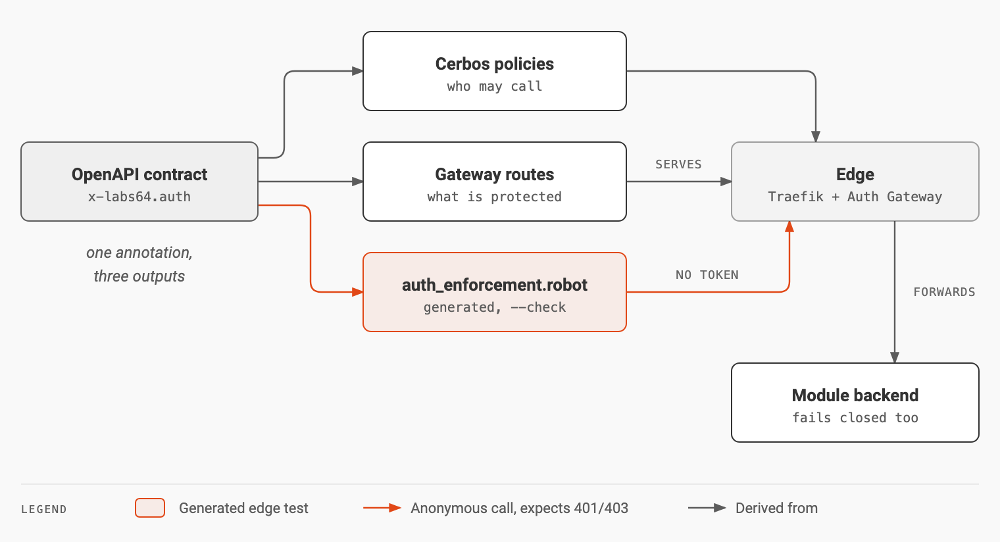

Many integration test suites take shortcuts. To check a side effect, they read a database table, look into a message broker, or call a service on its internal port instead of through the gateway. That is convenient, but it tests something your customers never touch. The suite can be green while the API your customers actually call returns the wrong status code, or lets the wrong caller in.

This post explains how the Labs64.IO regression suite tests the platform the way a client sees it, at the gateway edge with real tokens, and how it generates authorization tests automatically so that no new endpoint slips through untested. It is written for QA engineers, developers and tech leads who own API test strategies.

**After reading, you will know:**

- what black-box testing *at the edge* means and why it catches more,
- how to structure an authorization matrix so a failure can only mean one thing,
- how to generate one security test per protected endpoint from the API contract,
- how edge tests and backend tests complement each other.

## Background: black-box at the edge

A black-box test knows only the public interface: URLs, request bodies, status codes and headers. Testing *at the edge* adds one rule: every request goes through the same gateway, authentication and authorization as production traffic. In Labs64.IO that is Traefik plus the [Auth Gateway](/products/auth-gateway/), which asks a central Cerbos service for every decision.

The suite uses [Robot Framework](https://robotframework.org/){:target="_blank"}{:rel="noopener nofollow"}, a keyword-driven test framework whose cases read close to plain English, so integrators and product owners can review them.

## The problem: security regressions are invisible to happy-path tests

Two kinds of failure matter most for an API platform, and ordinary tests miss both:

- **A protected operation becomes reachable** without the right scope. A happy-path test with an admin token still passes.
- **A new operation is added without any authorization test**, because someone forgot. Nothing fails, because nothing tests it.

A suite that bypasses the gateway cannot see either problem at all.

## The solution in three parts

### Part 1: every test goes through the gateway

All tests call the platform at its public address (`http://gateway.localhost` locally, configurable with `GATEWAY_BASE_URL`). Tokens are minted per test from a mock identity provider or Keycloak, with exactly the scopes under test. The few cross-module checks that need to look at logs are tagged `local-k8s-only` and skip cleanly elsewhere.

### Part 2: a scope matrix where only credentials change

AuditFlow's `authz.robot` (in [labs64.io-auditflow](https://github.com/Labs64/labs64.io-auditflow){:target="_blank"}{:rel="noopener nofollow"}, `tests/e2e/`) states its contract: wrong scope → `403`, correct scope → `200`, missing or malformed credentials → `401` before any authorization decision. Two of its cases:

```robotframework
Reject missing authorization (401)
    [Documentation]    POST /audit/publish without auth header returns 401.
    [Tags]    auditflow    regression    auth
    Create Unauthenticated AuditFlow Session
    ${event}=    Build Valid Audit Event    unauth-check
    ${response}=    Publish Audit Event    ${event}
    Response Status Should Be    ${response}    401

Reject wrong scope (403)
    [Documentation]    Token missing audit-event:write scope is denied with 403 by cerbos.
    [Tags]    auditflow    regression    auth    tenant-isolation
    Create Session With Scope    auditflow-wrong-scope    ${AUDITFLOW_BASE_URL}    audit-event:read
    ${event}=    Build Valid Audit Event    wrong-scope-check
    ${response}=    Publish Audit Event    ${event}    alias=auditflow-wrong-scope
    Response Status Should Be    ${response}    403
```

The event is always valid; only the credentials change. So a `401` or `403` can only be about authorization, never about a bad payload. The positive cases (`audit-event:write` alone, or together with other scopes, returns `200`) are tested the same way.

### Part 3: one generated test per protected operation

Each operation in a Labs64.IO OpenAPI contract declares who may call it in an `x-labs64.auth` block. The same annotation already generates the Cerbos policies and the gateway routes. A script, `generate_auth_enforcement_suite.py`, reads it too and writes `tests/common/auth_enforcement.robot`: one case per protected operation, which calls it without credentials and expects `401` or `403`.

{:class="blog-center"}

```robotframework
auditflow POST /audit/publish rejects anonymous callers
    [Documentation]    publishEvent declares x-labs64.auth requiring a tenant and scope(s) audit-event:write. An unauthenticated call must be refused at the edge.
    [Tags]    auditflow    smoke    auth    auth-enforcement    generated
    Protected Operation Should Reject Anonymous Access    ${AUDITFLOW_BASE_URL}    POST    /audit/publish
```

CI runs the generator with `--check`, which fails if the committed file no longer matches the contracts. Adding an operation without regenerating its test fails the build.

The edge suite is half of a two-part guarantee: each backend also proves it fails closed on its own in an `AuthEnforcementContractTest`, for the case that a request ever reaches it without passing the gateway.

## The outcome

| Risk | Typical integration suite | Edge suite with generated cases |
|---|---|---|
| Wrong scope accepted | not seen (admin token) | `403` expected, test fails |
| Endpoint added without auth test | not seen | CI fails on `--check` |
| Gateway route missing or wrong | not seen (internal port) | test fails at the edge |
| Contract, policy and routes drift apart | not seen | impossible: one source |

The shared and generated suites live in [labs64.io-tests](https://github.com/Labs64/labs64.io-tests){:target="_blank"}{:rel="noopener nofollow"}; each module keeps its own e2e suite in its repository, and the test recipes run them together:

```bash
git clone https://github.com/Labs64/labs64.io-tests.git && cd labs64.io-tests
python -m venv .venv && source .venv/bin/activate
pip install -r requirements.txt
just smoke                      # fast gate across shared and module suites
just test-module auditflow      # one module's e2e suite
just test-auth                  # only the authorization tests
```

The recipes expect the module repositories as sibling folders, as the [workspace](/blog/2025/12/28/labs64-workspace-tooling/) sets them up. Robot's `log.html` shows the full request and response of every failing step. The [Regression Tests](https://labs64.io/docs/development/regression-tests.html) page has the details.

## Trade-offs

- **Some side effects are hard to see from outside.** Edge tests need a readable signal; where only logs show it, the test is limited to local clusters.
- **Edge tests need a running platform.** They complement unit tests in each module; they do not replace them.

## Apply it to your own APIs

1. Run regression tests only through the public gateway, with real tokens.
2. Build an authorization matrix where the payload is always valid and only credentials change.
3. Declare access rules in the API contract, and generate one "anonymous call is refused" test per protected operation.
4. Make CI fail when the generated tests are out of date.
5. Keep a fail-closed test in each backend as a second line.

## Key takeaways

- **Test where customers are.** A request that bypasses the gateway skips authentication, authorization and routing, exactly the parts most likely to break dangerously.
- **Change one variable at a time.** With a valid payload and varying credentials, a status code tells you precisely what failed.
- **Security tests should be generated, not remembered.** Deriving them from the same contract as the policies makes "forgot the test" impossible.
- **Drift is caught at build time.** A `--check` mode turns a stale generated file into a failing pipeline.
- **Two layers, one guarantee:** the edge enforces, and the backend fails closed if the edge is ever bypassed.

For the policy side, see [Policy-as-Code Authorization](/platform/authorization/) and [One policy decision point, three enforcement points](/blog/2026/03/26/cerbos-authorization-three-tier-pep/).
