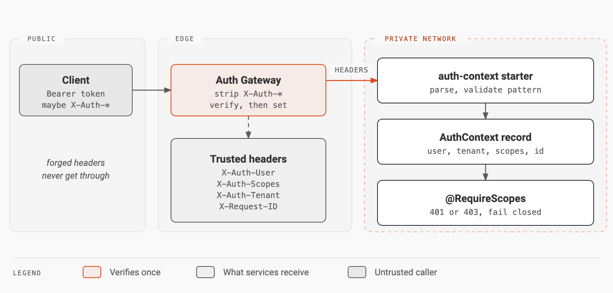

In a microservice platform, every service needs to know who is calling. The obvious answer is to let each service validate the caller's JWT. But token validation is security-critical code: fetching signing keys, handling key rotation, clock skew, caching. Copy it into every service, in every language, and you have many chances to get it subtly wrong.

This post explains the alternative used in the [Labs64.IO Ecosystem](/architecture/): the gateway verifies the token **once**, and passes the verified identity to the services in four headers. It covers the contract, the shared libraries that enforce it in Java and Python, and the one condition under which this design is safe. It is written for architects and backend developers designing authentication for a set of services behind a gateway.

**After reading, you will know:**

- the "edge authentication with identity propagation" pattern,
- which headers carry the identity and how they are protected against forgery,
- how services read them through one small, fail-closed library,
- how to keep two implementations of a security contract identical.

## Background: who checks the token?

There are two common designs:

- **Every service validates the token.** Simple to understand, but security code is duplicated, and every service needs network access to the identity provider's keys.
- **The gateway validates, services trust the result.** One verification point; services receive facts, not tokens.

The second design is only safe if two things hold: clients cannot forge the facts, and nothing except the gateway can reach the services.

## The problem: duplicated, inconsistent identity handling

Labs64.IO has services in Java (Spring Boot) and Python (FastAPI). Before a shared contract existed, each service parsed identity and tenant information slightly differently, and every new service meant writing the same plumbing again. Differences in parsing are exactly where security bugs hide: one service treats an empty scope list differently, another accepts a tenant value the others reject.

## The solution in three parts

{:class="blog-center"}

### Part 1: the gateway strips, verifies and sets four headers

For every request, the [Auth Gateway](/products/auth-gateway/) first removes any identity headers the client sent, then verifies the token, then sets these headers (documented in the [shared libraries reference](https://labs64.io/docs/development/shared-libraries.html)):

| Header | Meaning |
|---|---|
| `X-Auth-User` | The subject, or `svc:<client>` for a service principal |
| `X-Auth-Scopes` | Comma-separated scopes |
| `X-Auth-Tenant` | The tenant, or `-` when the caller has no tenant |
| `X-Request-ID` | The caller's ID when it is well formed, otherwise a generated UUIDv7 |

Every value must match `^[a-zA-Z0-9_.:-]+$`, which keeps the headers safe to log and impossible to use for header injection. The stripping is the first filter of every gateway route; see [From Traefik IngressRoute to the Kubernetes Gateway API](/blog/2025/12/14/gateway-api-traefik-migration/).

### Part 2: services read one record and check scopes

In Java, the `auth-context-spring-boot-starter` parses the headers into an immutable record and binds it to the request:

```java
public record AuthContext(String userId, String tenantId, Set<String> scopes, String requestId) { ... }
```

Handlers read it with `AuthContextHolder.get()` (an `Optional`) or `AuthContextHolder.require()` (throws if nothing is bound). The tenant becomes a method call on a value the client cannot choose, which is where tenant isolation starts.

The only check left in the service is the fine-grained one. `@RequireScopes` states its rule in its Javadoc:

```java
/**
 * Operation-level scope check (authorization split: path-level RBAC is
 * enforced at the gateway; finer-grained checks live in the module). The
 * caller must hold at least one of the listed scopes; otherwise 403 (401 when
 * no context is bound at all).
 */
public @interface RequireScopes { String[] value(); }
```

It is generated from the API contract, as described in [Declare authorization in your OpenAPI spec](/blog/2026/04/09/oauth2-auth-migration/). The behaviour is fail closed: no valid user on a protected path → `401`; missing scope → `403`.

### Part 3: one contract, two languages, shared test vectors

The Python library, `auth-context-python`, implements the same behaviour for FastAPI and other ASGI services. To keep both identical, they are tested against one file, `test-vectors/auth-context-vectors.json`, which the repository's rules describe in one line: *the vectors are the contract; code follows*. Its 17 cases include:

- a full context is accepted;
- a tenant of `-` maps to "no tenant";
- an empty or missing scopes header means no scopes;
- a missing or empty user on a protected path is rejected as `UNAUTHORIZED`.

Any change to either parser must keep the vectors green in Java and Python, in the same commit.

## The outcome

| | Each service validates tokens | Verify once at the edge |
|---|---|---|
| Places with token-validation code | every service | the Auth Gateway |
| Identity parsing in Java and Python | separate, can differ | one contract, 17 shared vectors |
| Where tenant comes from | varies | `X-Auth-Tenant`, set by the gateway |
| Missing identity on a protected path | depends on the service | `401`, always |

## Trade-offs

This design moves trust to the network path. A service that accepts `X-Auth-*` headers believes whoever can reach it. In Labs64.IO that is covered by three measures:

- the gateway strips these headers from all inbound traffic;
- module charts can render a NetworkPolicy (`networkPolicy.enabled`, off by default) that allows traffic only from the gateway and listed in-namespace clients; turn it on in any shared cluster;
- each backend still fails closed when a request arrives without a context.

Service-to-service calls use the same contract; [Service-to-service auth in Kubernetes](/blog/2026/06/21/direct-internal-calls-replacing-oauth-hop/) shows how.

## Apply it to your own platform

1. Pick a small set of identity headers and a strict value format.
2. Make the gateway remove them from every inbound request before authentication.
3. Ship one library per language that parses them into an immutable context and fails closed.
4. Keep the libraries in sync with shared, language-neutral test vectors.
5. Enforce with network policies that only the gateway (and named internal callers) can reach the services.

The Java starter is on Maven Central:

```xml
<dependency>
    <groupId>io.labs64</groupId>
    <artifactId>auth-context-spring-boot-starter</artifactId>
</dependency>
```

To run the library tests and read the vectors, check out [labs64.io-commons](https://github.com/Labs64/labs64.io-commons) and run `mvn -B verify`.

## Key takeaways

- **Verify once, propagate facts.** One component validates tokens; services receive a small, verified identity instead.
- **Forgery protection comes first:** strip client-supplied identity headers before authentication, on every route.
- **The network is part of the security model.** Trusted headers are only as safe as the rule that nothing else can reach the service.
- **Fail closed by default:** missing identity is `401`, missing scope is `403`, never "allowed because a header was absent".
- **Test vectors keep polyglot code honest.** One data file, two implementations, the same answers.

The [Zero-Trust Edge Proxy](/platform/zero-trust/) and [Identity](/platform/identity/) pages explain the gateway's role in the architecture.
