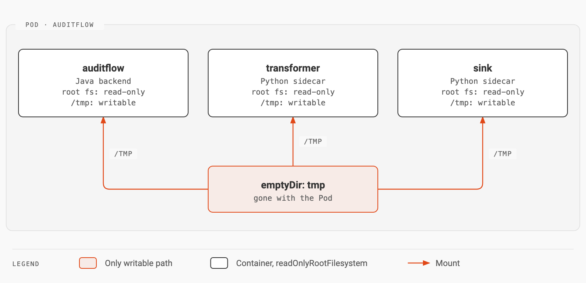

A read-only root filesystem is one of the cheapest ways to harden a container. If an attacker manages to run code inside it, they cannot replace binaries, install tools or drop files into system paths. One line in the Pod spec turns it on. And then, often, the application stops working.

This post explains why that happens, the standard fix, and how the Labs64.IO [AuditFlow](/products/auditflow/) chart applies it to a Pod with a Java backend and two Python services. It is written for platform engineers and developers who want to harden their Kubernetes workloads without breaking them.

**After reading, you will know:**

- what `readOnlyRootFilesystem` protects against,
- why Java and Python applications fail with "Read-only file system" when it is on,
- how a single `emptyDir` volume at `/tmp` fixes it, and how to choose between disk and memory,
- where this setting fits next to the Kubernetes Pod Security Standards.

## Background: what a read-only root protects

A container image is a filesystem. By default, a running container can write anywhere in it: replace `/usr/bin/curl`, add a script to `/etc`, download a tool. `readOnlyRootFilesystem: true` in the container's `securityContext` makes that whole image immutable at runtime. Writes are only possible to volumes you mount explicitly. It is least privilege, applied to the filesystem.

## The problem: frameworks write temporary files

Your own code may never touch disk, but the runtime almost certainly does:

- Java's `java.io.tmpdir` defaults to `/tmp`; it is used for multipart uploads, ZIP handling and by many libraries.
- Python's `tempfile` module is used by a long list of packages.

With a fully read-only root, those writes fail with `Read-only file system`, deep inside a dependency rather than in your code. You can see it in ten seconds with Docker, which has the same switch:

```bash
docker run --rm --read-only alpine:3 sh -c 'touch /tmp/x && echo ok'
```

```text
touch: /tmp/x: Read-only file system
```

## The solution: a writable `/tmp`, nothing else

Give the container exactly one writable path, `/tmp`, and keep everything else read-only. In Docker:

```bash
docker run --rm --read-only --tmpfs /tmp alpine:3 sh -c 'touch /tmp/x && echo "/tmp writable"; touch /etc/x'
```

```text
/tmp writable
touch: /etc/x: Read-only file system
```

In Kubernetes, the same idea is an `emptyDir` volume mounted at `/tmp`. An `emptyDir` is created empty when the Pod starts on a node and deleted when the Pod is removed (a container crash does not remove it):

```yaml
spec:
  containers:
    - name: app
      image: your-image
      securityContext:
        readOnlyRootFilesystem: true
        allowPrivilegeEscalation: false
      volumeMounts:
        - name: tmp
          mountPath: /tmp
  volumes:
    - name: tmp
      emptyDir: {}
```

### How the AuditFlow chart does it

AuditFlow runs three containers in one Pod: the Java backend, the Python transformer and the Python sink. The chart's default values set a strict security context:

```yaml
securityContext:
  allowPrivilegeEscalation: false
  capabilities:
    drop:
      - ALL
  readOnlyRootFilesystem: true
  runAsNonRoot: true
```

The shared `chart-libs` template adds a `tmp` `emptyDir` for Java applications, and the AuditFlow values mount the same volume into both Python sidecars.

## The outcome

{:class="blog-center"}

Rendering the chart with `helm template` shows `readOnlyRootFilesystem: true` on all three containers and one `tmp` volume mounted at `/tmp` in each. Check a running Pod with `kubectl exec <pod> -- touch /tmp/ok`, then try writing anywhere else to see the refusal.

| | Default container | Read-only root only | Read-only root + `/tmp` |
|---|---|---|---|
| Attacker can change binaries | yes | no | no |
| Java and Python apps work | yes | often not | yes |
| Writable paths | everywhere | none | `/tmp` only |

## Trade-offs

- **Disk or memory.** `medium: Memory` backs the volume with RAM (tmpfs). It is fast, but files there count against the memory limit of the container that wrote them, so large temporary files can trigger an out-of-memory kill. The disk-backed default is safer unless you know temp files stay small. A `sizeLimit` works with both:

  ```yaml
  emptyDir:
    medium: Memory
    sizeLimit: 64Mi
  ```

- **Other writable paths.** Some processes write to `/var/cache`, `/var/log` or a data directory. Give each its own `emptyDir`, a `PersistentVolume` if data must survive restarts, or redirect the writes into `/tmp`. Run the workload once in a test environment and search the logs for `Read-only file system`.
- **It is not a compliance checkbox.** The Pod Security Standard "Restricted" does not require a read-only root. It requires, for example, `allowPrivilegeEscalation: false`, `runAsNonRoot`, a seccomp profile and dropped capabilities. A read-only root is an additional layer next to those.

## Apply it to your own workloads

1. Set `readOnlyRootFilesystem: true` on every container.
2. Mount an `emptyDir` at `/tmp` (shared by all containers in the Pod if they need it).
3. Run the workload in a test environment and look for `Read-only file system` errors.
4. Add a volume or a configuration change for each additional path that really needs writing.
5. Combine it with the Restricted profile controls (non-root, no privilege escalation, dropped capabilities).

## Key takeaways

- **A read-only root makes the image immutable at runtime,** so code running inside cannot replace binaries or add tools.
- **Runtimes write behind your back.** Java and many Python libraries need `/tmp`, so a fully read-only root breaks them.
- **One `emptyDir` at `/tmp` is the standard fix:** exactly one writable path, deleted with the Pod.
- **Prefer disk-backed `emptyDir`,** because memory-backed files count against the container's memory limit.
- **It is one layer of several.** Pair it with non-root users, no privilege escalation and dropped capabilities.

The Labs64.IO chart conventions are in [labs64.io-helm-charts](https://github.com/Labs64/labs64.io-helm-charts), and the [Cloud-Native Kubernetes](/platform/kubernetes/) page describes the platform they deploy.
