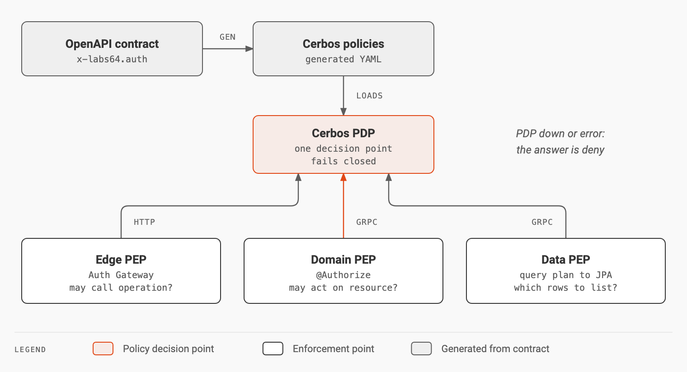

In a multi-tenant platform, authorization tends to fall apart into pieces. The gateway checks who may call which endpoint. Each service checks its own business rules. And every query that lists data has a hand-written `WHERE tenant_id = ?` that somebody must remember. When each piece has its own rules and its own engine, one change to a permission means edits in several places, and one forgotten filter means one tenant can see another's data.

This post shows how Labs64.IO moved from in-process policy evaluation (Cedar, at the edge and in each service) to **one central policy decision point**, [Cerbos](https://cerbos.dev){:target="_blank"}{:rel="noopener nofollow"}, asked by three small enforcement points. It is written for architects and security-minded developers who design authorization across services and data access.

**After reading, you will know:**

- what a policy decision point (PDP) and a policy enforcement point (PEP) are,
- why one central PDP with several thin PEPs is easier to keep correct,
- how to generate policies, including a cross-tenant guard, from the API contract,
- how a PDP can filter list queries instead of only answering yes or no.

## Background: PDP and PEP

The terms come from the XACML standard and are used by most policy engines today. A **policy decision point** evaluates rules and answers "allow" or "deny". A **policy enforcement point** sits where a request happens, asks the PDP, and enforces the answer. Separating the two means one place holds the rules, while enforcement stays close to the code that needs it.

## The problem: three kinds of questions, three engines

A request in Labs64.IO raises three different authorization questions:

1. **At the edge:** may this caller invoke this operation at all?
2. **In the service:** may this caller act on *this particular* resource, for example this payment?
3. **In the data layer:** which rows may this caller see in a list?

Answering them with separate, in-process engines meant separate policy copies, separate updates and separate places to forget the tenant check.

## The solution: one PDP, three thin PEPs

{:class="blog-center"}

All three PEPs fail closed: if the PDP is unreachable or a call throws, the answer is deny.

### Step 1: generate the policies from the API contract

Nobody writes the policies by hand. Each module declares its rules in its OpenAPI spec under `x-labs64.auth`, and the build generates the Cerbos policies (and a routing manifest) from it:

```yaml
/payments/{paymentId}/pay:
  post:
    operationId: payPayment
    x-labs64:
      auth:
        tenant: true
        scopes:
          - payment:pay
        resourceType: Payment   # generated domain permit and tenant guard
        resource: "#paymentId"  # reference passed to the @Authorize resolver
```

`OpenApiAuthPreprocessor` (in `labs64.io-commons`) turns that into:

```yaml
# GENERATED from x-labs64.auth by OpenApiAuthPreprocessor — do not edit.
resourcePolicy:
  resource: Payment
  rules:
  - actions: [payPayment]
    effect: EFFECT_ALLOW
    roles: ['*']
    condition:
      match:
        expr: "(has(request.principal.attr.tenant) || (\"service\" in request.principal.roles)) && request.principal.attr.scopes.exists(s, s == \"payment:pay\")"
  - actions: ['*']
    effect: EFFECT_DENY
    roles: ['*']
    condition:
      match:
        expr: has(request.resource.attr.tenant) && (!has(request.principal.attr.tenant) || request.resource.attr.tenant != request.principal.attr.tenant)
```

The first rule allows `payPayment` with the right scope. The second is the **cross-tenant guard**: any action on a resource that belongs to a tenant is denied if the caller has no tenant or a different one. It is generated for every resource type, so nobody can forget it.

### Step 2: the edge PEP asks one question per request

The [Auth Gateway](/products/auth-gateway/) verifies the JWT, matches the request to a route, maps the caller to a Cerbos principal (role `service` for `svc:` callers, otherwise `user`, with scopes and tenant as attributes) and asks the PDP over HTTP:

```python
allowed = self._get_client().is_allowed(
    action,
    Principal(subject, roles=roles, attr=attr),
    Resource(id=resource_id, kind=resource_kind),
    request_id=request_id,
)
```

Any exception becomes a deny. The PDP address (`CERBOS_URL`) and timeout (`CERBOS_TIMEOUT`, default two seconds) are configurable, and an optional short decision cache (`AUTHZ_DECISION_CACHE_TTL`, off by default) can answer repeats locally.

### Step 3: the domain PEP checks the actual resource

Inside a Spring Boot service, `@Authorize(action = "payPayment", resourceType = "Payment", resource = "#paymentId")` is generated onto the API interface. The interceptor asks a module-provided resolver to load the resource, then asks the PDP over gRPC:

```java
return ResourceEntity.builder("Payment", payment.getId().toString())
        .attribute("tenant", payment.getTenantId())
        .build();
```

Even if a bug in the service loads another tenant's payment, the generated guard denies the action. Workflow rules such as "only a READY payment can be paid" stay in the service on purpose: they are business logic, not access control. The starter has a `SHADOW` mode that logs decisions without blocking, so a new policy can be compared before it is enforced.

### Step 4: the data PEP turns a decision into a filter

For list endpoints, a yes/no is not enough. Cerbos *query planning* answers a different question: "under which conditions may this caller list resources of this type?" `CerbosPlanMapper` converts the answer into an engine-neutral expression, and `QueryPlanSpecifications` turns it into a JPA `Specification`, supporting exactly six operators (`and`, `or`, `not`, `eq`, `ne`, `in`); anything else throws. In Checkout:

```java
final QueryPlan plan = queryPlanner.plan(AuthContextHolder.get().orElseThrow(),
        "listPurchaseOrders", "PurchaseOrder");
if (plan instanceof QueryPlan.AlwaysDenied) {
    return Page.empty();
}
final Specification<PurchaseOrderEntity> authzSpec =
        QueryPlanSpecifications.toSpecification(plan, Map.of("tenant", "tenantId"));
// Defense in depth: the request tenant filter stays ANDed with the plan.
final Specification<PurchaseOrderEntity> spec = authzSpec.and(
        (root, q, cb) -> cb.equal(root.get("tenantId"), tenantId));
```

The tenant filter stays in the query as well; the plan adds to it, never replaces it.

## The outcome

Because policies are generated, the thing to test is the *decisions*. `auth-policy-cerbos/validate.sh` compiles the generated policies with `cerbos compile` and runs a truth-table suite, including the cross-tenant case:

```text
└── decision equivalence (truth_table_test.yaml) [7 OK]
7 tests executed [7 OK]
== cerbos gate: PASS
```

| | In-process engines per layer | One PDP, three PEPs |
|---|---|---|
| Policy sources | one per layer and service | one, generated from OpenAPI |
| Cross-tenant guard | written by hand where remembered | generated for every resource type |
| List queries | hand-written tenant filters | PDP query plan + tenant filter |
| Testing policies | per service | one truth-table gate in CI |
| On engine error | depends | deny, everywhere |

## Trade-offs

- **The PDP is an operational dependency:** a deployment and service to run.
- **Every domain decision is a network call.** The starter uses a timeout, one retry for transient failures (a check is read-only), a warm-up call at startup and an optional short cache.
- **The query-plan translator is intentionally narrow.** Six operators are enough for tenant and ownership filters, and anything unexpected fails loudly.

## Apply it to your own platform

1. Separate *deciding* (one PDP) from *enforcing* (thin PEPs at the edge, in services and in queries).
2. Generate policies from a single source, and include a structural tenant guard for every resource type.
3. Make every PEP fail closed on errors and timeouts.
4. Use query planning for lists instead of hand-written filters, and keep the tenant filter as defense in depth.
5. Test policy *decisions* with a truth table in CI, and roll out new rules in shadow mode first.

## Key takeaways

- **Decide once, enforce close to the action.** A central PDP holds the rules; PEPs at the edge, in the domain and in the data layer just ask.
- **Three questions need three PEPs:** may the caller call it, act on this resource, and see these rows.
- **Generated guards cannot be forgotten.** A cross-tenant deny rule for every resource type comes from the contract, not from memory.
- **Authorization can shape queries,** not only block requests: query plans become database filters.
- **Fail closed and test decisions.** Errors mean deny, and a truth table proves the policies do what the contract says.

The implementation is in [labs64.io-commons](https://github.com/Labs64/labs64.io-commons){:target="_blank"}{:rel="noopener nofollow"} (`auth-context-java`, `authz-queryplan-jpa`, `auth-policy-cerbos`) and [labs64.io-authgateway](https://github.com/Labs64/labs64.io-authgateway){:target="_blank"}{:rel="noopener nofollow"}. See also [Policy-as-Code Authorization](/platform/authorization/) and [Zero-Trust Edge Proxy](/platform/zero-trust/).
