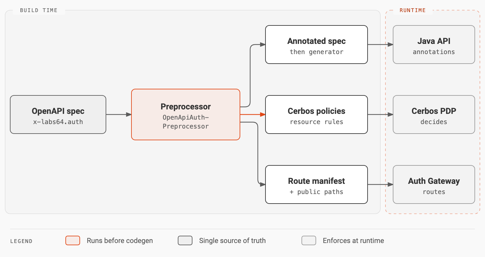

In most codebases, the rule "only callers with the `payment:read` scope may list payments" lives in a controller annotation or a security configuration class. The API documentation does not show it, the gateway does not know it, and the tests have to discover it. When a reviewer looks at a new endpoint, they read the spec, but the access rule is somewhere else entirely.

This post shows how the [Labs64.IO Ecosystem](/architecture/) moved that rule into the API contract itself: each OpenAPI operation declares who may call it, and every enforcement layer is generated from that one declaration. It is written for API designers, architects and Java developers who work contract-first.

**After reading, you will know:**

- why access rules belong next to the operation in the API contract,
- how a small OpenAPI extension describes tenant and scope requirements,
- how one build step turns it into Java annotations, policies and gateway routes,
- how the runtime enforces it without the service ever touching a token.

## Background: contract-first, but without the security part

Contract-first teams treat the OpenAPI document as the source of truth for paths, parameters and payloads, and generate server interfaces and clients from it. Standard OpenAPI also has a `security` section, but it describes *authentication* (which token type, which OAuth scopes exist). It cannot express "the caller needs a tenant" or "the caller may only act on payments of their own tenant".

## The problem: security plumbing in every service

Before this change, every Labs64.IO service carried its own security code: a development auth filter, a tenant header filter, role checks scattered across controllers. Each parsed the same headers a little differently, and onboarding a new service meant writing the same plumbing again. The Payment Gateway, for example, had its own Spring Security stack. The access rules existed, but only as code, in many places.

## The solution in three parts

The Payment Gateway's switch is [pull request #9](https://github.com/Labs64/labs64.io-payment-gateway/pull/9){:target="_blank"}{:rel="noopener nofollow"}, which replaced its in-app Spring Security stack with the shared auth-context starter.

### Part 1: declare the rule on the operation

Each operation can carry an `x-labs64` extension with an `auth` block:

```yaml
paths:
  /payment-providers:
    get:
      operationId: listPaymentProviders
      x-labs64:
        auth:
          tenant: true
          scopes:
            - payment-provider:read
```

`tenant: true` means the caller must belong to a tenant. `scopes` lists the scopes the caller needs; holding any one of them is enough. The block can also sit on a path, and its operations inherit it unless they override it.

There is no `public: true` flag. An operation without any requirement is *inferred* to be public, which makes public endpoints visible in review. Standard OpenAPI `security` is deliberately not used for enforcement.

### Part 2: generate everything from it at build time

`OpenApiAuthPreprocessor` in [labs64.io-commons](https://github.com/Labs64/labs64.io-commons) runs before the OpenAPI code generator, during Maven's `generate-sources` phase. It reads the extension and produces three outputs:

{:class="blog-center"}

1. An annotated spec, so the generated Java API interfaces carry `@RequireTenant`, `@RequireScopes`, `@Authorize` or `@PublicEndpoint`.
2. Cerbos resource policies for the central policy decision point (see [One policy decision point, three enforcement points](/blog/2026/03/26/cerbos-authorization-three-tier-pep/)).
3. A routing manifest and a list of public paths for the gateway.

The [integration guide](https://github.com/Labs64/labs64.io-commons/blob/master/auth-context-java/INTEGRATION.md){:target="_blank"}{:rel="noopener nofollow"} walks through the `pom.xml` changes.

### Part 3: enforce at runtime without tokens

The service never parses a token. The gateway authenticates the caller and passes the result as four trusted headers ([the trusted identity header contract](/blog/2026/02/25/trusted-header-contract/)). The `auth-context-spring-boot-starter` turns them into an immutable record:

```java
public record AuthContext(String userId, String tenantId, Set<String> scopes, String requestId) {
    // userId and requestId must not be empty; scopes defaults to an empty set
}
```

Its interceptors enforce the generated annotations, fail closed: a non-public path without a valid identity gets `401`, a caller without the required scope gets `403`.

A service adds the starter (versions come from the `labs64io-parent` pom; releases are on Maven Central under `io.labs64`):

```xml
<dependency>
    <groupId>io.labs64</groupId>
    <artifactId>auth-context-spring-boot-starter</artifactId>
</dependency>
```

## The outcome

| | Rules in code | Rules in the contract |
|---|---|---|
| Where a reviewer sees the access rule | somewhere in the code | next to the operation |
| Gateway, policies, annotations | maintained separately | generated from one block |
| Public endpoints | "forgot the annotation" looks the same | inferred and visible in the spec |
| New service | write security plumbing | add the starter and the extension |

The regression suite even generates its edge tests from the same block, as shown in [Test at the edge](/blog/2026/02/10/robot-framework-edge-suite/).

## Trade-offs

- **A vendor extension is not a standard.** Generic OpenAPI tools ignore `x-labs64.auth`; the value comes from the generator and the shared libraries.
- **The build gains a step.** The preprocessor must run before code generation in every module; the integration guide makes that a copy-paste change.

## Apply it to your own APIs

1. Choose a small extension that states tenant, scope and resource rules per operation.
2. Run a preprocessing step before code generation that turns it into annotations (for example via the generator's `x-operation-extra-annotation`).
3. Generate gateway routes and policies from the same block.
4. Enforce the annotations in one shared library that fails closed.

## Key takeaways

- **An access rule is part of the API contract,** just like its path and payload, so it belongs in the same document.
- **Standard OpenAPI `security` describes authentication, not authorization.** Tenant and resource rules need an extension.
- **One declaration, many enforcement layers:** annotations, policies and gateway routes generated from the same block cannot disagree.
- **Public by inference is safer than public by omission,** because a missing rule is visible in the spec.
- **Services check scopes, not tokens.** Token validation stays at the gateway; services enforce generated annotations, fail closed.

See also [Policy-as-Code Authorization](/platform/authorization/) and the [Shared Libraries](https://labs64.io/docs/development/shared-libraries.html) docs.
