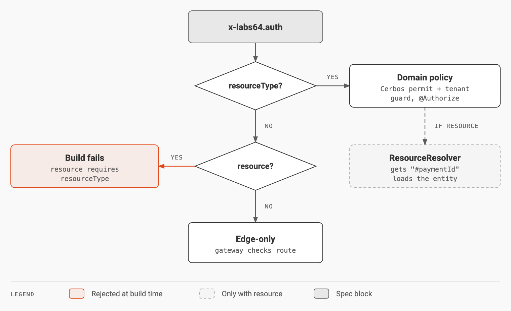

When security code is generated from a contract, every field in that contract is an instruction. If one field means two different things, the generator has to guess which one you meant, and the guess is invisible in code review. In access control, an invisible guess is how a check quietly disappears.

This post describes such a case in the Labs64.IO authorization extension, `x-labs64.auth`, and how we fixed it: one overloaded field became two explicit fields, and the build now rejects the combination that makes no sense. It is written for API designers and developers who generate code from OpenAPI or similar contracts. If the extension is new to you, start with [Declare authorization in your OpenAPI spec](/blog/2026/04/09/oauth2-auth-migration/).

**After reading, you will know:**

- why overloaded fields are dangerous in contracts that generate security code,
- the difference between a *resource type* and a *resource reference* in authorization,
- how to make a build fail on an invalid combination, with a pinned error message,
- how to migrate a spec without a silent change of meaning.

## Background: type and reference

Resource-level authorization needs two pieces of information:

- **What kind of thing is protected?** For example `Payment`. This decides which policy applies and which tenant guard is attached.
- **Which one exactly?** For example the payment whose ID is in the `paymentId` path parameter. At runtime, the service loads it and checks it.

## The problem: one field did both jobs

In `x-labs64.auth`, a single `resource` field used to carry both meanings: the type (`Payment`) and, by convention, an implied reference. You could not state a type without also implying a reference, and the reference never appeared in the spec. A reviewer who saw `resource: Payment` could not tell whether the concrete payment would be loaded and checked.

## The solution in two parts

### Part 1: two fields, one meaning each

The extension now has `resourceType` and an optional `resource`:

```yaml
/payments/{paymentId}/pay:
  post:
    operationId: payPayment
    x-labs64:
      auth:
        tenant: true
        scopes:
          - payment:pay
        resourceType: Payment    # generates the domain permit and the cross-tenant guard
        resource: "#paymentId"   # passed to the resolver; optional
```

- `resourceType` selects the generated policy and the tenant guard. Operations without it are checked at the gateway only.
- `resource` is the expression the runtime passes to the module's `ResourceResolver`, which loads the entity. It is only valid together with `resourceType`.

The generated annotation carries both, visibly:

```java
@Authorize(action = "payPayment", resource = "#paymentId", resourceType = "Payment")
```

{:class="blog-center"}

### Part 2: the build rejects the bad combination

The check sits in `AuthPolicy.from`, which the preprocessor calls for every operation:

```java
if (resource != null && resourceType == null) {
    throw new IllegalArgumentException(OpenApiAuthPreprocessor.AUTH_EXTENSION
            + ".auth.resource requires x-labs64.auth.resourceType");
}
```

A unit test pins the message, so it is part of the contract:

```java
@Test
void resourceReferenceRequiresResourceType() {
    // an operation with x-labs64.auth.resource but no resourceType
    assertThatIllegalArgumentException()
            .isThrownBy(() -> new OpenApiAuthPreprocessor().enrich(openApi))
            .withMessageContaining("x-labs64.auth.resource requires x-labs64.auth.resourceType");
}
```

This runs in Maven's `generate-sources` phase, so a mistake fails the build instead of changing runtime behaviour.

## The outcome

The change was breaking on purpose, so that no spec could keep the old meaning silently. Every old-style `resource: Payment` without `resourceType` now fails the build with the message above, which is exactly how the places to migrate are found:

| You had | Change it to |
|---|---|
| `resource: Payment` | `resourceType: Payment` |
| `resource: Payment` and you want the entity checked | `resourceType: Payment` and `resource: "#paymentId"` |

After migration, Checkout's spec sets `resourceType: PurchaseOrder` on the four purchase-order operations it protects in the domain (list, get, update and checkout), with `resource: "#id"` on the three that have an `{id}` path parameter. AuditFlow's `publishEvent` uses `resourceType: AuditEvent` alone, with no reference.

| | One overloaded field | Two explicit fields |
|---|---|---|
| Type and reference visible in review | no, partly implied | yes |
| Invalid combination | silently interpreted | build fails with a clear message |
| Old specs after the change | could change meaning quietly | fail until migrated |

## Trade-offs

- **A breaking change costs every consumer a migration.** Here that was the point: a silent change of meaning in access control is worse than a red build.
- **More fields to understand.** Two fields with one meaning each are still easier to review than one field with two.

## Apply it to your own contracts

1. Look for fields in your contracts that carry more than one meaning, especially where security code is generated.
2. Split them into fields with one meaning each.
3. Validate every combination at build time, and pin the error messages with tests.
4. Prefer a breaking change over a silent reinterpretation.

## Key takeaways

- **In generated security code, every field is an instruction.** Ambiguity becomes behaviour nobody reviewed.
- **Type and reference are different questions:** *what kind* selects the policy, *which one* lets the runtime load and check it.
- **One field, one meaning, and an error for nonsense combinations.**
- **Fail at build time, not at runtime.** A red pipeline is cheap; a silently missing check is not.
- **Breaking on purpose can be the safe migration,** because it forces every old declaration to be looked at.

The preprocessor, the annotations and the Spring starter live in [labs64.io-commons](https://github.com/Labs64/labs64.io-commons) (`auth-context-java`); the [Shared Libraries](https://labs64.io/docs/development/shared-libraries.html) page gives the overview.
