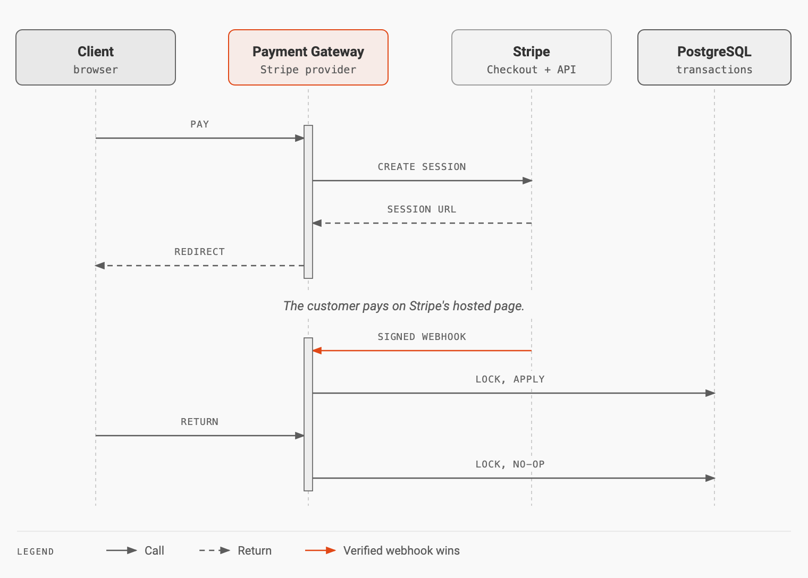

A hosted checkout looks simple: create a session, send the customer to the provider's payment page, wait for confirmation. In a demo it works on the first try. In production, the network drops a request, a webhook arrives twice, and the customer's browser comes back at the same moment as the provider's confirmation. Each of those can turn into a double charge or a payment shown as failed although the money arrived.

This post shows how the [Labs64.IO Payment Gateway](/products/payment-gateway/) integrates Stripe Checkout so that those situations are harmless ([pull request #22](https://github.com/Labs64/labs64.io-payment-gateway/pull/22){:target="_blank"}{:rel="noopener nofollow"}). It is written for developers and integrators building any Stripe Checkout integration; the rules apply to other hosted checkouts as well.

**After reading, you will know:**

- the three things that break checkout integrations in production,
- how idempotency keys make session creation safe to retry,
- how to verify Stripe webhooks so that only Stripe can change a payment,
- how a row lock and final states make racing updates harmless.

## Background: how Stripe Checkout works

1. Your server creates a Checkout session and gets a URL.
2. The customer pays on Stripe's hosted page.
3. Stripe redirects the browser back to your site, **and** sends your server a webhook with the result.

Steps 3a and 3b are independent: either can arrive first, and Stripe delivers webhooks *at least once*, so the same event can arrive more than once.

## The problem: retries, untrusted callbacks and races

- **Retries.** If your server retries a failed "create session" call and Stripe had in fact created the first one, the customer could end up with two sessions and pay twice.
- **Untrusted callbacks.** Your webhook endpoint is public. Anyone can send JSON to it; only a valid signature proves it came from Stripe.
- **Races and duplicates.** The browser return and the webhook may be processed at the same time, and a late or repeated event must not overwrite a final result.

## The solution in four parts

{:class="blog-center"}

### Part 1: validate credentials when the provider is registered

A Stripe provider needs a `secretKey` and a `webhookSecret`. The gateway checks their shape (`sk_` or `rk_`, and `whsec_`) when a tenant registers the provider, so a typo fails immediately rather than on the first payment:

```text
{"code":"VALIDATION_ERROR","message":"Stripe secretKey must be a Stripe secret or restricted API key.", ...}
HTTP 400
```

It is a shape check only; it cannot tell whether a key is live.

### Part 2: create sessions with an idempotency key

When the client calls `/payments/{paymentId}/pay`, the provider creates a Checkout session with an idempotency key equal to the gateway's transaction ID. If the call is retried, Stripe returns the same session instead of creating a second one. The transaction ID is also stored in the session and payment-intent metadata, so webhooks can be matched later:

```java
private static RequestOptions requestOptions(final UUID idempotencyKey) {
    return RequestOptions.builder()
            .setIdempotencyKey(idempotencyKey.toString())
            .build();
}
```

The return and cancel URLs that Stripe sees belong to the gateway; the client's own URLs are validated and used only for the final redirect.

### Part 3: accept only verified, known webhooks

```java
event = Webhook.constructEvent(context.request().body(), signature, webhookSecret);
...
if (!context.transaction().id().equals(verifiedTransactionId)) {
    throw new WebhookRejectedException("Stripe webhook transaction does not match restored transaction.");
}
```

- The signature is checked against the **exact raw request body**, so nothing may rewrite the body before it.
- The transaction ID inside the verified payload must match the transaction the gateway loaded.
- Only four event types are accepted, with an explicit mapping; anything else is rejected with `400`.

| Stripe event | Gateway result |
|---|---|
| `checkout.session.completed` | `SUCCESS` if `payment_status` is `paid` or `no_payment_required`, otherwise `PENDING` |
| `checkout.session.async_payment_succeeded` | `SUCCESS` |
| `checkout.session.async_payment_failed` | `FAILED` |
| `checkout.session.expired` | `FAILED` |

### Part 4: apply every result under a lock, and keep final states final

Every provider result, from a webhook or from the browser return, goes through one method that loads the transaction with a pessimistic lock (`SELECT ... FOR UPDATE`) and does nothing if the transaction is already final:

```java
@Lock(LockModeType.PESSIMISTIC_WRITE)
Optional<PaymentTransactionEntity> findByIdAndTenantIdForUpdate(UUID id, String tenantId);
```

Two results for one transaction run one after the other, and a late failure event cannot overwrite a successful payment.

## The outcome

| Situation | Naive integration | With these rules |
|---|---|---|
| "Create session" retried | possible second session | same session returned |
| Forged webhook | may change a payment | rejected, `400` |
| Same event delivered twice | applied twice | second is a no-op |
| Webhook and browser return together | race, last writer wins | serialized; final state kept |

The repository's Robot Framework suite (`tests/e2e/stripe_psp_flow.robot`) runs the gateway against a WireMock stand-in for Stripe and checks the request contract, replay, webhook signatures and terminal-state protection. A separate smoke test against Stripe test mode covers the hosted pages and real credentials.

## Trade-offs

- **Scope is one-time payments.** The provider creates Checkout sessions in `payment` mode; refunds and Stripe Billing are not covered yet.
- **Locks serialize work per transaction.** That is cheap for payments (few writers per transaction) and exactly what correctness needs.

## Apply it to your own Stripe integration

1. Use an idempotency key on every Stripe call that creates something.
2. Store your own ID in the session and payment-intent `metadata`.
3. Verify webhook signatures on the raw body; never parse and re-serialize first.
4. Handle only the event types you know; reject the rest.
5. Update payment state in one place, under a lock, and make final states final.
6. For local testing, forward only the supported events with the Stripe CLI, and keep its temporary `whsec_` secret apart from the Dashboard endpoint secret:

```bash
stripe listen \
  --events checkout.session.completed,checkout.session.async_payment_succeeded,checkout.session.async_payment_failed,checkout.session.expired \
  --forward-to http://localhost:8080/providers/stripe/webhooks
```

The full setup is in the [Stripe guide](https://labs64.io/docs/modules/payment-gateway/stripe/).

## Key takeaways

- **Production breaks checkouts in three ways:** retries, untrusted callbacks, and racing or duplicate updates.
- **Idempotency keys make creation safe to retry;** your own transaction ID is a natural key.
- **Only a verified signature can change a payment,** checked on the raw body and matched to the expected transaction.
- **One locked update path, final states final:** the second writer finds the result and does nothing.
- **Test the contract offline, the integration online:** a stand-in for the API logic, a smoke test for the real provider.

The code is in [labs64.io-payment-gateway](https://github.com/Labs64/labs64.io-payment-gateway){:target="_blank"}{:rel="noopener nofollow"} under `payment-gateway-providers/stripe`; it plugs into the SPI described in [One payment API, many PSPs](/blog/2026/01/26/psp-abstraction-spi/).
