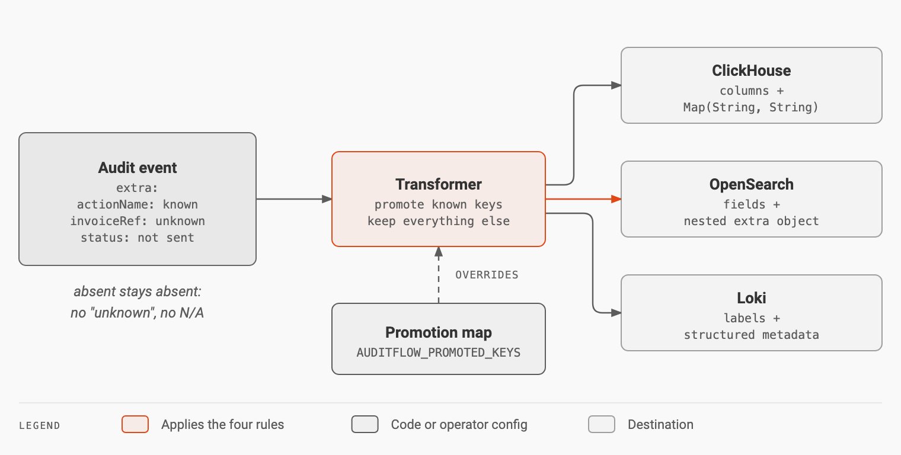

An audit trail is only worth something if people can trust what is in it. Two quiet failures destroy that trust: values that never arrive, and values that were never sent but appear anyway. Both happen easily when events carry free-form fields and a pipeline reshapes them for different storage systems.

This post explains how [AuditFlow](/products/auditflow/), the Labs64.IO audit pipeline, handles free-form event fields, the bug that made us write the rules down, and how you can turn your own fields into real columns. It is written for developers and data engineers who move semi-structured events into analytics or log stores such as ClickHouse, OpenSearch or Loki.

**After reading, you will know:**

- why placeholders such as `"unknown"` are worse than missing values,
- four rules that keep free-form fields trustworthy across destinations,
- how to promote your own fields to columns, in code or by configuration,
- why log stores like Loki need a closed set of labels.

## Background: the open `extra` map

Every audit event published to AuditFlow has an `extra` field: an open map with no required keys, where each deployment can use its own field names. AuditFlow delivers events to destinations through *transformers*, small Python modules that reshape an event for one destination. Three of them serve analytics and logs: `audit_clickhouse`, `audit_opensearch` and `audit_loki`. They move a few well-known keys from `extra` into top-level fields so you can filter and group by them.

## The problem: dropped keys and invented values

The Loki transformer used to get both things wrong:

- **It dropped data.** Every `extra` key it did not recognise was discarded. An `invoiceRef` sent by a publisher never reached Loki.
- **It invented data.** Missing keys were filled with `unknown_action`, `unknown_status`, `N/A` and a log level of `UNKNOWN`.

The second is the nastier one. A fabricated `unknown_status` looks exactly like a value a publisher really sent, so dashboards filtering on it matched made-up data. The fix ([commit a2352a6](https://github.com/Labs64/labs64.io-auditflow/commit/a2352a6){:target="_blank"}{:rel="noopener nofollow"}) was marked as a breaking change for that reason: anyone filtering on the placeholder had to change their query.

## The solution in three parts

{:class="blog-center"}

### Part 1: four rules for every transformer

The contract is enforced by a test suite (`test_extra_contract.py`) that runs against every module in `transformers/`, including ones added later:

| Rule | What it means |
|---|---|
| Open | No `extra` key is required. An event with an empty `extra` routes through every pipeline. |
| Absent is absent | A missing key produces an omitted field, never `"unknown"`, `"N/A"` or `null` text. |
| Nothing is dropped | An unrecognised key still reaches the destination: a `Map(String, String)` column in ClickHouse, a nested `extra` object in OpenSearch, structured metadata in Loki. |
| Uniform extension | Every transformer that promotes keys exposes `make_transform` and a `promoted` attribute. |

The well-known vocabulary is a convention, not a schema. It has six keys, shared by all three transformers and published in the AuditFlow OpenAPI contract:

```python
WELL_KNOWN_EXTRA = {
    "actionName": "action_name",
    "actionStatus": "action_status",
    "actionMessage": "action_message",
    "userId": "user_id",
    "durationMs": "duration_ms",
    "responseStatus": "response_status",
}
```

### Part 2: promote your own keys

Out of the box, an `invoiceRef` lands in the `extra` map:

```python
from transformers.audit_clickhouse import transform

event = {
    "eventType": "api.call",
    "timestamp": "2026-08-18T10:00:00Z",
    "sourceSystem": "billing",
    "tenantId": "acme",
    "extra": {"userId": "customer123", "actionName": "invoice/create",
              "actionStatus": "SUCCESS", "invoiceRef": "INV-1", "durationMs": 34},
}
transform(event)
# {..., "action_name": "invoice/create", "action_status": "SUCCESS",
#  "user_id": "customer123", "duration_ms": 34, "extra": {"invoiceRef": "INV-1"}, ...}
```

To make it a column of its own, layer a mapping on top of the bundled module:

```python
from audit_clickhouse import make_transform

transform = make_transform({"invoiceRef": "invoice_ref"})
# the output now has "invoice_ref": "INV-1" and an empty "extra"
```

Or, without code, set an environment variable on the transformer container:

```bash
AUDITFLOW_PROMOTED_KEYS='{"invoiceRef": "invoice_ref"}'
```

Precedence runs from the built-in vocabulary, to the `make_transform()` argument, to `AUDITFLOW_PROMOTED_KEYS`, to `AUDITFLOW_PROMOTED_KEYS_<MODULE_ID>`: code declares the domain, the operator overrides it. A malformed mapping fails the module's import and shows up in `GET /registry` instead of quietly dropping a column.

### Part 3: keep Loki labels a closed set

Loki gets one extra rule: only `action_name` and `action_status` become stream **labels**; everything else goes to structured metadata. Labels are Loki's index, and every distinct label value creates a new stream. Letting operators promote keys such as user IDs into labels would create unbounded cardinality, one of the most common ways to make a Loki installation slow and expensive.

## The outcome

| | Before | After |
|---|---|---|
| Unknown key (`invoiceRef`) in Loki | dropped | kept in structured metadata |
| Missing key | `unknown_status`, `N/A` | field omitted |
| Can a filter match invented data? | yes | no |
| New transformer | rules by convention | contract test applies automatically |
| Own column | code change in the module | `make_transform` or one env variable |

Every value in a column was sent by a publisher, and a missing field means the publisher did not send it.

## Trade-offs

- **Promotion needs a matching column.** The ClickHouse sink inserts with `input_format_skip_unknown_fields` enabled, so if you promote `invoice_ref` without first running `ALTER TABLE ... ADD COLUMN`, the value is dropped at insert. The environment-variable route is configuration-only on the transformer side, not schema-free.
- **"Absent" is less convenient for dashboards** than a default value. It is the honest choice; handle missing values in the query, where it is visible.

## Apply it to your own event pipeline

1. Keep an open map for fields you do not know in advance, and never drop it on the way to a store.
2. Never fill missing values with placeholders; omit them.
3. Promote frequently queried fields into real columns, and add the column first.
4. Keep index dimensions (Loki labels, Elasticsearch keyword fields with high cardinality) to a small, closed set.
5. Enforce the rules with a test that runs against every transformer, current and future.

## Key takeaways

- **A placeholder is a lie that looks like data.** `"unknown"` cannot be told apart from a value someone really sent.
- **"Absent is absent" and "nothing is dropped"** are the two rules that make free-form fields trustworthy.
- **Schema-less in, structured out:** keep unknown keys in a map, promote the ones you query into columns.
- **Code declares, operators override:** promotion works from code and from configuration, with a clear precedence.
- **Index dimensions must stay bounded.** Promoting arbitrary keys into Loki labels is a cardinality problem waiting to happen.

To try it, the [AuditFlow quick start](https://labs64.io/docs/modules/auditflow/#quick-start) runs the stack with Docker Compose, including ClickHouse; the code is in [labs64.io-auditflow](https://github.com/Labs64/labs64.io-auditflow){:target="_blank"}{:rel="noopener nofollow"} under `auditflow-transformer/`.
