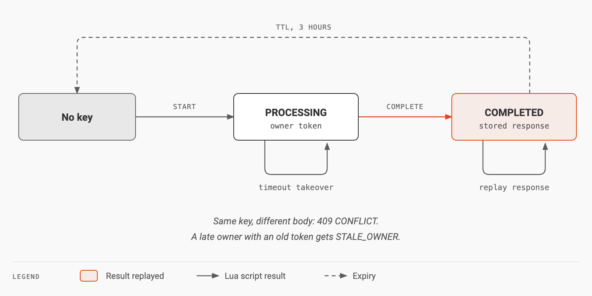

A client retry, a network blip or a load balancer timeout must never charge a customer twice. The client cannot know whether its first "pay" request reached the server before the connection dropped, so it sends it again. Whether that second request becomes a second charge is entirely up to the server.

This post explains the standard defence, the **idempotency key**, and how the [Labs64.IO Payment Gateway](/products/payment-gateway/) implements it with Redis and two small Lua scripts after first doing it in PostgreSQL ([pull request #31](https://github.com/Labs64/labs64.io-payment-gateway/pull/31){:target="_blank"}{:rel="noopener nofollow"}). It is written for backend developers and architects who design APIs where a repeated request must not repeat a side effect.

**After reading, you will know:**

- what an idempotency key must guarantee, including the case that is easy to forget,
- why Redis fits this better than a database table,
- how two atomic scripts implement the whole state machine without locks,
- how an owner token makes timeout takeover safe.

## Background: the idempotency key

The pattern became popular through payment APIs such as Stripe's, and an IETF draft describes the `Idempotency-Key` HTTP header. The client sends a unique key with a request; the server promises that one key produces one result. An implementation must handle five situations:

1. **First request:** process it and remember the result.
2. **Repeat after completion:** return the stored result without processing again.
3. **Repeat while the first is still running:** do not process in parallel.
4. **Same key, different request body:** refuse, because the client made a mistake.
5. **The first request died halfway:** let a later retry take over, without letting the dead request write a result if it comes back.

## The problem: the PostgreSQL version was heavy

The first design used a JPA entity with a unique index on tenant, operation and key. A request hashed its body and inserted a `PROCESSING` row with `ON CONFLICT DO NOTHING`; the winner owned the key, the loser replayed the stored response. A scheduled job deleted expired rows.

It worked. But it needed an entity, a repository with pessimistic locking, a cleanup scheduler and five settings (`redisTtl`, `databaseTtl`, `processingTimeout`, `cleanupInterval`, `cleanupBatchSize`), for a record that is written once, read rarely and thrown away after a few hours.

## The solution in three parts

### Part 1: one Redis hash per key, with a TTL

Redis offers exactly what the record needs: expiry built in (no cleanup job), atomic server-side scripts (no distributed lock) and a simple hash. The Redis key is `payment-gateway:idempotency:` plus a SHA-256 of tenant, operation and client key, so no client-supplied text ends up in a key name. The hash holds:

```
requestHash       SHA-256 of the canonical request
status            PROCESSING | COMPLETED
executionToken    proves which attempt owns the key
startedAt         epoch milliseconds, for timeout detection
responseStatus    (when completed)
responseHeaders   JSON (when completed)
responseBody      JSON (when completed)
```

### Part 2: the state machine in two scripts

{:class="blog-center"}

`start-or-replay.lua` runs when a request arrives and returns one of four answers: `STARTED` (new key, or previous owner timed out), `COMPLETED` (with the stored response to replay), `PROCESSING` (another request is still working) or `CONFLICT` (same key, different body). Its core:

```lua
local requestHash = redis.call('HGET', KEYS[1], 'requestHash')

if not requestHash then
    redis.call('HSET', KEYS[1],
        'requestHash', ARGV[1],
        'status', 'PROCESSING',
        'executionToken', ARGV[2],
        'startedAt', now)
    redis.call('PEXPIRE', KEYS[1], ARGV[3])
    return {'STARTED'}
end

if requestHash ~= ARGV[1] then
    return {'CONFLICT'}
end
```

`complete.lua` runs when processing ends and stores the response only if the caller still owns the key.

### Part 3: an owner token makes takeover safe

```lua
local executionToken = redis.call('HGET', KEYS[1], 'executionToken')
if executionToken ~= ARGV[2] then
    return 'STALE_OWNER'
end
```

Without the token, a slow first request and a retry that took over after the timeout could both finish and both write a result. With it, only the current owner can complete; the other gets `STALE_OWNER`.

Two timers do different jobs: the TTL (`IDEMPOTENCY_REDIS_TTL`, default 3 hours) is how long a result is remembered; the processing timeout (`IDEMPOTENCY_PROCESSING_TIMEOUT`, default 5 minutes) is how long to wait before assuming the original caller died.

## The outcome

Through the real API (the [Payment Gateway quick start](https://labs64.io/docs/modules/payment-gateway/#try-a-payment-with-docker) uses the NoOp provider, so no PSP account is needed), paying the same payment twice with one key:

```bash
for i in 1 2; do
  api -X POST localhost:8080/payments/$PAYMENT/pay -H "Idempotency-Key: order-1001" \
    | grep -o '"status":"[A-Z]*"' | tr '\n' ' '; echo
done
api "localhost:8080/payment-transactions?paymentId=$PAYMENT" | grep -o '"totalItems":[0-9]*'
```

```text
"status":"CLOSED" "status":"SUCCESS"
"status":"CLOSED" "status":"SUCCESS"
"totalItems":1
```

Two calls, one transaction. Reusing the key with a different body returns `409` with `IDEMPOTENCY_CONFLICT`.

| | PostgreSQL version | Redis version |
|---|---|---|
| Moving parts | entity, locking repository, cleanup job | one hash, two scripts |
| Expiry | scheduled cleanup | Redis TTL |
| Concurrency control | row locks | atomic scripts |
| Settings | five | two |

You can also run the scripts alone against a throwaway Valkey (a Redis-compatible server); they live in `payment-gateway-be/src/main/resources/redis/idempotency/`:

```bash
docker run -d --rm --name idem-demo valkey/valkey:8-alpine
docker cp start-or-replay.lua idem-demo:/s.lua
docker cp complete.lua idem-demo:/c.lua
R() { docker exec idem-demo valkey-cli "$@"; }

R --eval /s.lua demo:key , hashA token1 10800000 300000   # STARTED
R --eval /s.lua demo:key , hashA token2 10800000 300000   # PROCESSING
R --eval /s.lua demo:key , hashB token2 10800000 300000   # CONFLICT
R --eval /c.lua demo:key , hashA token1 201 '{}' '{"id":"p1"}' 10800000   # COMPLETED
R --eval /s.lua demo:key , hashA token3 10800000 300000   # COMPLETED, 201, {}, {"id":"p1"}
docker rm -f idem-demo
```

## Trade-offs

- **Redis is now on the write path.** If the script call fails, the request fails, on purpose: no payment runs without protection.
- **The window is the TTL.** A retry after three hours with the same key is treated as a new request.
- **Keys are hashes.** To find one by hand, compute the same SHA-256 (tenant, operation and key, each followed by a zero byte).

## Apply it to your own API

1. Accept an `Idempotency-Key` header on every operation with side effects.
2. Store, per key, a hash of the request, a status, an owner token and the response.
3. Implement claim-or-replay and complete-if-owner as atomic operations (Lua in Redis, or a transaction in a database).
4. Choose the TTL from your clients' retry window, and the processing timeout from your slowest operation.

## Key takeaways

- **The server decides whether a retry becomes a duplicate.** Idempotency keys make that decision explicit.
- **Five situations, not one:** first request, repeat, concurrent repeat, misuse, and a dead first attempt.
- **Short-lived records fit a cache with expiry.** A TTL replaces cleanup jobs; atomic scripts replace locks.
- **An owner token makes takeover safe,** so a request that comes back to life cannot overwrite the real result.
- **Fail closed:** without the idempotency store, no payment should run.

The Java side is `RedisIdempotencyRepository` in [labs64.io-payment-gateway](https://github.com/Labs64/labs64.io-payment-gateway){:target="_blank"}{:rel="noopener nofollow"}. The same two-script pattern fits webhook deduplication and any other "exactly once within a window" problem.
