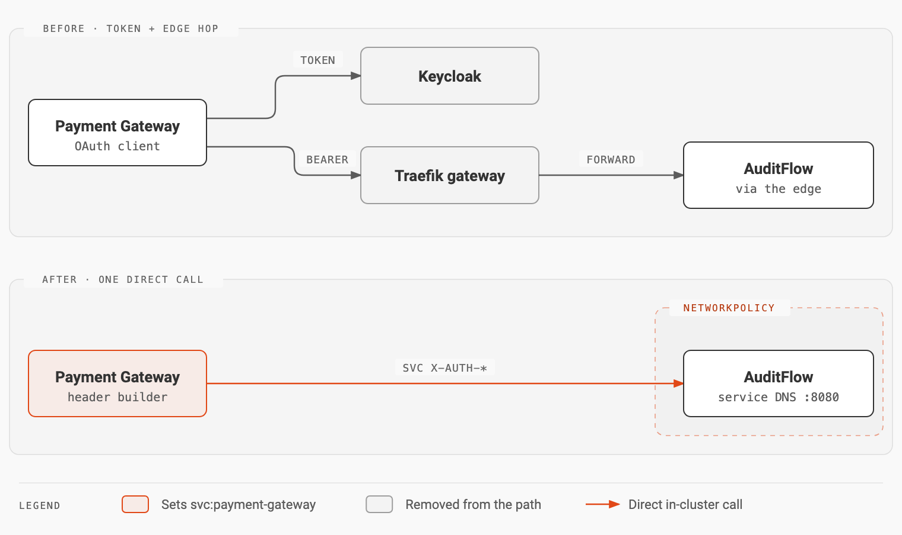

When one service calls another inside the same cluster, how should the callee know who is calling? The textbook answer is OAuth2: the caller fetches a token from the identity provider and sends it along. It works, but for two services sitting next to each other it means an extra token request, client secrets to manage and often a detour through the public gateway, for every single call.

This post describes how the Labs64.IO Payment Gateway now sends audit events to AuditFlow with **one direct call** instead, what replaced the token, and the condition this design depends on. It is written for architects and platform engineers who design service-to-service authentication on Kubernetes.

**After reading, you will know:**

- the common options for service-to-service authentication and their costs,
- how trusted identity headers and a service principal replace a token for internal calls,
- how one shared builder keeps the header contract consistent,
- why a NetworkPolicy is not optional in this design.

## Background: three ways for services to authenticate each other

| Option | How the callee knows the caller | Cost |
|---|---|---|
| OAuth2 client credentials | validates a token from the identity provider | token requests, a client secret per service, often a hop through the gateway |
| Mutual TLS (often via a service mesh) | verifies the caller's certificate | certificate management or a mesh to operate |
| Trusted headers + network policy | trusts headers from callers the network allows | security depends on the network policy |

All three are legitimate; the right choice depends on what you already run. Labs64.IO already trusts identity headers on every request that comes through its gateway (see [the trusted identity header contract](/blog/2026/02/25/trusted-header-contract/)), so the third option reuses machinery that exists.

## The problem: a lot of machinery for one audit event

The [Payment Gateway](/products/payment-gateway/) publishes payment lifecycle events to [AuditFlow](/products/auditflow/). Originally, each event cost:

1. a token request to Keycloak with the client-credentials grant,
2. a call through the public Traefik gateway with a Bearer token,
3. token verification at the edge, before the event finally reached AuditFlow.

On top came a client ID and secret per calling service, stored, rotated and configured in Keycloak and in Helm values.

## The solution in four parts

The change shipped as four pull requests: [commons#19](https://github.com/Labs64/labs64.io-commons/pull/19) (header encoding), [auditflow#28](https://github.com/Labs64/labs64.io-auditflow/pull/28) (request-scoped headers in the client), [payment-gateway#36](https://github.com/Labs64/labs64.io-payment-gateway/pull/36) (the publisher) and [helm-charts#16](https://github.com/Labs64/labs64.io-helm-charts/pull/16) (configuration).

{:class="blog-center"}

### Part 1: one builder owns the header contract

Header names, the `svc:` prefix for service principals and value validation live in `auth-context-core`, a library with no Spring dependency:

```java
final Map<String, String> headers = AuthContextHeaders.builder()
        .servicePrincipal(serviceName)      // "svc:payment-gateway"
        .tenant(event.getTenantId())
        .scopes(scopes)                     // audit-event:write
        .requestId(requestId)
        .build();
```

`build()` fails fast if the user or request ID is missing: an internal call has no anonymous form.

### Part 2: the client accepts per-request headers

`AuditFlowClient` gained overloads with `AuditFlowRequestOptions`; existing callers compile unchanged:

```java
PublishResult publish(AuditEvent event);
PublishResult publish(AuditEvent event, AuditFlowRequestOptions options);
```

The client's tests pin the precedence rules (`publishAppliesRequestHeadersWithoutToken`, `tokenProviderOverridesRequestAuthorizationHeader`, `eventCorrelationIdOverridesRequestHeader`).

### Part 3: the publisher shrinks

The OAuth token provider and its `spring-security-oauth2-client` dependency are gone. The publisher builds the headers and calls the client:

```java
final AuditFlowRequestOptions requestOptions = AuditFlowRequestOptions.builder()
        .headers(headers)
        .build();
return client.publish(event, requestOptions);
```

The request ID is the event's correlation ID when there is one, so payments and their audit events share an ID.

### Part 4: configuration points at the service

The Helm values replace the OAuth block with the service URL and an internal-call identity:

```yaml
applicationYaml:
  labs64:
    auditflow:
      enabled: false
      # Direct AuditFlow Kubernetes Service URL
      url: "http://labs64io-auditflow.labs64io.svc.cluster.local:8080"
      source-system: labs64.io-payment-gateway
      internal-call:
        service-name: payment-gateway
        scopes:
          - audit-event:write
```

## The outcome

| | Before | After |
|---|---|---|
| Network calls per event | token request + gateway + AuditFlow | one call to AuditFlow |
| Secrets per calling service | client ID and secret in Keycloak | none |
| Onboarding another internal caller | new Keycloak client | a Helm value |
| Caller identity seen by AuditFlow | token subject | `svc:payment-gateway` |

To check the rendered configuration:

```bash
helm repo add labs64io https://labs64.github.io/labs64.io-helm-charts && helm repo update
helm template my-payments labs64io/payment-gateway \
  --set applicationYaml.labs64.auditflow.enabled=true | grep -n -i "auditflow"
```

## Trade-offs

Trusted headers are only as trustworthy as the network path: AuditFlow believes `X-Auth-*` headers from whoever can reach its API port. Two measures keep that safe:

1. The gateway removes `X-Auth-*` headers from all external traffic.
2. Inside the cluster, only intended callers may reach AuditFlow. The chart's `networkPolicy` section allows ingress from the gateway and a list of named in-namespace clients (it ships with `payment-gateway`), on the API port only.

The chart ships with `networkPolicy.enabled: false`, so the policy is something you turn on. **If you use this pattern, turn it on.** Also note that `kubectl port-forward` is not subject to NetworkPolicy, so port-forward rights on the namespace are sensitive.

## Apply it to your own platform

1. Decide which mechanism your platform already trusts (tokens, mTLS or gateway headers) and reuse it for internal calls.
2. Give machine callers explicit service principals (`svc:<name>`).
3. Put header names and validation in one shared builder.
4. Enforce with a NetworkPolicy that only named callers reach the service, and treat port-forward rights as sensitive.

## Key takeaways

- **There is no single right answer for service-to-service auth;** tokens, mTLS and trusted headers trade different costs.
- **Reuse the trust model you already have.** If services already trust gateway headers, internal calls can use the same contract.
- **Service principals make machine callers visible** (`svc:payment-gateway`), without a token.
- **One builder, one contract:** header names, prefixes and validation in one library, used by every caller.
- **The network becomes part of authentication.** Without a NetworkPolicy, trusted headers prove nothing.

The code is in [labs64.io-commons](https://github.com/Labs64/labs64.io-commons) and [labs64.io-payment-gateway](https://github.com/Labs64/labs64.io-payment-gateway); the events are described in the [Payment Gateway docs](https://labs64.io/docs/modules/payment-gateway/#events).
