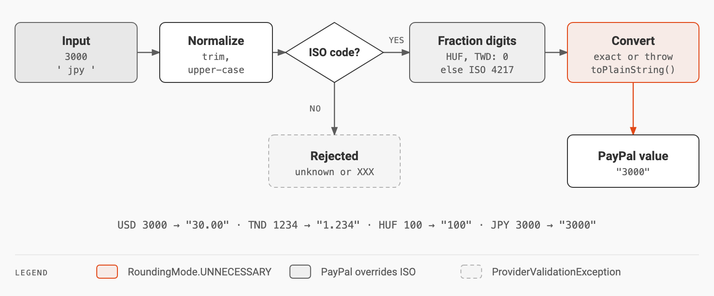

Your payment integration passes its tests for US dollars (3000 cents become "30.00"), for euros, even for Tunisian dinars with their three decimals (1234 becomes "1.234"). Then the first Japanese customer buys a 3000-yen item, and you send PayPal "30.00". PayPal answers with an error, because yen has no decimals at all.

This post explains how the [Labs64.IO Payment Gateway](/products/payment-gateway/) converts amounts for PayPal correctly, including the currencies where PayPal and the ISO standard disagree. It is written for developers who integrate payment providers in any language; the examples are Java.

**After reading, you will know:**

- why integer minor units are the right way to store money,
- why the conversion back to a provider's format is where bugs hide,
- which currencies PayPal treats differently from ISO 4217,
- how to convert exactly, fail loudly, and test what goes over the wire.

## Background: money as minor units

Floating-point numbers cannot represent most decimal fractions exactly (`0.1 + 0.2` is not `0.3`), so amounts stored as `double` drift. The standard practice is to store an integer count of the currency's smallest unit plus the currency code: 30.00 USD is `3000`, 1.234 TND is `1234`, 3000 JPY is `3000`.

To turn `3000` back into a string, you need the number of decimal places for the currency. ISO 4217 defines it, and Java exposes it through `Currency.getInstance(code).getDefaultFractionDigits()`:

```text
USD -> 2
EUR -> 2
JPY -> 0
TND -> 3
HUF -> 2
TWD -> 2
```

## The problem: providers can disagree with ISO

PayPal's [currency codes reference](https://developer.paypal.com/api/rest/reference/currency-codes/){:target="_blank"}{:rel="noopener nofollow"} marks three currencies with the note "This currency does not support decimals. If you pass a decimal amount, an error occurs.": HUF, JPY and TWD. JPY matches ISO. **HUF and TWD do not:** ISO gives them two fraction digits, PayPal wants whole numbers. A converter based only on ISO data would send "100.00" for 100 forints and get an error back.

Two more traps sit in the same place: silently rounding an amount that does not convert exactly, and printing large amounts in scientific notation such as `1E+6`.

## The solution in three parts

{:class="blog-center"}

### Part 1: one converter with the exceptions in a map

All currency rules for PayPal live in one package-private class, `PaypalMoneyConverter`, with no PayPal SDK types in it:

```java
// PayPal requires whole-unit amounts for these currencies despite their ISO fraction digits.
private static final Map<String, Integer> PAYPAL_FRACTION_DIGIT_OVERRIDES = Map.of(
        "HUF", 0,
        "TWD", 0);

static String toMajorUnits(final BigDecimal minorUnits, final String currencyCode) {
    final int fractionDigits = fractionDigits(currencyCode);
    return minorUnits.movePointLeft(fractionDigits)
            .setScale(fractionDigits, RoundingMode.UNNECESSARY)
            .toPlainString();
}
```

`fractionDigits` checks the override map first and falls back to ISO. The provider uses the converter for the order total, the item total and every item's unit amount, so the logic exists in exactly one place.

### Part 2: normalise, validate and fail loudly

- Currency codes are trimmed and upper-cased first (`" jpy "` becomes `"JPY"`).
- Unknown codes and special codes such as `XXX` are rejected with a `ProviderValidationException`: "PayPal payment requires a valid ISO-4217 purchaseOrder.currency."
- `RoundingMode.UNNECESSARY` throws if the amount cannot be represented exactly; money is never rounded silently.
- `toPlainString()` never produces scientific notation.

### Part 3: test the helper and the wire

Four unit tests cover ISO cases, the PayPal overrides, normalisation and invalid codes:

```java
assertThat(PaypalMoneyConverter.toMajorUnits(BigDecimal.valueOf(3000), "USD")).isEqualTo("30.00");
assertThat(PaypalMoneyConverter.toMajorUnits(BigDecimal.valueOf(3000), "JPY")).isEqualTo("3000");
assertThat(PaypalMoneyConverter.toMajorUnits(BigDecimal.valueOf(1234), "TND")).isEqualTo("1.234");
assertThat(PaypalMoneyConverter.toMajorUnits(BigDecimal.valueOf(100), "HUF")).isEqualTo("100");
```

A unit test only proves the conversion. A Robot Framework case, `Create zero-decimal JPY PayPal order`, runs the whole payment flow against a local PayPal stand-in and checks the JSON sent to PayPal's Orders API: `amount.value`, `breakdown.item_total.value` and the item's `unit_amount.value` must all be `3000`. That catches a wrong field or a missing breakdown, which no converter test would see.

## The outcome

| Amount | Naive "divide by 100" | ISO-only converter | Converter with PayPal overrides |
|---|---|---|---|
| USD 3000 | "30.00" | "30.00" | "30.00" |
| TND 1234 | "12.34" (wrong) | "1.234" | "1.234" |
| JPY 3000 | "30.00" (rejected) | "3000" | "3000" |
| HUF 100 | "1.00" (wrong) | "100.00" (rejected) | "100" |

To run the unit tests:

```bash
git clone https://github.com/Labs64/labs64.io-payment-gateway.git && cd labs64.io-payment-gateway
mvn -B -pl payment-gateway-providers/paypal -am test -Dtest=PaypalMoneyConverterTest
```

A related guard came with the same work: after approval, PayPal sends the buyer back with a `token` parameter, which is the PayPal order ID. The provider now compares it with the order ID stored on the transaction before capturing, so a callback for a different order, from a stray tab or a crafted URL, never leads to a capture attempt.

## Trade-offs

- **Override maps need maintenance.** If PayPal changes its currency rules, the map must change too; keeping it in one class with tests makes that a one-line, reviewed edit.
- **Throwing on inexact amounts can fail a checkout.** That is intended: a visible error is cheaper than a wrong charge.

## Apply it to your own payment integration

1. Store amounts as integer minor units plus an ISO 4217 code; calculate with a decimal type, never floating point.
2. Put each provider's currency rules into one tested converter, with explicit overrides where the provider deviates from ISO.
3. Normalise and validate currency codes at the boundary.
4. Convert with exact arithmetic and fail on anything inexact.
5. Test the request payload the provider receives, not only the helper.

## Key takeaways

- **Minor units are right for storage; the conversion back is where bugs live.**
- **"Two decimals" is an assumption, not a rule.** JPY has none, TND has three.
- **Providers can disagree with the standard.** PayPal wants whole numbers for HUF and TWD although ISO gives them two decimals.
- **Never round money silently.** `RoundingMode.UNNECESSARY` turns an inexact amount into a visible error.
- **Test the wire format.** A correct helper does not prove a correct request.

The code is in [labs64.io-payment-gateway](https://github.com/Labs64/labs64.io-payment-gateway){:target="_blank"}{:rel="noopener nofollow"} under `payment-gateway-providers/paypal`; the [Payment Gateway docs](https://labs64.io/docs/modules/payment-gateway/) cover the PayPal setup.
