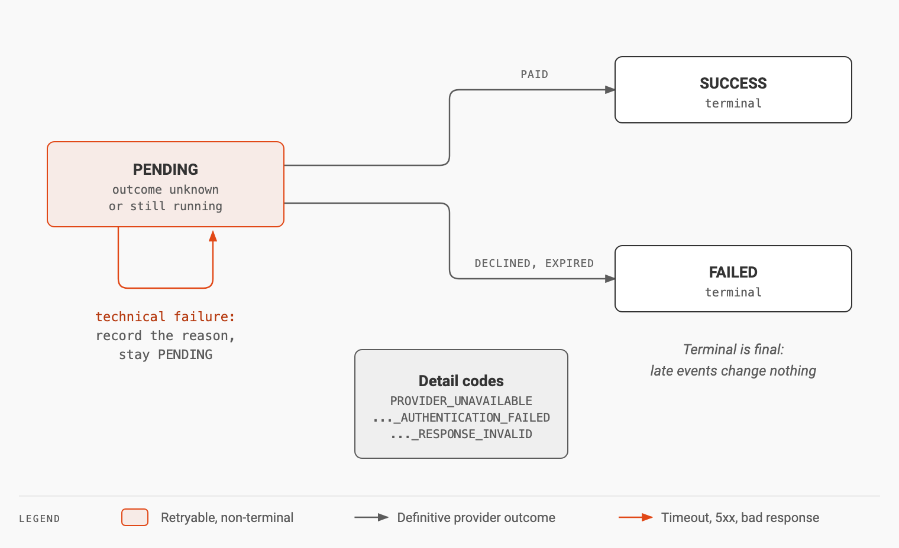

A customer's order is worth 149 euros. Your system asks the payment provider to capture the money, and the request times out. Did the money move? You do not know. If you mark the payment `FAILED` anyway and the capture actually went through, the customer has been charged and told it failed. That means an angry support ticket, and a double charge if they simply try again.

This post explains the rule the [Labs64.IO Payment Gateway](/products/payment-gateway/) follows since [pull request #43](https://github.com/Labs64/labs64.io-payment-gateway/pull/43){:target="_blank"}{:rel="noopener nofollow"}: **a technical failure of the provider call is never a payment outcome.** It is written for developers and architects of payment integrations, and of any system that changes state based on a third party's answer.

**After reading, you will know:**

- the difference between a *definitive* provider outcome and a *technical* failure,
- why mixing the two causes the worst kind of payment incident,
- a small, provider-neutral vocabulary for "we do not know yet",
- how to record the reason without settling the payment, even when an exception is thrown.

## Background: final and non-final payment states

A payment transaction moves through states. Some are **terminal**: `SUCCESS` (money moved) and `FAILED` (it definitely did not). Once a transaction is terminal, nothing should change it again. Until then it is `PENDING`: the outcome is still open.

## The problem: outages were modelled as declined payments

Before the change, checkout completion and webhook handling treated provider exceptions like business rejections and moved the transaction to a terminal `FAILED` state. An old test name says it all: `completeMarksTransactionFailedAndUsesFallbackRedirectWhenProviderCheckoutFails`. A provider that was down was treated as a payment that was refused.

That is wrong in two ways:

- **It settles too early.** The transaction becomes final while the real outcome is unknown, so a later webhook saying "paid" has to fight a terminal state.
- **It erases the reason.** An operator cannot tell a provider outage from rejected credentials from a malformed response.

## The solution in three parts

{:class="blog-center"}

### Part 1: two kinds of result, two code paths

- A **definitive** provider outcome (success, declined, cancelled, expired) is *returned* as a `PaymentResult`, and may move the transaction to a terminal state.
- An execution **without** a definitive outcome (timeout, rate limit, server error, rejected credentials, an incomplete success response) is *thrown* as `ProviderExecutionException`, and may not.

### Part 2: a small vocabulary for "we do not know"

The provider SPI describes the second kind with one enum:

```java
public enum ProviderExecutionFailure {
    UNAVAILABLE,            // connection error, timeout, rate limit, server-side failure
    AUTHENTICATION_FAILED,  // the PSP rejected the credentials
    INVALID_RESPONSE        // e.g. a "successful" response without its required object id
}
```

Its Javadoc is the policy: none of these values is a failed payment, and none may trigger a terminal transition. Each provider translates its own SDK errors into this enum, so the core never looks at PSP-specific exceptions. Stripe's adapter does it in one method:

```java
static ProviderExecutionFailure classifyExecutionFailure(final StripeException exception) {
    return exception instanceof AuthenticationException
            ? AUTHENTICATION_FAILED
            : UNAVAILABLE;
}
```

If Stripe returns a Checkout session without its ID or URL, that is `INVALID_RESPONSE`, not "failed".

### Part 3: record the reason, stay pending, survive the exception

The gateway writes down why, under a database lock, and leaves the status alone:

```java
public PaymentTransactionEntity recordProviderExecutionFailure(
        final PaymentTransactionEntity transaction,
        final ProviderExecutionFailure failure) {
    return updateIfNonTerminal(
            transaction.getTenantId(),
            transaction.getId(),
            lockedTransaction -> lockedTransaction.setStatusDetails(StatusDetails.builder()
                    .code(statusDetailCode(failure))
                    .message(providerExecutionMessages.message(failure))
                    .build()));
}
```

`updateIfNonTerminal` re-reads the row with `FOR UPDATE` and does nothing if it is already final. The three values map to the detail codes `PROVIDER_UNAVAILABLE`, `PROVIDER_AUTHENTICATION_FAILED` and `PROVIDER_RESPONSE_INVALID`.

One Spring detail would have hidden that reason: when a runtime exception leaves a `@Transactional` method, Spring rolls back everything it wrote. The webhook path therefore declares:

```java
@Transactional(noRollbackFor = ProviderExecutionException.class)
public PaymentWebhookResult processWebhook(final WebhookRequest request) {
    ...
    try {
        result = webhookSupport.handleWebhook(context);
    } catch (ProviderExecutionException ex) {
        transactionService.recordProviderExecutionFailure(transaction, ex.failure());
        throw ex;
    }
    transactionService.applyResult(transaction, result);
```

The detail is committed, and the exception still reaches the caller.

## The outcome

| A provider call times out | Before | After |
|---|---|---|
| Transaction status | `FAILED` (terminal) | `PENDING` |
| Reason visible to operators | lost | `PROVIDER_UNAVAILABLE` |
| Later webhook "paid" | conflicts with a final state | settles the payment correctly |
| Customer experience | "failed" although charged | waiting, then the real result |

A parameterized test runs once for every enum value and asserts that the transaction stays `PENDING` with the right detail code and that no "finalized" event is published. Add a fourth failure type and the test asks you what its code should be.

## Trade-offs

- **Pending can last.** If the provider never sends a result, someone has to look. The detail code tells them why it is pending, and the payment can be resolved by a later webhook or a status query.
- **Adapters must classify honestly.** Calling a real decline "unavailable" would leave payments pending forever; the enum is deliberately small to keep that decision clear.

## Apply it to your own payment flow

1. Separate definitive outcomes (return a result) from technical failures (throw).
2. Only definitive outcomes may set a terminal state; make terminal states final.
3. Define a small, provider-neutral vocabulary for technical failures, and let each adapter map to it.
4. Record the reason under a lock, and make sure your transaction handling does not roll it back.
5. Pin the policy with a test that covers every failure type.

## Key takeaways

- **Technical failure is not payment failure.** A timeout means "unknown", and "unknown" is not "declined".
- **Terminal states are a promise.** Only a definitive answer from the provider may make one.
- **A small vocabulary keeps adapters honest:** unavailable, authentication failed, invalid response.
- **Record the reason, not a verdict.** A detail code on a pending transaction helps operators without blocking the real outcome.
- **Know your framework's rollback rules.** `noRollbackFor` keeps the recorded reason when an exception is rethrown.

The code is in [labs64.io-payment-gateway](https://github.com/Labs64/labs64.io-payment-gateway){:target="_blank"}{:rel="noopener nofollow"}: `ProviderExecutionFailure` in the provider SPI, the services in `payment-gateway-be`. For how providers plug in, see [One payment API, many PSPs](/blog/2026/01/26/psp-abstraction-spi/).
