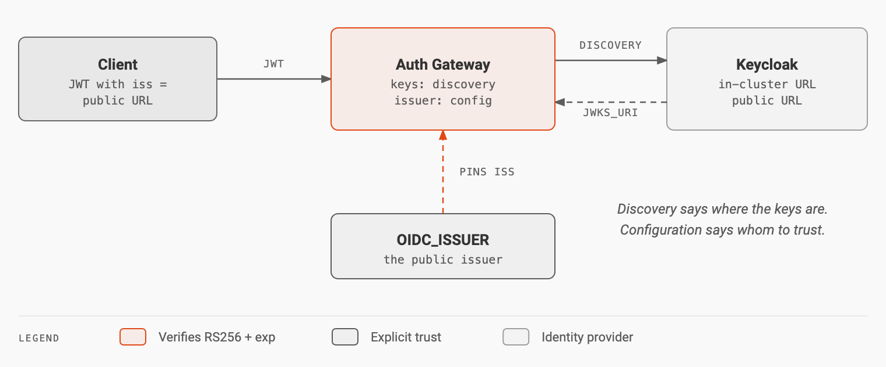

You deploy Keycloak and an API gateway into the same Kubernetes cluster, point the gateway at Keycloak's internal address, and every valid token is rejected with "Invalid issuer". Or worse: everything works, but the decision about *which* tokens your platform trusts is quietly being made by whatever answers a network request.

This post explains where both problems come from, and how the Labs64.IO [Auth Gateway](/products/auth-gateway/) separates *where to find the signing keys* from *whom to trust*. It is written for platform engineers and developers who validate OIDC/JWT tokens behind Kubernetes, with Keycloak or any other provider.

**After reading, you will know:**

- what OIDC discovery provides and what it was designed for,
- why in-cluster and public addresses produce an issuer mismatch,
- why the accepted issuer should come from configuration, not from the network,
- which JWT checks a gateway should always enforce.

## Background: OIDC discovery

An OpenID Connect provider publishes a JSON document at `<issuer>/.well-known/openid-configuration`. Clients read it to find two things a token check needs:

- `jwks_uri`: where the public signing keys are, so signatures can be verified and keys can rotate;
- `issuer`: the identifier that the `iss` claim in every token must match.

The specification expects the `issuer` in that document to match the URL it was fetched from. That works when every client reaches the provider by the same public URL.

## The problem: one provider, two names

Inside Kubernetes, the gateway usually talks to Keycloak over the cluster network, while browsers and external services use the public hostname. Fetching discovery over the internal address returns an internal issuer:

```text
http://keycloak.tools.svc.cluster.local:8080/realms/labs64io
```

But the tokens were issued under the public name:

```text
https://keycloak.localhost/realms/labs64io
```

A gateway that checks tokens against the *discovered* issuer rejects every valid token. And there is a deeper issue: if the accepted issuer always comes from the discovery response, then whatever answers that request defines whom your platform trusts.

## The solution in three parts

{:class="blog-center"}

### Part 1: keys from discovery, issuer from configuration

The Auth Gateway reads an optional setting, `OIDC_ISSUER`. Discovery still provides the `jwks_uri`, so key rotation keeps working; the issuer to check comes from configuration when it is set:

```python
OIDC_ISSUER = os.getenv("OIDC_ISSUER", "")

def get_expected_issuer() -> str:
    """Return the explicit JWT issuer, falling back to discovery metadata."""
    if OIDC_ISSUER:
        return OIDC_ISSUER
    if "issuer" not in DISCOVERY_CACHE:
        get_jwks()
    return DISCOVERY_CACHE["issuer"]
```

When discovery reports something else, the gateway logs a warning and keeps the configured value:

```python
if OIDC_ISSUER and discovered_issuer != OIDC_ISSUER:
    app_logger.warning(
        "Discovery issuer %s differs from explicit JWT issuer %s",
        discovered_issuer, OIDC_ISSUER)
```

A discovery document without `issuer` or `jwks_uri` is rejected outright.

### Part 2: strict token checks

Verification uses PyJWT with RS256 only, and passes issuer and audience directly:

```python
payload = jwt.decode(
    token,
    _signing_key(kid),
    algorithms=["RS256"],
    audience=OIDC_AUDIENCE,
    issuer=get_expected_issuer(),
    options={"verify_iat": False, "require": ["exp"]},
)
```

`require: ["exp"]` matters: PyJWT checks expiry only when the claim is present, so without it a token without `exp` would never expire.

### Part 3: tests that pin the behaviour

`tests/test_oidc_issuer.py` contains seven tests, among them:

- a discovery document missing `issuer` is rejected;
- an explicit issuer overrides a different discovered issuer;
- without an explicit issuer, the discovered one is used;
- a token with the wrong issuer gets `401` with `Invalid token: Invalid issuer`;
- concurrent key refreshes fetch once and never return an empty key set (the key set is replaced as a whole under a lock).

```bash
git clone https://github.com/Labs64/labs64.io-authproxy.git
cd labs64.io-authproxy/traefik-authproxy
python3 -m venv .venv && . .venv/bin/activate
pip install -r requirements.txt pytest httpx
python -m pytest tests/test_oidc_issuer.py -v
```

## The outcome

| | Issuer from discovery | Issuer pinned with `OIDC_ISSUER` |
|---|---|---|
| In-cluster discovery, public tokens | every token rejected | tokens accepted |
| Who decides which issuer is trusted | whoever answers discovery | your configuration |
| Key rotation | works | works (keys still from discovery) |
| Mismatch visible | as rejected tokens | as a warning in the log |

To use it, add `OIDC_ISSUER` to the Auth Gateway's environment next to `OIDC_DISCOVERY_URL` and `OIDC_AUDIENCE`; the README lists all variables.

## Trade-offs

- **It is optional.** Without `OIDC_ISSUER` the gateway falls back to the discovered issuer, which keeps simple setups working but leaves the trust decision with the network. For production, set it.
- **Discovery still matters.** The `jwks_uri` comes from discovery, so the discovery URL must point at your real identity provider.

## Apply it to your own gateway

1. Configure the expected issuer explicitly; do not take it from the discovery response.
2. Keep using discovery (or a configured JWKS URL) for signing keys, so rotation works.
3. Allow only the signing algorithms you expect (for example RS256).
4. Require `exp`, and check audience and issuer on every token.
5. Refresh keys atomically, so a request never sees a half-updated key set.

## Key takeaways

- **Discovery tells you where the keys are; configuration tells you whom to trust.** Keep those two decisions apart.
- **One provider often has two names in Kubernetes,** internal and public, and tokens carry the public one.
- **"Invalid issuer" with valid tokens** usually means the gateway learned the issuer over the internal address.
- **Strict checks are cheap:** fixed algorithms, audience, issuer and a required `exp`.
- **Test the trust rules,** including the cases where configuration and discovery disagree.

The [Zero-Trust Edge Proxy](/platform/zero-trust/) and [Federated Identity](/platform/identity/) pages show where the gateway sits; the same hardening work is described in [Why sync def keeps FastAPI health checks alive](/blog/2026/09/17/fastapi-sync-def-keeps-health-checks-alive/).
