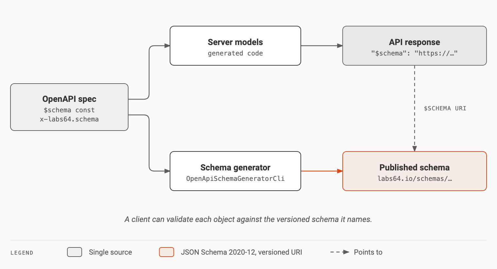


BEFORE PUBLISHING (checked 2026-11-13, delete this block afterwards):
The published PaymentProvider schema does not validate a live gateway response. The API returns null for
icon, recurring and config, while the schema has `recurring` as a required non-null boolean, `config` as a
non-null object, and `icon` marked with the OpenAPI 3.0 keyword `nullable`, which JSON Schema 2020-12 ignores.
This post therefore validates a hand-built payload only, and states the limits. Fix the generator or the API,
then re-run the validation against a live response and tighten the wording.


Most API integrations start the same way. A developer reads a documentation page, guesses the shape of an object, and writes a parser. If the guess is wrong, the first real payment fails, or worse, a field quietly parses to `null`. And when the API changes a year later, nobody knows which version of the object the client was written against.

This post shows how the [Labs64.IO Payment Gateway](/products/payment-gateway/) puts the contract into the payload itself: every public response object names the versioned JSON Schema that describes it. It is written for API designers and integrators who want contracts that clients, tests and tools can check automatically.

**After reading, you will know:**

- what a self-describing response is and why it helps integrators,
- how to generate versioned JSON Schema files from an OpenAPI document,
- how to publish them at stable addresses and reference them from the payload,
- what a schema does and does not promise.

## Background: what "self-describing" means

A self-describing message carries a pointer to its own description. JSON Schema reserves the `$schema` keyword for that idea inside schema documents, and many data formats use a `$schema` property the same way (VS Code settings files are a familiar example): a tool sees the URI, fetches the schema, and knows how to validate, autocomplete or generate code.

## The problem: the contract lives somewhere else

An OpenAPI document describes the whole API, but a client holding one JSON object cannot tell from the object itself:

- which contract it follows,
- which version of that contract,
- where to find a machine-readable description to validate it against.

Hand-written JSON Schema files would answer that, but they drift from the API the first time someone edits the OpenAPI file.

## The solution in three parts

{:class="blog-center"}

### Part 1: every public object names its schema

In the OpenAPI source (`openapi-payment-gateway-v1.yaml`), each public component, such as `Payment`, `PaymentProvider`, `PaymentTransaction` and the checkout confirmations, has a required, read-only `$schema` property with a fixed value, plus an `x-labs64` extension recording the object and version:

```yaml
PaymentProvider:
  type: object
  additionalProperties: false
  properties:
    $schema:
      type: string
      format: uri
      readOnly: true
      const: "https://labs64.io/schemas/payment-gateway/PaymentProvider/1.0.0.json"
  x-labs64:
    schema:
      object: PaymentProvider
      version: "1.0.0"
```

The `const` makes the URI part of the contract. The field is really emitted; listing providers on a local gateway (see the [quick start](https://labs64.io/docs/modules/payment-gateway/#try-a-payment-with-docker)) returns objects that begin like this:

```json
{"$schema":"https://labs64.io/schemas/payment-gateway/PaymentProvider/1.0.0.json","id":"2416f718-...","provider":"noop","name":"No-Op (Test)", ...}
```

### Part 2: schemas are generated from the same OpenAPI file

A small generator, `OpenApiSchemaGeneratorCli`, extracts each component into its own JSON Schema document. It runs through two `just` recipes, with a dry run that writes nothing:

```bash
just schemas-generate <output-dir>   # write the schema files
just schemas-dry-run  <output-dir>   # show what would change, write nothing
```

```text
CREATE    schemas/payment-gateway/PaymentProvider/1.0.0.json  [component=PaymentProvider, revision=1.0.0]
CREATE    schemas/payment-gateway/Payment/1.0.0.json  [component=Payment, revision=1.0.0]
...
Dry run: no files written.
```

### Part 3: published at stable, versioned addresses

The files are published on this website under `schemas/payment-gateway/<Object>/<version>.json`. Each is a JSON Schema draft 2020-12 document with its own `$id`; references to other objects use absolute URIs instead of local fragments:

```json
"payment": {
  "$ref": "https://labs64.io/schemas/payment-gateway/ConfirmationPayment/1.0.0.json"
}
```

The version is part of the URI, so a client built against `1.0.0` keeps resolving exactly that contract after a later version ships. `additionalProperties: false` and `required` lists make the schemas strict.

## The outcome

A client can now take any object, read `$schema`, fetch the schema and validate:

```bash
curl -s https://labs64.io/schemas/payment-gateway/PaymentProvider/1.0.0.json -o provider.json
python3 -m venv .venv && . .venv/bin/activate && pip install jsonschema
python - <<'PY'
import json, jsonschema
schema = json.load(open("provider.json"))
payload = {"$schema": schema["$id"], "id": "550e8400-e29b-41d4-a716-446655440010",
           "provider": "stripe", "name": "Stripe", "description": "Cards", "recurring": True}
jsonschema.validate(payload, schema)                       # passes
jsonschema.validate({**payload, "provider": 42}, schema)   # raises ValidationError
PY
```

The second call fails with `42 is not of type 'string'`.

| | Docs-only contract | Self-describing responses |
|---|---|---|
| Which contract does this object follow? | guess from the docs | `$schema` says so |
| Machine-readable description | the whole OpenAPI file | one schema per object and version |
| Drift between docs and API | possible | generated from the same source |
| Old clients after a new version | unclear | old URI still resolves |

## Trade-offs

- **A schema describes shape, not meaning.** Whether a payment succeeded is a question for the `status` field and the documentation, not for the schema.
- **Strict schemas need careful nullability.** OpenAPI 3.0's `nullable` keyword has no meaning in JSON Schema 2020-12; fields that can be `null` must be declared with a `null` type, or a validator will reject real responses.

## Apply it to your own API

1. Add a read-only `$schema` property with a `const` URI to each public object in your OpenAPI document.
2. Generate one JSON Schema file per object and version from that document; never write them by hand.
3. Publish them at versioned URIs, with absolute `$ref`s between them.
4. Never change a published version; a breaking change gets a new URI.
5. Validate real responses against the published schemas in CI.

## Key takeaways

- **A self-describing object tells every client which contract it follows** and where to fetch it.
- **Generate schemas from the API contract,** so documentation and implementation cannot drift.
- **Put the version in the URI** and keep published versions immutable; old clients keep working.
- **Strictness is a feature with a cost:** `additionalProperties: false` catches typos, but nullability must be modelled correctly.
- **Schemas describe shape, not behaviour;** documentation still explains what values mean.

To regenerate the schemas yourself, clone [labs64.io-payment-gateway](https://github.com/Labs64/labs64.io-payment-gateway), create an empty directory and run `just schemas-dry-run` with it. The [Payment Gateway docs](https://labs64.io/docs/modules/payment-gateway/) cover the API itself.
