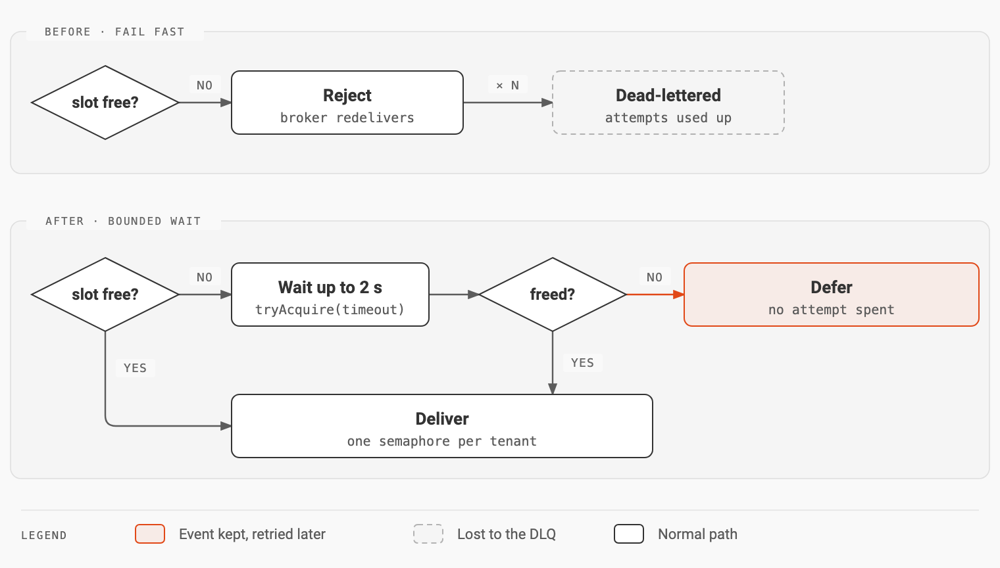

A load test against [AuditFlow](/products/auditflow/), the Labs64.IO audit pipeline, ended with 147 events in the dead-letter queue, although nothing in the pipeline was broken. For an audit trail that is the worst kind of failure: every component was healthy, and evidence was still lost.

This post explains the two concurrency mistakes behind it, both common in event-driven services, and the fixes. It is written for developers and operators of message-driven systems, especially those mixing Python async services and Java consumers.

**After reading, you will know:**

- how a blocking call inside a Python `async def` endpoint serializes a whole service,
- why "fail fast" is the wrong reaction for a queue consumer that is merely busy,
- how a bounded wait plus a deferral keeps events out of the dead-letter queue,
- which settings control this in AuditFlow.

## Background: how AuditFlow delivers events

AuditFlow has three services. A Java backend consumes events from the message broker, calls a Python **transformer** service to reshape each event, and a Python **sink** service to write it to its destination (S3, webhooks, databases, log platforms). A delivery that fails is retried later; one that keeps failing, or is rejected too often, ends in the tenant's dead-letter queue (DLQ).

## The problem: two ways to look broken while healthy

**1. A blocking call on the event loop.** The sink endpoint was declared `async def`, so every request on a pod shared one event loop. The sinks do blocking I/O (S3, HTTP, JDBC) and the endpoint called them directly. While one sink waited on the network, the pod could not serve any other event. The S3 sink also built a new client for every event; on EKS that re-resolves credentials with an STS `AssumeRoleWithWebIdentity` call, which costs more than the upload itself.

**2. A per-tenant limit that failed fast.** AuditFlow caps how many deliveries one tenant may have in flight per pod, so one busy tenant cannot take all the threads. The first version **rejected immediately** when the cap was reached. The rejection made the broker redeliver the event, and every redelivery counted toward the dead-letter threshold. Within seconds, events over the cap had used up their attempts and were dead-lettered, although the tenant's own work was about to finish.

## The solution in two parts

### Part 1: move blocking work off the event loop

The fix in `auditflow-sink/sink.py` is one line:

```python
# Sinks do blocking I/O (S3, HTTP, JDBC). Run them in the thread pool: called directly from
# this coroutine they would block the event loop and serialize every event on the pod.
result = await run_in_threadpool(process_function, event_data, properties)
```

`run_in_threadpool` (from Starlette) runs the blocking call on a worker thread, so the loop keeps serving other events. The S3 sink now also keeps one client per (region, credentials, endpoint), capped at 64, behind a lock:

```python
_CLIENTS = {}
_CLIENTS_LOCK = threading.Lock()
_MAX_CLIENTS = 64
```

### Part 2: wait a bounded time, then defer without penalty

{:class="blog-center"}

The per-tenant limiter now waits for a free slot, but only for a limited time:

```java
public boolean tryAcquire(String tenantId) {
    Semaphore semaphore = permits.computeIfAbsent(tenantId, k -> new Semaphore(maxInFlight));
    if (semaphore.tryAcquire()) {
        return true;
    }
    if (maxWaitMillis == 0) {
        return false;
    }
    try {
        return semaphore.tryAcquire(maxWaitMillis, TimeUnit.MILLISECONDS);
    } catch (InterruptedException e) {
        Thread.currentThread().interrupt();
        return false;
    }
}
```

Each tenant has its own semaphore, so waiting for one tenant never blocks another. If no slot frees up in time, the delivery is **deferred**: parked for the shortest retry delay *without spending a delivery attempt*. The settings, with their defaults from `application.yml`:

```yaml
tenants:
  consumer:
    max-in-flight-per-tenant: 32
    max-wait-millis: 2000
```

The consumer thread count is set with `AUDITFLOW_CONSUMER_CONCURRENCY` (default 8). The [delivery model docs](https://labs64.io/docs/modules/auditflow/delivery-model/) explain how deferrals and retry tiers fit together.

## The outcome

| | Before | After |
|---|---|---|
| One slow sink call | blocks every event on the pod | blocks one worker thread |
| S3 client per event | new client, STS call each time | cached per configuration |
| Tenant over its in-flight cap | rejected, redelivered, attempt spent | waits up to 2 s, then deferred, no attempt spent |
| Result under load | healthy events dead-lettered | system slows down, nothing is lost |

The original fix used 4 as the per-tenant cap; it is 32 today after the delivery model was reworked. The wait-then-defer behaviour is what stayed.

## Trade-offs

- **Waiting holds a consumer thread** for up to two seconds. That is why the wait is bounded and the cap is per tenant.
- **Deferral delays delivery.** Under sustained overload, events arrive later instead of failing, which is the right trade for audit data but should show up in monitoring.

## Apply it to your own consumers

1. Search every `async def` endpoint for direct blocking calls, including client constructors that touch the network.
2. Reuse expensive clients instead of creating them per request.
3. When a consumer is merely busy, wait a bounded time instead of rejecting.
4. If the wait fails, defer without counting an attempt; reserve the dead-letter queue for real failures.

## Key takeaways

- **One blocking call can serialize an async service.** Blocking I/O belongs on a thread, not on the event loop.
- **Client construction can be network I/O,** especially with cloud credentials; cache clients.
- **Fail-fast is the wrong default when rejection triggers redelivery,** because redeliveries use up the attempts meant for real failures.
- **Bounded wait, then defer:** give pressure a moment to clear, then step aside without penalty.
- **Under load, slower is better than lossy,** especially for an audit trail.

The code is in [labs64.io-auditflow](https://github.com/Labs64/labs64.io-auditflow){:target="_blank"}{:rel="noopener nofollow"}: `TenantConcurrencyLimiter.java` in `auditflow-be` and `sink.py` in `auditflow-sink`. The same blocking-call problem in a FastAPI gateway is described in [Why sync def keeps FastAPI health checks alive](/blog/2026/09/17/fastapi-sync-def-keeps-health-checks-alive/).
