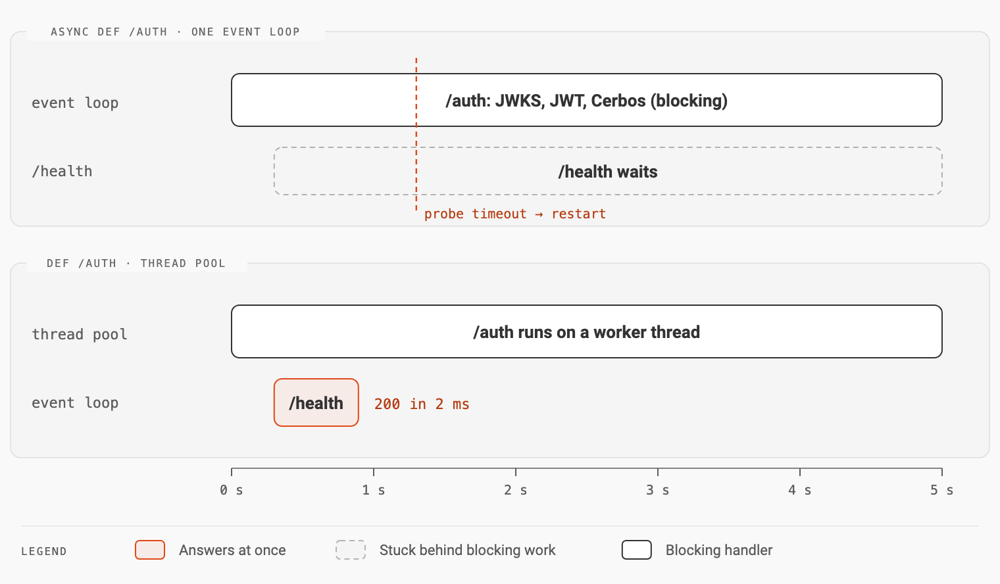

During load testing, Kubernetes started restarting every replica of a Python service, one after another. The service was not crashing and not out of memory; its health endpoint simply stopped answering in time. The cause was a single keyword, and the fix was to delete it.

This post explains what happened in the Labs64.IO [Auth Gateway](/products/auth-gateway/), the FastAPI service that checks every request to the platform, and how to avoid it in your own services. It is written for Python developers and operators who run FastAPI (or any ASGI framework) on Kubernetes.

**After reading, you will know:**

- how FastAPI runs `async def` and `def` handlers differently,
- why one blocking call can make a healthy pod fail its liveness probe,
- a one-minute experiment that shows the effect,
- how to write a test that keeps the fix from regressing.

## Background: `async def` and `def` in FastAPI

FastAPI supports both kinds of handler, and treats them very differently:

- An **`async def`** handler runs directly **on the event loop**. All requests on that worker share the loop; it can serve many of them only while each one is *awaiting* something.
- A plain **`def`** handler runs **in a thread pool**. The loop hands it to a worker thread and stays free for other requests.

So `async def` is fast only if everything inside it is non-blocking. A blocking call (a synchronous HTTP client, a synchronous SDK, `time.sleep`) freezes the whole loop until it returns.

## The problem: blocking work inside `async def`

For each request, the Auth Gateway verifies a JWT, may refresh signing keys from the identity provider, and asks the Cerbos policy service whether the caller is allowed. All of that is blocking work, and the `/auth` handler was declared `async def`.

Under load, a few slow `/auth` calls held the event loop. Every other request on the pod waited, including `/health`. The kubelet's liveness probe missed its deadline a few times, Kubernetes restarted the pod, the remaining pods got more traffic, and the problem spread.

## The solution in two parts

{:class="blog-center"}

### Part 1: declare blocking handlers with `def`

The `/auth` handler is now a plain function, and its docstring records why:

```python
@app.get("/auth", response_model=AuthResponse, tags=["Auth"])
@app.post("/auth", response_model=AuthResponse, tags=["Auth"])
def authenticate(request: Request):
    """Authenticate and authorize a request forwarded by Traefik.

    A plain (sync) handler on purpose: FastAPI runs it in the thread pool. JWT verification, the JWKS
    fetch and the Cerbos call all block; inside an ``async def`` they stalled the event loop, so under
    load /health missed its probe deadline and the kubelet restarted every replica.
    """
```

`/health` stays `async def`, because it does no blocking work.

### Part 2: a test that proves the loop stays free

A regression test reproduces the failure: three `/auth` requests are made to block on a slow decision, and while they do, `/health` must answer in under a second:

```python
def test_health_answers_while_auth_requests_block(store, monkeypatch):
    ...
    with TestClient(app) as shared:
        blocked = [threading.Thread(target=shared.get, args=("/auth",), ...) for _ in range(3)]
        for t in blocked:
            t.start()
        time.sleep(0.3)
        started = time.monotonic()
        assert shared.get("/health").status_code == 200
        assert time.monotonic() - started < 1.0
```

One `TestClient` context means one shared event loop, as under uvicorn. The test fails with `async def` and passes with `def`.

Running handlers on threads means shared state needs care, so two more changes went in: one pooled, thread-safe Cerbos client instead of a new connection per request, and an atomic replacement of the signing-key cache, so no request ever sees a half-refreshed key set.

## The outcome

You can see the effect in a minute. Save this as `app.py`:

```python
import time
from fastapi import FastAPI

app = FastAPI()


@app.get("/work")
async def work():          # change this line to: def work():
    time.sleep(5)
    return "done"


@app.get("/health")
async def health():
    return "ok"
```

```bash
pip install fastapi uvicorn
uvicorn app:app --port 8000 &
curl -s http://localhost:8000/work --max-time 1 > /dev/null &
curl -s -w "%{http_code} in %{time_total}s\n" http://localhost:8000/health --max-time 3
```

| Handler for `/work` | `/health` while `/work` runs |
|---|---|
| `async def` | no answer within 3 seconds (curl times out) |
| `def` | `200 in 0.0019s` |

In the Auth Gateway, the same change ended the restart loop under load.

## Trade-offs

- **The thread pool is finite.** FastAPI's sync handlers run in AnyIO's worker pool (40 threads by default). Slow downstream calls still need timeouts, or the pool fills up.
- **Threads need thread-safe state.** Shared clients and caches must be safe for concurrent use, as the two follow-up changes show.

## Apply it to your own FastAPI services

1. List every `async def` handler and check what it calls. Anything synchronous that touches the network or disk is blocking.
2. Declare those handlers with `def`, or wrap the blocking calls in `run_in_threadpool`.
3. Keep `async def` for handlers that only await non-blocking libraries.
4. Add a test that blocks some requests and checks that `/health` still answers quickly.
5. Make shared clients and caches thread-safe.

## Key takeaways

- **`async def` runs on the event loop; `def` runs on a thread.** The keyword decides how FastAPI schedules your code.
- **One blocking call in an `async def` handler freezes every request on that worker,** health checks included.
- **Failed liveness probes can be a concurrency bug,** not a resource problem.
- **If a handler blocks, use `def`.** Reserve `async def` for code that only awaits.
- **Test behaviour under contention,** not only the happy path, so the fix cannot regress unnoticed.

The code is in [labs64.io-authgateway](https://github.com/Labs64/labs64.io-authgateway){:target="_blank"}{:rel="noopener nofollow"} (`tests/test_auth_decision.py` holds the regression test); the [Zero-Trust Edge Proxy](/platform/zero-trust/) page shows where the gateway fits. AuditFlow hit the same issue in its sink service, described in [Bounded waits beat fail-fast](/blog/2026/09/02/auditflow-bounded-waits-concurrency/).
