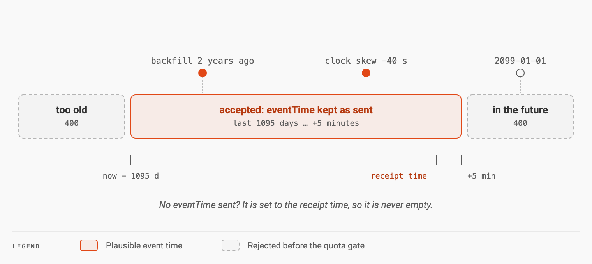

Every audit event answers the question "when?", but there are two different "whens": when the action happened, and when the audit system heard about it. Mix them up and your analytics go wrong quietly: a backfill of two years of history lands in today's chart, and a publisher with a wrong clock writes rows that are deleted the moment they arrive.

This post explains how [AuditFlow](/products/auditflow/), the Labs64.IO audit pipeline, separates the two times and protects itself against implausible ones, in one place at the front door. It is written for developers and data engineers who ingest events from many producers into analytics stores.

**After reading, you will know:**

- the difference between event time and processing (receipt) time,
- which jobs belong to each timestamp,
- why a client-supplied timestamp needs bounds, and how to choose them,
- why validation should run before quota and queueing.

## Background: event time and processing time

This is a classic distinction from stream processing:

- **Event time** is when something happened at the source. It is the publisher's claim, and what a report means by "when".
- **Processing time** (here *receipt time*) is when your system saw it. Only your own clock can provide it.

They differ because of network delays, offline clients, retries and backfills, sometimes by seconds, sometimes by years.

## The problem: client clocks decide where data lands

AuditFlow stores events in destinations such as ClickHouse, whose shipped table is partitioned and expired (TTL) by event time, because reports are about event time. That creates two risks:

- **A clock in the future** (a misconfigured publisher) writes rows into partitions far ahead and distorts every time-based report.
- **A very old event time** writes a row that is already older than the table's retention, so it is deleted on arrival: accepted, and silently gone.

On top of that, each downstream transformer used to carry its own "use `eventTime`, or else `timestamp`" fallback, three copies of the same rule.

## The solution in three parts

### Part 1: two timestamps, one job each

| | Event time | Receipt time |
|---|---|---|
| Field | `eventTime` | `timestamp` |
| Means | when the action happened at the source | when AuditFlow received the event |
| Set by | the publisher (optional) | AuditFlow only; a client value is ignored |
| Used for | reports, partitions, retention | arrival order, deduplication, archive date folders |

One class, `EventTimePolicy`, stamps both:

```java
public void stamp(AuditEvent event, OffsetDateTime receivedAt) {
    event.setTimestamp(receivedAt);
    if (event.getEventTime() == null) {
        event.setEventTime(receivedAt);
    }
}
```

A publisher that sends no `eventTime` gets the receipt time, so downstream code always finds the field set and needs no fallback.

### Part 2: a plausibility window for the client's clock

{:class="blog-center"}

AuditFlow keeps `eventTime` exactly as sent, but only if it is plausible relative to the receipt time; otherwise the event is rejected with `400`:

```java
if (eventTime.isAfter(receivedAt.plus(properties.getMaxFuture()))) {
    return "eventTime " + eventTime + " is in the future: ...";
}
if (eventTime.isBefore(receivedAt.minus(properties.getMaxAge()))) {
    return "eventTime " + eventTime + " is too old: ...";
}
```

The defaults encode real constraints:

```yaml
auditflow:
  event-time:
    max-future: PT5M     # clock skew between publisher and server
    max-age: P1095D      # oldest backfill accepted (the shipped ClickHouse retention)
```

Five minutes covers ordinary clock skew. 1095 days (three years) matches the shipped ClickHouse retention, so nothing is accepted that would expire on arrival. The error message names the limit and what to do.

### Part 3: validate before spending quota

The check runs before the tenant's quota gate, so a rejected event never costs quota:

```java
OffsetDateTime receivedAt = OffsetDateTime.now();
String eventTimeProblem = eventTimePolicy.violation(event, receivedAt);
if (eventTimeProblem != null) {
    throw new IllegalArgumentException(eventTimeProblem);
}

// Ingest gate: provisioning + per-tenant quota, BEFORE the event reaches the broker.
tenantGate.check(event.getTenantId());
```

In a batch request the check applies per event, so one bad event does not block its neighbours.

## The outcome

| Event | Before | After |
|---|---|---|
| No `eventTime` sent | downstream fallbacks, three copies | set to receipt time at ingest |
| `eventTime` in 2099 | stored, distorts reports | `400`, says "in the future" |
| `eventTime` 5 years ago | stored, deleted by TTL on arrival | `400`, says "too old" |
| Backfill 2 years ago | stored | stored, kept as sent |

Try it with the local stack from the [AuditFlow quick start](https://labs64.io/docs/modules/auditflow/#quick-start):

```bash
curl -sS -i -X POST http://localhost:8080/audit/publish \
  -H 'Content-Type: application/json' \
  -d '{"eventType":"demo.event","sourceSystem":"test","tenantId":"demo","eventTime":"2099-01-01T00:00:00Z"}'
```

The response is a `400` naming the five-minute limit. Remove `eventTime` and the event is accepted with the receipt time as its event time.

## Trade-offs

- **Old backfills are refused.** If you need to import history older than three years, raise `max-age` together with the destination's retention.
- **The window must follow your sinks.** `max-age` should not exceed the shortest retention among the destinations your tenants use.

## Apply it to your own ingest API

1. Give each timestamp one meaning: the client's event time and your own receipt time.
2. Let only the server set the receipt time; ignore client values for it.
3. Default a missing event time to the receipt time, once, at ingest.
4. Bound the client's event time: allow small clock skew into the future, and nothing older than your retention.
5. Validate before quota, queueing or any other cost.

## Key takeaways

- **Two clocks, two jobs:** event time for "when it happened" and reports; receipt time for order, deduplication and housekeeping.
- **A client-supplied timestamp is a claim.** Keep it, but do not let it decide anything it should not control.
- **Bounds should come from real limits:** clock skew for the future, retention for the past.
- **One policy at the door beats fallbacks everywhere.** Stamp and validate once; every consumer can then trust the fields.
- **Reject early and cheaply,** before quota and before the broker.

The field semantics are in the [AuditFlow docs](https://labs64.io/docs/modules/auditflow/#time-fields-event-time-and-receipt-time); the code is in [labs64.io-auditflow](https://github.com/Labs64/labs64.io-auditflow){:target="_blank"}{:rel="noopener nofollow"} (`EventTimePolicy.java`).
