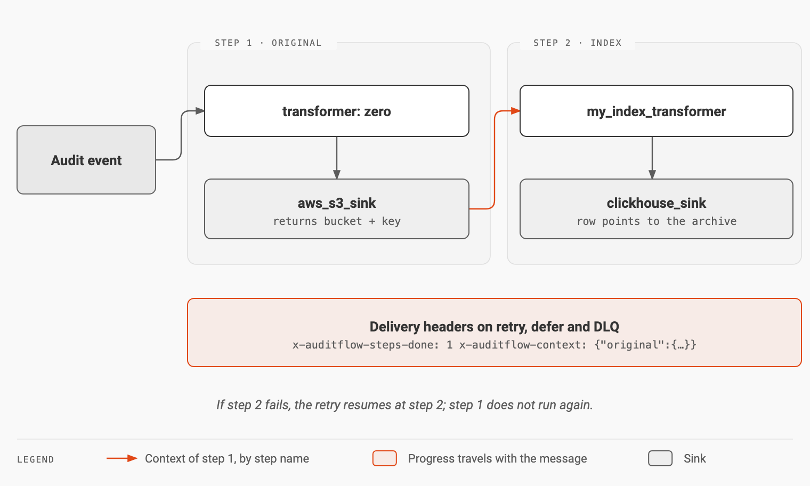

A common requirement in audit and compliance systems: keep the original event in cheap, immutable storage such as S3, and also put a searchable row into an analytics database that **points to** that archived object. The second write depends on the result of the first: you only know the object's key after the archive has written it.

This post shows how [AuditFlow](/products/auditflow/), the Labs64.IO audit pipeline, supports such dependent writes with ordered *pipeline steps*, and how it makes them safe to retry. It is written for developers and architects who build event pipelines with more than one destination per event.

**After reading, you will know:**

- why two independent pipelines are a poor fit for dependent writes,
- how ordered steps pass a result from one destination to the next,
- how carrying progress with the message makes retries resume at the failed step,
- how to stop publishers from forging the data passed between steps.

## Background: pipelines, transformers and sinks

In AuditFlow, a *pipeline* decides where an event goes. It runs one or more *transformers* (small Python modules that reshape the event) and hands the result to a *sink*, which writes it to a destination such as S3 or ClickHouse. Failed deliveries are retried over minutes and hours; events that keep failing go to the tenant's dead-letter queue (DLQ), from where they can be replayed.

## The problem: dependent writes in independent pipelines

Until recently a pipeline had exactly one shape: transformers, then one sink. To archive to S3 and also index in ClickHouse, you configured two independent pipelines:

- the transformations ran twice,
- the index pipeline had no way to learn where the archive pipeline had stored the object,
- and if you combined both writes in one custom sink, a failure in the second write repeated the first on every retry.

## The solution in three parts

{:class="blog-center"}

### Part 1: a pipeline can be an ordered list of steps

Each step has its own transformers and sink. This shape comes from the [pipeline docs](https://labs64.io/docs/modules/auditflow/configuring-pipelines/): archive the original first, then write an index row that points to it.

```yaml
pipelines:
  - name: archive
    enabled: true
    steps:
      - name: original
        transformer: { name: zero }
        sink: { name: aws_s3_sink, properties: { bucket: my-audit-archive } }
      - name: index
        transformer: { name: my_index_transformer }   # reads input_data["context"]["original"]["key"]
        sink: { name: clickhouse_sink }
```

A pipeline has either `steps` or the older single transformer and sink. A tenant file that mixes them, has a step without a sink, or reuses a step name is refused when it loads, so mistakes show up at deploy time.

### Part 2: sinks return a context for later steps

A sink may return a `context` object. The S3 sink returns the bucket and key it just wrote:

```python
"context": {"bucket": bucket, "key": object_key}
```

AuditFlow keeps what each finished sink returned, under the step's name, and passes it to later steps' transformers as a top-level `context` field: `{"original": {"bucket": "...", "key": "..."}}`. The context of one event may take up to 4 KiB; anything larger, or not a JSON object, is treated as poison and dead-lettered.

### Part 3: progress travels with the message

If step 2 of 3 fails and its retries run out, a replay that started over at step 1 would archive the object again and lose the context step 2 needed. So the progress travels on the message itself, in two headers:

```java
/** How many steps of a pipeline already succeeded for this event: a retry, a defer or
 *  a DLQ replay continues at the next one instead of repeating them. */
public static final String STEPS_DONE = "x-auditflow-steps-done";
/** The event's step context so far (JSON object), by step name. */
public static final String CONTEXT = "x-auditflow-context";
```

Both headers survive every re-publish path: retry, deferral and DLQ replay. A unit test covers the replay case (`aDlqReplayResumesAtTheFailedStep`), and the end-to-end suite checks that a delivery whose second step fails lands in the DLQ with `stepsDone: 1`.

Because `context` is a field on the event, a publisher could try to fake what an earlier step "returned". Two guards prevent that: ingest rejects any event with a non-empty `context` with `400` (an empty object, which generated clients send, is accepted and dropped), and AuditFlow never writes `context` when it serializes an event.

```bash
curl -sS -i -X POST http://localhost:8080/audit/publish \
  -H 'Content-Type: application/json' \
  -d '{"eventType":"t","sourceSystem":"s","tenantId":"demo","context":{"original":{"key":"forged"}}}'
# 400: context is reserved for AuditFlow and must not be set by a publisher
```

## The outcome

| | Two independent pipelines | One pipeline with steps |
|---|---|---|
| Index row knows the archive key | no | yes, via `context.original` |
| Transformations | run twice | run once per step |
| Step 2 fails, retry | repeats everything (if combined) | resumes at step 2 |
| DLQ replay | starts over | continues at the failed step |
| Publisher fakes step data | n/a | rejected with `400` |

## Trade-offs

- **Steps are coupled on purpose.** While the first sink is down, the second waits under the retry tiers. Destinations that do not depend on each other should stay separate pipelines.
- **One retry budget covers the whole pipeline.**
- **Delivery is at least once.** If the process dies between finishing a step and storing its outcome, that step can run again, so sinks should tolerate duplicates.
- **Dry runs cannot see context.** A dry run with `"transform": true` runs every step's transformers, but without calling sinks, so later steps run without a context; the report marks this with `withoutContext: true`.

## Apply it to your own pipeline

1. Model dependent writes as ordered steps in one unit, and independent destinations as separate units.
2. Let each step return a small, structured result, and pass it on by step name.
3. Store progress and context with the message, and copy them on every retry and replay path.
4. Reserve the field that carries step results, and reject it from external producers.
5. Make sinks idempotent, because at-least-once delivery will sometimes repeat a step.

## Key takeaways

- **Dependent writes need an order,** and the second write needs the first one's result.
- **Pass results forward by name,** small and structured, instead of re-deriving them.
- **Progress belongs to the message,** not to a process, so any retry or replay resumes where it stopped.
- **Data passed between steps must not be forgeable.** Reserve the field and reject it at ingest.
- **Couple only what depends on each other;** keep independent destinations independent.

The full rules, including batching behaviour, are in [Pipeline steps and the step context](https://labs64.io/docs/modules/auditflow/configuring-pipelines/); the implementation is in [labs64.io-auditflow](https://github.com/Labs64/labs64.io-auditflow). The S3 sink used in step 1 is the subject of [When S3 hangs](/blog/2026/11/14/auditflow-s3-sink-budget/).
