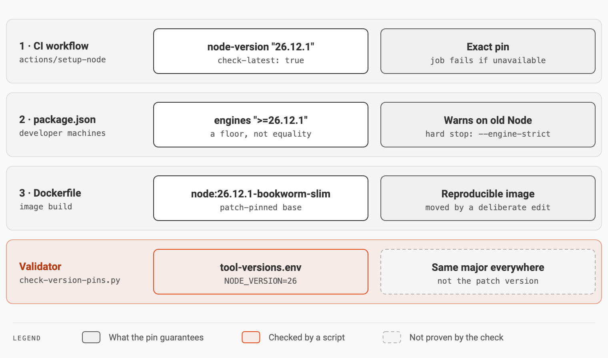

When a serious vulnerability is announced in a runtime, the fix usually looks like one line: bump the version. The harder question comes a few weeks later. Is every build still using the patched version? Or did a CI runner with a cached older toolchain, a contributor's old laptop, or a Dockerfile nobody touched quietly bring the vulnerable version back?

This post shows how Labs64.IO pinned a patched Node.js release after [CVE-2026-111497](https://helpnetsecurity.com/2026/10/27/node2shell-broccoli2shell-vulnerability-cve-2026-111497), and is honest about what each pin does and does not guarantee. It is written for DevOps engineers, security leads and frontend teams responsible for keeping runtimes patched across several repositories.

**After reading, you will know:**

- the three places where a runtime version can drift,
- how to pin a patched version in CI, in `package.json` and in Docker images,
- what a cross-repository validator can prove, and what it cannot,
- a quick way to find risky floating versions in your own workflows.

## Background: the CVE

Node.js disclosed an out-of-bounds write in the Brotli decoder it bundles. Published reports describe it as a remote code execution risk for servers that decompress Brotli data from untrusted sources; the Node.js 26 line was fixed in 26.12.1. Check the Node.js security advisory for affected versions before you act on your own setup.

## The problem: one runtime, three places to drift

The Labs64.IO Checkout and Customer Portal frontends run Node.js in three contexts, and each can fall behind independently:

1. **CI.** The workflow used a floating major (`node-version: "26"`), which resolves to whatever 26.x the runner has cached, possibly older than the patch.
2. **Developer machines.** A contributor running `npm run dev` on an old Node would never notice.
3. **Docker builds.** The image is built from whatever base image the Dockerfile names.

## The solution in three pins and one check

{:class="blog-center"}

### Pin 1: CI names the exact patched version

```yaml
- name: Set up Node
  uses: actions/setup-node@v7
  with:
    node-version: "26.12.1"
    check-latest: true  # the runner's cached Node can lag the patch release (CVE-2026-111497)
    cache: npm
```

With an exact version and `check-latest`, a runner that cannot provide 26.12.1 fails the job visibly instead of building with an older runtime. Both frontend workflows use the same version.

### Pin 2: `package.json` declares a floor

```json
"engines": {
  "node": ">=26.12.1"
}
```

A floor, not an exact match, so the next patch release works without another emergency change. npm only refuses an older Node in engine-strict mode (`npm install --engine-strict`, or `engine-strict=true` in `.npmrc`); otherwise it warns.

### Pin 3: Docker images use a patch-pinned base

```dockerfile
FROM node:26.12.1-bookworm-slim AS builder
```

Builds are reproducible, and moving to the next patch is a visible, reviewed edit.

### The check: a validator for the runtime line

The workspace repository holds the ecosystem's toolchain file, `tool-versions.env`, where `NODE_VERSION=26` is deliberately a *major* version: moving a language runtime is an ecosystem-wide decision. The cross-repository validator, `scripts/check-version-pins.py`, compares Dockerfile base images with that file. Because a patch-pinned image (`26.12.1`) can never equal a major (`26`), Node images are reduced to their major before comparison, while Java and Python images are compared as written:

```python
for image, tool, normalize in (
    (r"eclipse-temurin", "JAVA_VERSION", lambda version: version),
    (r"python", "PYTHON_VERSION", lambda version: version),
    (r"node", "NODE_VERSION", major),
):
    for found in re.findall(rf"^FROM\s+{image}:([0-9.]+)", dockerfile.read_text(), re.M):
        if normalize(found) != tools.get(tool):
            fail(f"{rel}: base image {image}:{found}, but tool-versions.env {tool}={tools.get(tool)}")
```

## The outcome

| Where Node runs | Before | After | Guarantees |
|---|---|---|---|
| CI | floating `"26"` | exact `26.12.1`, `check-latest` | job fails if the patch is unavailable |
| Developer machines | anything | `engines >=26.12.1` | warning, or a hard stop with engine-strict |
| Docker image | as written | `node:26.12.1-bookworm-slim` | reproducible, patched base |
| Across repositories | unchecked | `just check-pins` | every image on the Node 26 line |

Be precise about the last row: the validator proves that every Dockerfile is on the runtime line the toolchain declares. It does **not** prove the patch version; that comes from the pins themselves. On the current master, `just check-pins` ends with `check-version-pins: clean — every shared pin agrees`.

## Trade-offs

- **Exact pins need deliberate updates.** The next Node patch means editing three files; that is the price of never moving by accident.
- **A floor in `engines` is soft by default.** Without engine-strict mode it only warns.

## Apply it to your own repositories

1. Find floating major versions in your workflows:

   ```bash
   grep -rn 'node-version' .github/workflows/ | grep -E 'node-version: *"?[0-9]+"?$'
   ```

2. Pin the patched version in CI, with `check-latest: true`.
3. Add an `engines` floor to `package.json`, and consider `engine-strict`.
4. Pin Docker base images to the patch version.
5. Add a check across repositories, and write down exactly what it proves.

## Key takeaways

- **Patching is one line; staying patched is a process.** A runtime runs in CI, on laptops and in images, and each can drift.
- **Floating versions are where regressions hide.** A cached runner can satisfy `"26"` with an unpatched release.
- **Use the right kind of pin for each place:** exact in CI and images, a floor for developers.
- **Validators prove what they compare, nothing more.** A major-line check does not prove a patch level.
- **Say what each control guarantees.** Knowing the limits is what lets you trust the rest.

The workflows and manifests are in [labs64.io-checkout](https://github.com/Labs64/labs64.io-checkout) and [labs64.io-customer-portal](https://github.com/Labs64/labs64.io-customer-portal); the validator is in [labs64.io-workspace](https://github.com/Labs64/labs64.io-workspace). For how the workspace ties the repositories together, see [A dozen repositories, one command](/blog/2025/12/28/labs64-workspace-tooling/).
