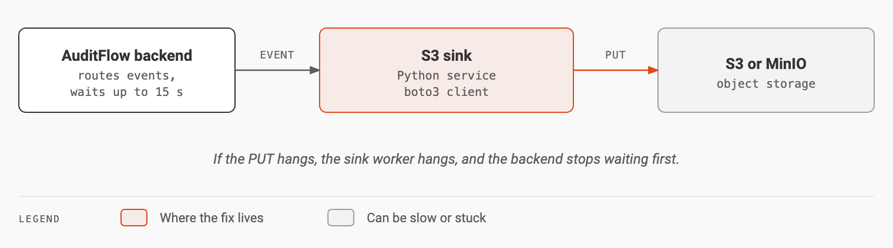
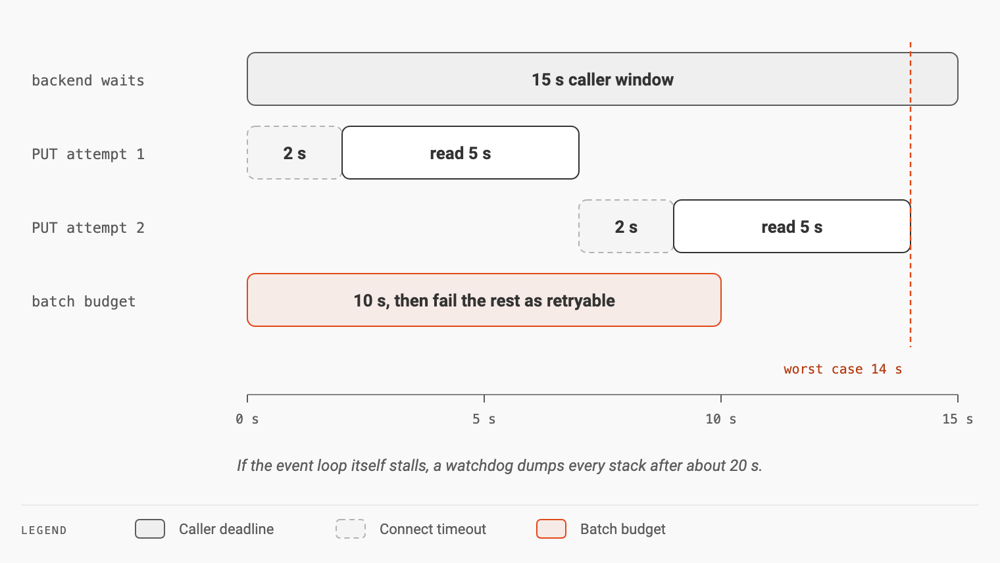

Most services call other services, and most of those calls have two timeouts: the one *your caller* is willing to wait, and the one *your client library* is willing to wait. When the second is longer than the first, a single slow dependency can quietly freeze your service, and the logs will not tell you why.

This post tells the story of exactly that problem in the S3 archive of [AuditFlow](/products/auditflow/), the Labs64.IO audit pipeline, and how we fixed it. It is written for developers and operators who run Python services that write to S3 or any S3-compatible storage (MinIO, Ceph, cloud equivalents), but the rule behind it applies to every network client.

**After reading, you will know:**

- why library default timeouts are dangerous when someone else is waiting for you,
- how to calculate client timeouts and retries from your caller's deadline,
- how to keep a batch of writes from running past that deadline,
- how to make a hung Python process print where it is stuck.

## Background: who waits for whom

AuditFlow receives audit events and delivers them to destinations called *sinks*. One of them archives events to S3. The delivery chain looks like this:

{:class="blog-center"}

The Java backend sends an event to the sink service and **waits up to 15 seconds** for an answer. If no answer arrives in time, it treats the delivery as failed and schedules a retry later. The sink service is a small Python application that uses `boto3`, the AWS SDK for Python, to write the object.

## The problem: a hang nobody could explain

Under normal conditions, a PUT to S3 takes milliseconds. But networks fail in unpleasant ways: a proxy accepts the connection and then never answers, a MinIO node stalls, a DNS change leaves a half-open socket behind.

In those cases the backend gave up after 15 seconds and logged `no answer within 15000ms`. That was the only clue. The sink, however, was still waiting, and it kept waiting much longer, because it was using the library's defaults:

| Who waits | How long |
|---|---|
| AuditFlow backend (the caller) | 15 seconds |
| botocore default connect timeout | 60 seconds |
| botocore default read timeout | 60 seconds |
| botocore retries | additional attempts on top |

So one stuck connection could hold a sink worker for minutes. Every event queued behind it on that worker ran into the backend's 15-second limit as well, and was retried later, adding load exactly when the system was struggling. And nothing in the sink's own logs said what it was waiting for.

The root cause is simple: **the sink's worst case was longer than its caller's patience.**

## The solution in three parts

We changed three things in the S3 sink, each closing one gap:

1. **A per-call ceiling:** explicit connect, read and retry settings, so the worst case of one PUT fits inside 15 seconds.
2. **A batch budget:** a batch of writes stops starting new ones when its time is up, and hands the rest back for a retry.
3. **A watchdog:** if the whole process hangs anyway, it prints every thread's stack before Kubernetes restarts it.

### Part 1: a per-call ceiling that fits the caller

Instead of trusting the defaults, the sink declares its own limits, with the reasoning next to them:

```python
# AuditFlow waits 15 s for a call to the sink. botocore's own defaults (60 s to connect and to read, retries on
# top) would let one stuck connection hold a worker for minutes, so a PUT gives up after about 14 s at the
# most, and a batch stops starting new PUTs once its budget is used: what is left is failed as retryable.
_CONNECT_TIMEOUT_SECONDS = 2
_READ_TIMEOUT_SECONDS = 5
_MAX_ATTEMPTS = 2
_BATCH_BUDGET_SECONDS = 10
```

They are passed to the boto3 client:

```python
Config(connect_timeout=_CONNECT_TIMEOUT_SECONDS, read_timeout=_READ_TIMEOUT_SECONDS,
       retries={'max_attempts': _MAX_ATTEMPTS, 'mode': 'standard'})
```

The numbers come from simple arithmetic: two attempts × (2 seconds to connect + 5 seconds to read) = **14 seconds in the worst case**, one second inside the backend's 15-second window. A slow but healthy S3 still has time to answer; a stuck one is cut off before the caller gives up. The `standard` retry mode keeps exponential backoff for throttling errors.

### Part 2: a time budget for batches

The sink can also receive several events at once and write them in groups, one S3 key prefix per group. Even with Part 1, a batch with several slow groups could add up to more than 15 seconds. So each group now checks a deadline before it starts:

```python
deadline = time.monotonic() + _BATCH_BUDGET_SECONDS
for key_prefix, indexes in groups.items():
    if time.monotonic() > deadline:
        for i in indexes:
            outcomes[i] = RuntimeError("Batch time budget used up before this group was written")
        continue
```

Three details make this safe:

- **The clock:** `time.monotonic()` never jumps when the system time is corrected, so the deadline is reliable.
- **The budget:** 10 seconds leaves room for the group that is already running to finish within the 15-second window.
- **The error type:** the remaining events fail with a `RuntimeError`, which AuditFlow treats as *retryable*. A `ValueError` would mean "bad data, do not retry". A test pins this, using a fake clock so it runs without any sleeps.

Nothing is lost: the events that did not fit are simply delivered on the next attempt.

### Part 3: a watchdog for when the process itself hangs

Timeouts cover outgoing calls. But the sink's event loop can also get stuck, for example in a library call that ignores timeouts. Kubernetes would eventually restart the container, but a restart without a stack trace teaches you nothing.

Python's `faulthandler` module can print the stack of every thread from a separate watchdog thread, even when the main loop is completely blocked. The sink re-arms that timer every few seconds:

```python
_WATCHDOG_REARM_SECONDS = 5
_WATCHDOG_DUMP_AFTER_SECONDS = 20


async def _event_loop_watchdog():
    while True:
        faulthandler.dump_traceback_later(_WATCHDOG_DUMP_AFTER_SECONDS, repeat=False)
        await asyncio.sleep(_WATCHDOG_REARM_SECONDS)
```

While the loop is healthy, the timer is reset before it fires. If the loop stops, the dump fires roughly 15 to 25 seconds later, before the container restart, so the stacks land in the logs. The watchdog starts and stops with the FastAPI application (`lifespan` hook), and `faulthandler.enable()` also prints stacks on hard crashes.

## The outcome

{:class="blog-center"}

| | Before | After |
|---|---|---|
| Worst case for one PUT | minutes (60 s connect + 60 s read, plus retries) | 14 seconds |
| Fits the backend's 15 s window | no | yes |
| A slow batch | could run past the window | stops at 10 s, rest retried |
| Events behind a stuck connection | blocked, then timed out | not blocked |
| A hung process | restarted, no clue why | stack trace in the logs first |

In short: a stuck S3 connection now costs one delivery attempt, which AuditFlow retries, instead of a frozen worker and a log line that explains nothing.

## Trade-offs

- **Very large objects** need more than 5 seconds to upload over a slow link. AuditFlow writes small JSON objects, so the limits fit. If you store large files, raise the read timeout and the caller's window together.
- **Fewer retries inside the sink** means more retries at the AuditFlow level. That is intended: those retries are spread out over minutes and hours, instead of piling up inside one request.

## Apply it to your own service

1. Find out how long your caller waits (HTTP client timeout, queue visibility timeout, gateway timeout).
2. Find every client library you call while the caller waits, and look up its default timeouts and retries.
3. Set them explicitly so that `attempts × (connect + read)` stays below the caller's limit.
4. Give loops and batches a deadline measured with a monotonic clock, and make overruns retryable.
5. Add a way for a hung process to print its stacks (`faulthandler` in Python, thread dumps in Java).

## Try it

```bash
git clone https://github.com/Labs64/labs64.io-auditflow.git
cd labs64.io-auditflow/auditflow-sink
python3 -m venv .venv && . .venv/bin/activate
pip install -r requirements-dev.txt
python -m pytest tests/test_sink_batch.py -k budget -v
```

## Key takeaways

- **Two deadlines meet at every call.** Your caller's timeout and your client library's timeout are independent settings, and nothing aligns them for you.
- **Library defaults are not your deadline.** botocore waits up to 60 s to connect and 60 s to read, plus retries; AuditFlow's backend waits 15 s. Defaults like these turn one stuck connection into a frozen worker.
- **Budget the worst case, not the average.** Attempts × (connect + read) must stay below the caller's window: here 2 × (2 s + 5 s) = 14 s < 15 s.
- **Loops need deadlines too.** A batch checks a monotonic-clock budget before each group and hands unfinished work back as *retryable*, so nothing is lost and nothing overruns.
- **Make hangs explain themselves.** A `faulthandler` watchdog prints every thread's stack before Kubernetes restarts the process, which turns "it restarted" into "it was stuck here".

The S3 sink is documented with the other destinations in the [AuditFlow sink catalogue](https://labs64.io/docs/modules/auditflow/sinks-and-transformers/). For the other half of AuditFlow's concurrency story, see [Bounded waits beat fail-fast](/blog/2026/09/02/auditflow-bounded-waits-concurrency/).
