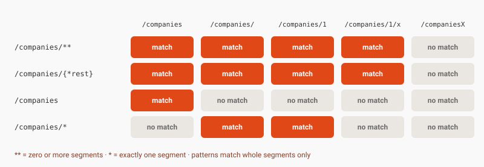

A gateway route is a promise: "everything under this path goes to that service". The promise breaks in small ways. A request for `/companies` returns 404 while `/companies/42` works, or the other way round, and the route looks right in the YAML.

This post answers one precise question that many developers type into a search box: **does the Spring Cloud Gateway predicate `Path=/companies/**` match the bare path `/companies`?** We checked the answer by running the matcher instead of quoting from memory. The post is written for developers and architects who put a Spring Cloud Gateway in front of several services and want routing rules they can predict.

**After reading, you will know:**

- what `Path=/companies/**` matches and what it does not,
- what changed for trailing slashes between Spring Framework 6 and 7,
- how `StripPrefix` and `RewritePath` change the path the backend sees,
- a short checklist for debugging a route that returns 404.

## Background: what a Path predicate is

Spring Cloud Gateway sends each request through routes. A route has an id, a target `uri`, a list of **predicates** (conditions) and a list of **filters** (changes to the request or response). A route is chosen when its predicates match, and only then do its filters run.

The `Path` predicate is the one almost every route uses. According to the [Gateway reference](https://docs.spring.io/spring-cloud-gateway/reference/spring-cloud-gateway-server-webflux/request-predicates-factories.html){:target="_blank"}{:rel="noopener nofollow"}, it takes a list of Spring path patterns and an optional flag `matchTrailingSlash`, which defaults to `true`. A minimal route:

```yaml
spring:
  cloud:
    gateway:
      server:
        webflux:
          routes:
            - id: companies
              uri: http://companies-service:8080
              predicates:
                - Path=/companies/**
```

The patterns are Spring's `PathPattern` syntax: `*` matches one path segment, `**` matches zero or more segments, and `{name}` captures a segment. The property prefix `spring.cloud.gateway.server.webflux` is the one used in the current reference; older versions used `spring.cloud.gateway.routes` (see [the property migration](/blog/2027/02/15/spring-cloud-gateway-server-webflux-properties/)).

## The problem: the same route, surprising answers

Three symptoms bring people to this question:

- `/companies` returns 404 although the route says `/companies/**`,
- `/companies/` and `/companies` behave differently in different environments,
- the backend receives a path nobody expected after a prefix filter.

Each has a different cause, and guessing is slow. The faster route is to separate the three decisions a gateway makes: **does the pattern match, did a different route win, and what path is forwarded?**

## The solution: test the pattern, then trace the route

### Part 1: what the pattern matches

We ran Spring's `PathPatternParser` directly, with its default settings, against several request paths. This is the matcher the Path predicate is built on, so it shows the pattern semantics without a gateway in the way. We ran it on Spring Framework 6.2.9 and 7.0.8 and the results were identical.

{:class="blog-center"}

| Pattern | `/companies` | `/companies/` | `/companies/1` | `/companies/1/x` | `/companiesX` |
| --- | --- | --- | --- | --- | --- |
| `/companies/**` | yes | yes | yes | yes | no |
| `/companies/{*rest}` | yes | yes | yes | yes | no |
| `/companies` | yes | no | no | no | no |
| `/companies/*` | no | yes | yes | no | no |

Three things stand out:

- `/companies/**` **does** match `/companies`. The `**` stands for zero or more segments, so the bare path counts.
- `/companies/*` is the strict variant: it needs exactly one more segment (an empty one after a slash counts), so `/companies` alone does not match.
- `/companiesX` never matches. A pattern matches whole segments, never a prefix of a segment.

If `/companies` returns 404 even though the pattern matches, the pattern is not the cause. Look at the next two parts.

### Part 2: trailing slashes changed in Spring 7

The Gateway reference says `matchTrailingSlash` defaults to `true`, and that with `false` the path `/red/1/` no longer matches `/red/{segment}`. In our run on Spring Framework 6.2.9, `PathPatternParser` has the method `setMatchOptionalTrailingSeparator`. On 7.0.8 that method no longer exists, and the pattern `/companies` does not match `/companies/`.

We did not run a full Gateway on Spring Boot 4 for this post, so do not read this as a statement about the gateway flag. Read it as a warning: if you move from Spring Boot 3 to 4, retest the trailing-slash cases of every route that matters, `/x` and `/x/`, in both directions. Patterns that use `**` were unaffected in our run.

### Part 3: what the backend sees

A matching route can still deliver a surprising path, because filters rewrite it after the match. Two filters cover most cases, and both are documented with examples.

`StripPrefix` removes a number of leading path parts. The reference example uses `Path=/name/**` with `StripPrefix=2`: a request to `/name/blue/red` reaches the service as `/red`.

`RewritePath` takes a Java regular expression and a replacement. In the reference, `RewritePath=/red/?(?<segment>.*), /$\{segment}` turns `/red/blue` into `/blue`. The backslash before `$` is a YAML detail, not part of the regular expression.

The rule that avoids most confusion: **write the predicate for what clients send, and the filter for what the service expects.** Keep both visible in one route:

```yaml
- id: companies
  uri: http://companies-service:8080
  predicates:
    - Path=/api/companies/**
  filters:
    - StripPrefix=1
```

With `StripPrefix=1`, `/api/companies/42` reaches the service as `/companies/42`. If the service itself serves under `/api`, remove the filter instead of adding a second one. The pattern for managing such prefixes at the gateway is described in [Let the gateway own your API version prefix](/blog/2025/11/15/auditflow-traefik-versioning/).

### Part 4: a 404 debugging checklist

Work through these in order. Each step narrows the question.

1. **Is the route loaded?** The `/gateway` actuator endpoint is off by default. Enable it with `management.endpoint.gateway.access=read-only` and `management.endpoints.web.exposure.include=gateway`, then call `/actuator/gateway/routes`. The reference lists this endpoint, plus `/actuator/gateway/routedefinitions` and `/actuator/gateway/routepredicates`. Prefer `read-only`: the reference warns that `unrestricted` allows creating, refreshing and deleting routes over HTTP, so those endpoints must be secured.
2. **Does the pattern match?** Compare your request path against the table above. Check the case of segments and the leading slash.
3. **Did another route match first?** List the routes and look for a broader predicate that also matches. We did not verify the evaluation order in the reference for this post, so check the routes list and the `order` of each route in your own setup rather than assuming.
4. **What did the filters do to the path?** Turn on logging. The reference names `org.springframework.cloud.gateway` and `reactor.netty` as the loggers that carry troubleshooting information at DEBUG and TRACE. For raw requests, set `spring.cloud.gateway.httpclient.wiretap=true` and `spring.cloud.gateway.httpserver.wiretap=true` with `reactor.netty` at DEBUG or TRACE.
5. **Does the backend serve that path?** Call the service directly with the path the filters produce. A 404 from the service is the service's answer, not the gateway's.

## The outcome

| Question | Before | After |
| --- | --- | --- |
| Does `/companies/**` match `/companies`? | "Probably" | Yes, verified on Spring Framework 6.2.9 and 7.0.8 |
| Strict one-segment match | Unclear | `/companies/*` |
| Trailing slash | Assumed stable | Retest when moving to Spring Boot 4 |
| 404 on a route | Guess and redeploy | Five ordered checks, three of them without code changes |

## Trade-offs

- `**` is forgiving: `/companies/**` also routes `/companies/1/x/y`. That is convenient, but it means the backend must reject paths it does not serve.
- Several broad patterns across routes make ordering matter. Keep predicates specific and add a path prefix per service.
- Exposing the `/gateway` actuator endpoint helps debugging, and it also publishes your routing table. Restrict it to internal networks.

## Apply it to your own gateway

- Write one test per important route for `/x`, `/x/` and `/x/1`, and run it on every framework upgrade.
- Choose `/x/**` when the bare path should route too, and `/x/*` when it should not.
- Put `StripPrefix` or `RewritePath` next to the predicate and document the path the backend receives.
- Enable `read-only` actuator access in non-production environments and look at the routes list before you read logs.

## Key takeaways

- `Path=/companies/**` matches `/companies`, `/companies/` and everything below; it does not match `/companiesX`.
- `/companies/*` is the pattern for "exactly one more segment".
- Trailing-slash handling differs between Spring Framework 6.2 and 7.0 in `PathPatternParser`; retest after upgrading.
- `StripPrefix` and `RewritePath` decide what the backend sees; the predicate decides only whether the route is chosen.
- Debug in order: route loaded, pattern matches, no earlier route wins, filters, backend.

## Related reading

- [Spring Cloud Gateway Routing: Predicates, Filters and Path=/** in Practice](/blog/2025/07/30/spring-cloud-gateway-routing/)
- [Spring Cloud Gateway rate limiting with Redis](/blog/2025/07/14/protect-api-with-requestratelimiter/)
- [Spring Cloud Gateway reference: Path Route Predicate Factory](https://docs.spring.io/spring-cloud-gateway/reference/spring-cloud-gateway-server-webflux/request-predicates-factories.html){:target="_blank"}{:rel="noopener nofollow"}
