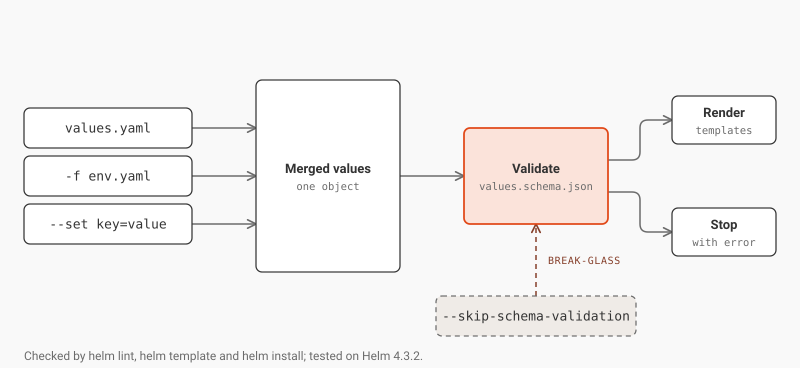

A Helm chart is configured through `values.yaml`, and that file is a contract that nobody enforces. A typo in a key is silently ignored, a string where a number belongs produces a confusing template error, and a bad value reaches the cluster before anyone notices.

Helm has had a built-in answer for years: put a file named **`values.schema.json`** next to `values.yaml`, and Helm checks every set of values against it. This post explains what that check does, shows the error messages it produces, and covers the parts that surprise people: `$ref`, subcharts, and how to switch validation off. Every example below was run on Helm 4.3.2. It is written for chart authors, platform engineers and the architects who define what a "supported configuration" of a chart is.

**After reading, you will know:**

- what Helm validates, and with which commands,
- how to express required keys, enums, ranges and conditional rules,
- what works and what fails with `$ref`, including a network-access side effect,
- how subchart schemas interact with the parent chart,
- how to generate the file instead of writing it, and how to check it in CI.

## Background: what Helm does with the file

When a chart contains `values.schema.json`, Helm validates the final, merged values (chart defaults, `-f` files and `--set` overrides) against it. The Helm documentation lists the commands that do this, and we confirmed `lint`, `template` and `install --dry-run=client`. A failed check stops the command with the path of the offending value:

```text
Error: values don't meet the specifications of the schema(s) in the following chart(s):
demo:
- at '/mode': value must be one of 'dev', 'prod'
```

The schema language is JSON Schema. Our first test used the 2020-12 `$schema` URI and a second one used draft-07; both were accepted by Helm 4.3.2.

{:class="blog-center"}

## The problem: a contract nobody enforces

Without a schema, three failures are common:

- **Typos disappear.** `replicaCout: 3` is just an extra key, and the chart keeps its default.
- **Wrong types fail late,** inside a template, with an error about the template rather than the value.
- **Invalid combinations deploy.** TLS is enabled, but no secret name was given.

The fix is to move these rules out of the heads of the chart authors and into a file that machines check.

## The solution: a schema that Helm enforces

### Part 1: the basic rules

This is the chart we used, reduced to the essentials:

```json
{
  "$schema": "https://json-schema.org/draft/2020-12/schema",
  "type": "object",
  "required": ["mode", "replicas"],
  "additionalProperties": false,
  "properties": {
    "mode": { "type": "string", "enum": ["dev", "prod"] },
    "replicas": { "type": "integer", "minimum": 1, "maximum": 10 },
    "tls": {
      "type": "object",
      "properties": {
        "enabled": { "type": "boolean" },
        "secretName": { "type": "string" }
      }
    }
  }
}
```

With `values.yaml` containing `mode: dev` and `replicas: 1`, `helm lint` passed. These overrides failed, with the messages Helm printed:

| Command | Message |
| --- | --- |
| `--set mode=staging` | `at '/mode': value must be one of 'dev', 'prod'` |
| `--set replicas=abc` | `at '/replicas': got string, want integer` |
| `--set replicas=11` | `at '/replicas': maximum: got 11, want 10` |
| `--set foo=1` | `at '': additional properties 'foo' not allowed` |

`additionalProperties: false` is what turns typos into errors. Use it deliberately: it also rejects keys that a parent chart passes in, such as `global`, unless you list them.

### Part 2: conditional rules with `if` and `then`

A rule such as "when TLS is on, a secret name is required" is a conditional. We added this to the root of the schema:

```json
"if": {
  "properties": { "tls": { "properties": { "enabled": { "const": true } }, "required": ["enabled"] } },
  "required": ["tls"]
},
"then": { "properties": { "tls": { "required": ["secretName"] } } }
```

`helm template r . --set tls.enabled=true` then failed with `at '/tls': missing property 'secretName'`.

### Part 3: `$ref`, and what does not work

A schema can reuse a definition inside the same file. This worked on Helm 4.3.2:

```json
{
  "$defs": { "port": { "type": "integer", "minimum": 1, "maximum": 65535 } },
  "properties": { "api": { "type": "object", "properties": { "port": { "$ref": "#/$defs/port" } } } }
}
```

`--set api.port=70000` failed with `at '/api/port': maximum: got 70,000, want 65,535`.

References to **other files and URLs** behave differently, and we tested both:

- A reference to a sibling file, `"$ref": "port.json"`, failed with `failing loading "file:///port.json": open /port.json: no such file or directory`. Helm resolved it against the filesystem root, not the chart directory.
- A reference to an `https://` URL made Helm attempt an HTTP request during validation (our test host did not exist and the error said so). A chart that references a remote schema therefore needs network access every time it is linted or installed, and a remote change can change the validation result.

The practical rule: keep `$ref` inside the same file, or let a generator bundle external references into `$defs` before you commit. The `helm-values-schema-json` plugin documents a `--bundle` option for this, and a `bundle` subcommand that "resolves every `$ref` in the file" and stores the subschemas inside `$defs`. We did not run that plugin for this post.

### Part 4: subcharts

Each chart in a dependency tree can have its own `values.schema.json`. In our test the parent had a schema for `api.port`, and a subchart called `sub` had its own schema limiting `port` to 9500. Setting `--set sub.port=9600` failed, and Helm named the **subchart** in the message:

```text
sub:
- at '/port': maximum: got 9,600, want 9,500
```

So a parent chart cannot override a subchart's own constraints by being permissive. If you use `additionalProperties: false` in a parent chart with dependencies, list the subchart keys (and `global`) in its `properties`, or the parent will reject them.

### Part 5: skipping validation, and linting overrides

For an emergency, `--skip-schema-validation` exists. With `--set mode=staging` and the flag, `helm template` rendered `mode: "staging"` without complaint. Treat it as a break-glass option and say so in your runbooks.

`helm lint` accepts value files, so you can test environment overrides: `helm lint . -f bad.yaml` reported both an `[ERROR] values.yaml` line and the schema failure for the templates.

### Part 6: generate the schema instead of writing it

Hand-written schemas drift from `values.yaml`. Two maintained tools generate the file from your values and from annotations in comments:

- [`dadav/helm-schema`](https://github.com/dadav/helm-schema) uses `# @schema` comment blocks and offers `--check`, which, per its README, exits non-zero when a schema is missing or stale without writing files.
- [`losisin/helm-values-schema-json`](https://github.com/losisin/helm-values-schema-json) is a Helm plugin that generates the file from one or more values files, supports drafts 4, 6, 7, 2019 and 2020 (2020 by default), and offers `--bundle` and `--no-additional-properties`.

For a comparison of these and `helm-docs`, see [helm-docs vs helm-schema](/blog/2026/12/21/helm-docs-vs-helm-schema/). Two cautions we verified from the project READMEs on 25 Nov 2026: Helm 4.2 and later verify plugin signatures by default, so installing a plugin directly from a git URL fails unless you pass `--verify=false` or install a signed release tarball; and the repository named in our older post, `ludwigprandtl/helm-schema`, no longer exists (the GitHub API returns 404), so use one of the two above.

### Part 7: check it in CI

Three steps cover the contract:

```bash
helm lint charts/mychart -f ci/values-prod.yaml
helm template mychart charts/mychart -f ci/values-prod.yaml > /dev/null
helm-schema -c charts/mychart --check      # if you generate the schema (dadav/helm-schema)
```

The first two prove that each environment's values satisfy the schema. The third proves that the committed schema matches `values.yaml`. Keep one values file per environment in the repository, so that this check covers what is actually deployed.

## The outcome

| Question | Before | After |
| --- | --- | --- |
| Typo in a key | Silently ignored | `additional properties 'foo' not allowed` |
| String instead of integer | Template error, cause unclear | `got string, want integer` at the value path |
| TLS on without a secret | Deploys, fails at runtime | `missing property 'secretName'` |
| Subchart limits | Discovered in production | Reported with the subchart name |

## Trade-offs

- A strict schema is a second interface to maintain; every new value needs a rule. Generating it from annotations reduces the cost.
- `additionalProperties: false` catches typos, and also blocks legitimate pass-through keys. Decide per object.
- Validation covers shape, not meaning: a valid port can still be the wrong port.
- Remote `$ref` adds a network dependency to every lint and install; avoid it.

## Apply it to your own charts

- Add a schema with `required`, `type` and `enum` for the five values that cause most incidents.
- Add `additionalProperties: false` to leaf objects first, then widen.
- Keep every `$ref` local, or bundle references before committing.
- Run `helm lint -f` for each environment's values file in CI.
- Pin the generator version in CI, and install plugins from signed releases on Helm 4.2 or later.

## Key takeaways

- Helm validates merged values against `values.schema.json` during `lint`, `template` and install commands.
- Errors name the exact value path; `additionalProperties: false` turns typos into errors.
- Use local `$ref` only: a sibling file reference failed on Helm 4.3.2 and a URL reference triggers an HTTP request at validation time.
- Subchart schemas are enforced and reported by chart name.
- Generate the schema from annotations and check it in CI rather than hand-editing it.

## Related reading

- [Automated Helm chart documentation and schema generation](/blog/2025/06/16/helm-chart-documentation/)
- [helm-docs vs helm-schema](/blog/2026/12/21/helm-docs-vs-helm-schema/)
- [Helm documentation: schema files](https://helm.sh/docs/topics/charts/#schema-files){:target="_blank"}{:rel="noopener nofollow"}
