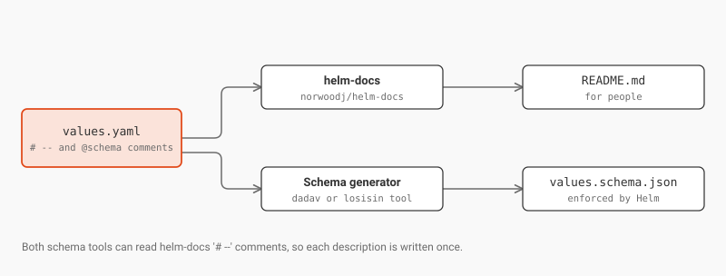

Search for "helm docs generator" or "helm schema plugin" and you meet several tools with similar names. They solve two different problems, and picking the wrong one costs an afternoon: one writes a README, another writes a validation file, and a third has not been updated since 2021.

This post sorts them out. We ran `helm-docs` locally and read the current README of every tool, with the repository status taken from the GitHub API on 25 Nov 2026. It is written for chart maintainers and for architects who set the documentation and validation standard for a set of charts.

**After reading, you will know:**

- which tool writes documentation and which writes the schema,
- how one comment style can feed both,
- which of the tools is actively maintained,
- how to wire them into a pre-commit hook and a CI pipeline.

## Background: two artifacts from one values file

A chart's `values.yaml` is its public interface. Two different consumers read it:

- **People** need a table: key, type, default, description. That is documentation.
- **Helm** needs rules: types, ranges, required keys. That is `values.schema.json`, and [it is enforced on `lint`, `template` and install](/blog/2026/12/14/helm-values-schema-json/).

Writing both by hand means writing every key three times (YAML, README, JSON), and they drift apart. The tools below generate one or the other from the values file and its comments.

{:class="blog-center"}

## The problem: similar names, different jobs

| Tool | Output | Repository status (GitHub API, 25 Nov 2026) |
| --- | --- | --- |
| `norwoodj/helm-docs` | `README.md` | Last release v1.14.2, 8 Jul 2024; last push 22 Jun 2026; licence GPL-3.0 |
| `dadav/helm-schema` | `values.schema.json` | Release 0.24.0, 18 Oct 2026; pushed 23 Nov 2026; MIT |
| `losisin/helm-values-schema-json` | `values.schema.json` | Release v2.6.1, 15 Nov 2026; pushed 20 Nov 2026; MIT |
| `karuppiah7890/helm-schema-gen` | `values.schema.json` | Archived; last release 0.0.4, 24 Dec 2020 |

Two further facts from our checks: the repository `ludwigprandtl/helm-schema`, which some older guides (including ours) name, returns 404, and `helm-schema-gen` is marked archived. Do not start a new project on either.

## The solution: pick one tool per artifact

### Part 1: `helm-docs` for the README

`helm-docs` reads `values.yaml`, `Chart.yaml` and an optional template, and writes a `README.md`. Comments beginning with `# --` become descriptions. We ran version 1.14.2 on this values file:

```yaml
# -- Deployment mode, `dev` or `prod`
mode: dev
# -- (int) Number of replicas
replicas: 1
tls:
  # -- Enable TLS
  enabled: false
  # -- Secret holding the certificate
  # @default -- `"<release>-tls"`
  secretName: ""
```

`helm-docs --dry-run` printed this table, with types inferred from the values and `@default` overriding the displayed default:

| Key | Type | Default | Description |
| --- | --- | --- | --- |
| mode | string | `"dev"` | Deployment mode, `dev` or `prod` |
| replicas | int | `1` | Number of replicas |
| tls.enabled | bool | `false` | Enable TLS |
| tls.secretName | string | `"<release>-tls"` | Secret holding the certificate |

Useful flags from `helm-docs --help`: `--chart-search-root` (default `.`) to find charts recursively, `--dry-run` to print instead of write, and `--template-files` (default `README.md.gotmpl`) to control the layout. Install with `brew install norwoodj/tap/helm-docs`, or run the container:

```bash
docker run --rm --volume "$(pwd):/helm-docs" -u $(id -u) jnorwood/helm-docs:latest
```

Note the licence: `helm-docs` is GPL-3.0, while both schema generators are MIT. Check this against your policy if you redistribute the tool.

### Part 2: a schema generator for `values.schema.json`

Both active tools read annotation comments, and both can reuse the `helm-docs` comments so that you write each description once.

| | `dadav/helm-schema` | `losisin/helm-values-schema-json` |
| --- | --- | --- |
| Form | Binary, also a Helm plugin | Helm plugin (`helm schema`) |
| Annotation | `# @schema` blocks around YAML keys such as `type`, `minimum`, `required` | Annotations in comments; config file `.schema.yaml` |
| Reuse `helm-docs` comments | `--helm-docs-compatibility-mode` | `--use-helm-docs` |
| Staleness check | `--check`: exits non-zero if a schema is missing or stale | CI diff recipe in README (regenerate and compare) |
| Dependencies | Merges dependency charts; flags to skip them | Bundles `$ref` subschemas with `--bundle` |
| Drafts | Not stated in our reading | 4, 6, 7, 2019, 2020 (default 2020) |

The `dadav/helm-schema` quickstart annotates a key like this:

```yaml
# @schema
# type: integer
# minimum: 1
# required: true
# @schema
# Number of application replicas.
replicaCount: 1
```

and then runs `helm-schema -c schema-demo --add-schema-reference`, followed by `helm lint`, `helm template` and `helm-schema -c schema-demo --check`. We did **not** run either schema generator in this session, so everything in this table comes from their READMEs.

### Part 3: install them on Helm 4

Plugin installation changed in Helm 4.2. According to the `dadav/helm-schema` README, plugin signature verification is on by default since Helm v4.2, and installing from a git repository URL fails because the plugin cannot be verified. You then have two options: install a signed release tarball (the project publishes `.prov` files for this), or accept the risk with `--verify=false`. In CI, the simplest route is to download a pinned release binary and verify its checksum.

### Part 4: pre-commit and CI

All three have a documented pre-commit hook (`helm-docs` and `helm-schema` ship hooks in their repositories). In CI, run the generators and fail if files changed:

```bash
helm-docs
helm-schema -c charts --check
git diff --exit-code charts/
```

The first line regenerates every README, the second checks the schemas without writing them, and the third fails the job if the README changed and was not committed. `helm-docs` offers `--dry-run`, but we did not find a dedicated check flag in its help, so the `git diff` form is the portable one.

## The outcome

| Question | Answer |
| --- | --- |
| Need a README table of values | `helm-docs` |
| Need Helm to reject bad values | `dadav/helm-schema` or `losisin/helm-values-schema-json` |
| Write descriptions once | Both schema tools can read `helm-docs` comments |
| Tool with no maintenance | `helm-schema-gen` (archived), `ludwigprandtl/helm-schema` (404) |

## Trade-offs

- `helm-docs` last released in July 2024. It is stable and widely used (1,776 stars on 25 Nov 2026), but you should not expect new features.
- Two schema generators means a choice; whichever you pick, pin its version in CI.
- Annotations in `values.yaml` add noise to a file people read. Keep them short, and put long rules in the schema.
- Generated files in git need a CI check, or they drift again.

## Apply it to your own charts

- Add `# --` comments to every user-facing value and run `helm-docs`.
- Pick one schema generator and add `--helm-docs-compatibility-mode` or `--use-helm-docs`.
- Commit `README.md` and `values.schema.json`, and verify both in CI.
- Pin tool versions and checksums; on Helm 4.2 and later, install plugins from signed releases.

## Key takeaways

- `helm-docs` writes documentation; the schema generators write the file Helm enforces.
- Of the four tools we checked, three are actively maintained and one is archived.
- Both active schema tools can reuse `helm-docs` comments, so you describe a value once.
- Helm 4.2 and later make git-URL plugin installs fail unless you verify a release or opt out.
- Whatever you generate, check it in CI.

## Related reading

- [Helm values.schema.json: generate, validate, $ref and CI](/blog/2026/12/14/helm-values-schema-json/)
- [Automated Helm chart documentation and schema generation](/blog/2025/06/16/helm-chart-documentation/)
