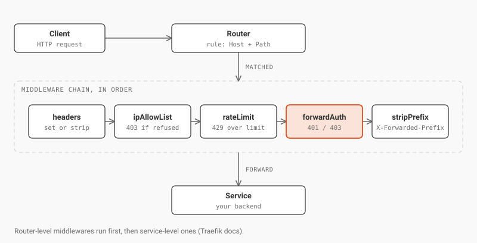

A reverse proxy is useful for what it does between the client and your service: add a header, cut a path prefix, limit a caller, ask another service whether a request may pass. In Traefik, each of those steps is a **middleware**, and on Kubernetes a middleware is a custom resource you can review, version and deploy with the rest of your manifests.

This post is the reference we wanted when we wrote our first charts. It shows how to define a middleware, three ways to attach it, the settings of the most used middlewares with their defaults, and the mistakes that cost the most time. Everything is taken from the Traefik v3.8 documentation (v3.8.0 was released on 23 Nov 2026), and no manifest was run against a cluster for this post. It is written for platform engineers, developers who write Helm charts, and the architects who decide what belongs at the edge.

**After reading, you will know:**

- how a `Middleware` resource is defined and how its name is referenced,
- how to attach it through `IngressRoute`, an `Ingress` annotation and the Gateway API,
- the fields and defaults of `headers`, `buffering`, `stripPrefix`, `rateLimit`, `ipAllowList`, `forwardAuth`, `errors` and `chain`,
- what the common errors mean.

For a Helm-based walk-through of one middleware, see [Configuring Traefik Middleware for Kubernetes](/blog/2025/08/01/configuring-traefik-middleware-for-kubernetes/).

## Background: routers, middlewares and services

Traefik routes a request in three stages. A **router** decides by a rule (host, path) whether a request belongs to it. Attached **middlewares** tweak the request before it goes to the backend, or the answer before it goes to the client. A **service** is the backend. The documentation defines two attachment levels: router-level middlewares run first, followed by service-level middlewares. Middlewares that use the same protocol can be combined into chains.

{:class="blog-center"}

On Kubernetes, the `Middleware` kind belongs to the Traefik CRDs. The documentation states that you must apply the Traefik Kubernetes CRDs to your cluster before creating `Middleware` objects, because that registers the kind.

## The problem: configuration that is easy to get half right

Most middleware problems on Kubernetes come from three places:

- the **name** you reference does not match the namespace-qualified name Traefik expects,
- the middleware lives in **another namespace** and cross-namespace references are off,
- a field **default** does something you did not intend, such as unlimited body sizes.

## The solution: define, attach, then tune

### Part 1: define a `Middleware`

The documentation's example for `stripPrefix`:

```yaml
apiVersion: traefik.io/v1alpha1
kind: Middleware
metadata:
  name: stripprefix
  namespace: foo
spec:
  stripPrefix:
    prefixes:
      - /stripit
```

The `spec` holds exactly one middleware type (here `stripPrefix`). The `stripPrefix` middleware strips the matching prefix and stores it in an `X-Forwarded-Prefix` header, which the backend can use to build relative URLs.

### Part 2: three ways to attach it

**`IngressRoute`.** The middleware is listed under the route. From the documentation:

```yaml
apiVersion: traefik.io/v1alpha1
kind: IngressRoute
metadata:
  name: ingressroutebar
spec:
  entryPoints:
    - web
  routes:
    - match: Host(`example.com`) && PathPrefix(`/stripit`)
      kind: Rule
      services:
        - name: whoami
          port: 80
      middlewares:
        - name: stripprefix
          namespace: foo
```

A middleware in another namespace can only be referenced when the `allowCrossNamespace` option is enabled in the Traefik Kubernetes CRD provider configuration. The documentation suggests that you can avoid this requirement by defining and referencing the middleware in the same namespace.

**`Ingress` annotation.** For standard `Ingress` objects, the annotation `traefik.ingress.kubernetes.io/router.middlewares` carries a comma-separated list. The documentation's example value is `auth@file,default-prefix@kubernetescrd`. The rule: a CRD middleware is written as `<namespace>-<name>@kubernetescrd`. The `@kubernetescrd` suffix is the provider namespace, so the reference says which provider owns the middleware. The documentation adds that when `safeNaming` is enabled, the form becomes `<namespace>_<name>@kubernetescrd`, with an underscore.

```yaml
metadata:
  annotations:
    traefik.ingress.kubernetes.io/router.middlewares: default-prefix@kubernetescrd
```

**Gateway API.** With `HTTPRoute`, a Traefik middleware is referenced through an `ExtensionRef` filter. The v3.8 documentation shows the shape for listener filters, which require the Gateway API Experimental Channel:

```yaml
filters:
  - type: ExtensionRef
    extensionRef:
      group: traefik.io
      kind: Middleware
      name: add-tenant-header
```

The documentation says the Kubernetes CRD provider must be enabled for these filters. For a real-world case of this pattern, including the ordering of native filters and middlewares, see [From Traefik IngressRoute to the Kubernetes Gateway API](/blog/2025/12/14/gateway-api-traefik-migration/).

### Part 3: the middlewares you will use most

| Middleware | What it does | Key fields and defaults (v3.8 docs) |
| --- | --- | --- |
| `headers` | Adds or changes request and response headers, CORS and security headers | `customRequestHeaders`, `customResponseHeaders`; custom headers overwrite existing headers with the same name |
| `buffering` | Limits request and response size | `maxRequestBodyBytes` default 0 (unlimited; over-limit requests get **413**), `maxResponseBodyBytes` default 0 (over-limit responses give the client a **500**), `memRequestBodyBytes` default 1048576 |
| `stripPrefix` | Removes a path prefix and sets `X-Forwarded-Prefix` | `prefixes` |
| `rateLimit` | Token bucket per source | `average` default 0 (no limit), `period` default 1s, `burst` default 1; optional `redis` for limits shared across Traefik instances |
| `ipAllowList` | Accepts only listed client IPs | `sourceRange` required; `rejectStatusCode` default 403 |
| `forwardAuth` | Delegates the decision to an auth service | `address` required; 2XX grants access, any other answer is returned to the client |
| `errors` | Serves a custom page for chosen statuses | `status`, `service` (required), `query` |
| `chain` | Bundles several middlewares into one reusable name | `middlewares` list, in order |

A few details worth knowing:

- **`rateLimit`** is token-bucket based. The rate is `average` divided by `period`, and `burst` is the bucket size. Without `redis`, the documentation says Traefik uses in-memory storage, which works only for a single instance. The `sourceCriterion` option decides what counts as one caller: the request host, a header name, or an IP chosen from `X-Forwarded-For` by `ipStrategy`.
- **`ipAllowList`** matches against the remote address unless you set `ipStrategy`. The documentation explains why: the previous network hop is only appended to `X-Forwarded-For` after the allow-list has run, so behind another proxy you must configure `ipStrategy.depth` or `excludedIPs` or the check sees the proxy's address.
- **`forwardAuth`** answers with the authentication server's response when access is not granted. Useful options are `authResponseHeaders` (headers copied from the auth response onto the forwarded request, replacing conflicting ones), `authRequestHeaders` (which request headers reach the auth service; all if empty), `forwardBody` (default false; the documentation says reading the body breaks streaming) and `maxBodySize`. The `trustForwardHeader` option is documented as deprecated and slated for removal in the next major version; the recommended setup is to configure trusted IPs on the entry point (`forwardedHeaders.trustedIPs`) so the entry point sanitises `X-Forwarded-*` headers. See [the Keycloak forwardAuth article](/blog/2025/08/07/securing-microservices-with-keycloak-and-traefik-authproxy/).
- **`buffering`** keeps the whole request in memory up to `memRequestBodyBytes`, then buffers on disk. Setting `disableRequestBuffer` streams the body, and then `maxRequestBodyBytes` is not enforced.

A combined example, a `rateLimit` and a `chain`:

```yaml
apiVersion: traefik.io/v1alpha1
kind: Middleware
metadata:
  name: api-limit
spec:
  rateLimit:
    average: 100
    period: 1s
    burst: 200
---
apiVersion: traefik.io/v1alpha1
kind: Middleware
metadata:
  name: api-allowed
spec:
  ipAllowList:
    sourceRange:
      - 192.168.1.7
      - 127.0.0.1/32
    rejectStatusCode: 404
```

Both can then be listed, in order, under `middlewares:` of one route, or bundled by a `chain` middleware.

### Part 4: common errors

| Symptom | Likely cause |
| --- | --- |
| `no matches for kind "Middleware" in version "traefik.io/v1alpha1"` when you apply a manifest | The Traefik CRDs are not installed in the cluster; the documentation says they must be applied first. This is kubectl's standard wording, and we did not reproduce it without a cluster |
| An Ingress annotation names a middleware that is not found | Wrong name format; use `<namespace>-<name>@kubernetescrd` (or `<namespace>_<name>@kubernetescrd` with `safeNaming`) |
| A route references a middleware in another namespace and it is ignored | `allowCrossNamespace` is not enabled on the CRD provider; keep both in one namespace |
| `ipAllowList` blocks everyone behind a load balancer | The check sees the proxy address; set `ipStrategy` |
| Large uploads fail with 413 | `maxRequestBodyBytes` in a `buffering` middleware |
| Backend cannot see the original prefix | After `stripPrefix`, read `X-Forwarded-Prefix` |

Debugging order: confirm the CRDs exist, confirm the middleware object exists in the expected namespace, confirm the reference format, then read the Traefik logs.

## The outcome

| Question | Answer |
| --- | --- |
| Where does middleware config live | In `Middleware` resources next to the app's manifests |
| How to attach | `IngressRoute.middlewares`, the Ingress annotation, or `ExtensionRef` in Gateway API |
| What needs a decision | Body-size limits, rate-limit storage, IP strategy |
| What to avoid | Cross-namespace references without a reason, deprecated `trustForwardHeader` |

## Trade-offs

- A middleware per concern is readable but spreads logic across objects; chains reduce repetition at the cost of one more indirection.
- Edge checks (IP allow-list, rate limit) protect early, but they run per Traefik instance unless you configure shared storage.
- `forwardAuth` adds a network call to every request. Keep the auth service close and fast.
- We checked the documentation, not a running cluster. Apply manifests to a test namespace and read the Traefik logs before production.

## Apply it to your own cluster

- Install the Traefik CRDs before the first `Middleware`.
- Keep each middleware in the same namespace as the route that uses it.
- Set explicit `maxRequestBodyBytes`, and size limits for any `forwardAuth` that forwards bodies.
- Configure `forwardedHeaders.trustedIPs` on the entry point rather than relying on `trustForwardHeader`.
- Use a `chain` for the set of middlewares every route needs.

## Key takeaways

- A middleware is a CRD with one type per object; attach it by `IngressRoute`, annotation or `ExtensionRef`.
- Annotation names follow `<namespace>-<name>@kubernetescrd`.
- Cross-namespace references need `allowCrossNamespace`.
- Defaults matter: unlimited body sizes, `burst` of 1, `rateLimit` off at `average: 0`.
- `forwardAuth` grants access on 2XX and returns the auth server's answer otherwise.

## Related reading

- [Configuring Traefik Middleware for Kubernetes](/blog/2025/08/01/configuring-traefik-middleware-for-kubernetes/)
- [Securing microservices with Keycloak and a Traefik auth proxy](/blog/2025/08/07/securing-microservices-with-keycloak-and-traefik-authproxy/)
- [From Traefik IngressRoute to the Kubernetes Gateway API](/blog/2025/12/14/gateway-api-traefik-migration/)
- [Traefik middleware documentation](https://doc.traefik.io/traefik/v3.8/reference/routing-configuration/http/middlewares/overview/){:target="_blank"}{:rel="noopener nofollow"}
