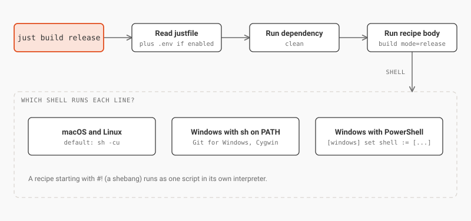

Every project has a handful of commands that people need to remember: build, test, lint, start the database, publish the image. They live in a README, in a shell history, or in a folder of scripts nobody dares to rename. When a new colleague joins, they ask in chat.

A **justfile** is the smallest fix for this: one file in the project root that names those commands and runs them. This post explains what it is, how it differs from `make`, how to make it work on Windows with PowerShell, and ends with a cheat sheet. Every example was run with `just` 1.59.0. It is written for developers who maintain a repository and for the architects and team leads who decide how a team shares its tooling.

**After reading, you will know:**

- what a justfile is and what problem it solves,
- how `just` differs from `make`,
- how to install it and how to choose the shell on Windows,
- the features that cover most real projects: arguments, variables, dependencies, `.env` files and multi-line recipes.

If you want a project story rather than a reference, read the earlier post [A better way to manage project commands](/blog/2025/05/30/manage-project-commands-justfile/).

## Background: a command runner is not a build system

`just` is a **command runner**. You give a command a name, and `just <name>` runs it. That sounds like `make`, and the `just` documentation is direct about the difference: `make` is a build system, built around producing files, while `just` only runs commands.

The difference shows in one well-known trap, described in the `just` README. If a file called `test` exists next to a makefile with a `test:` target, `make test` answers "`test' is up to date" and does nothing, because `make` assumes the target produces a file named `test`. The standard workaround is a `.PHONY` list. In `just`, all recipes behave as if they were phony, so nothing like it is needed.

Two more `make` habits that `just` avoids, according to the same README: the difference between `=` and `:=` in assignments, and the need to write `$$` to use an environment variable in a recipe.

| | `make` | `just` |
| --- | --- | --- |
| Purpose | Build files from sources | Run named project commands |
| Name collides with a file | Recipe may be skipped unless declared `.PHONY` | Never skipped; all recipes behave as phony |
| Shell variable in a recipe | `$$VAR` | `$VAR` |
| List the available commands | Not built in | `just --list` |
| Windows | Needs a separate `make` | Choose the shell in the file |

Use `make` when you really are building files with dependency tracking. Use `just` for everything else.

## The problem: commands scattered across people and files

A typical repository without a command runner has three kinds of knowledge:

- **README commands** that go stale the day after they are written,
- **scripts** (`build.sh`, `run_tests.cmd`) that work on one operating system,
- **tribal knowledge**, such as "run the formatter before the tests, but not on CI".

None of these can be listed, none can be checked by a tool, and each one is one more thing to explain to a newcomer or to a CI pipeline.

## The solution: five features that do most of the work

### Part 1: install it

The `just` README lists these package managers, among others:

| System | Command |
| --- | --- |
| macOS (Homebrew) | `brew install just` |
| Any system with Rust | `cargo install just` |
| Windows (winget) | `winget install --id Casey.Just --exact` |
| Windows (Scoop) | `scoop install just` |
| Windows (Chocolatey) | `choco install just` |

For Linux distributions and other packages, see the README table. You can also add shell completion: the README documents scripts for Bash, Zsh, Fish, PowerShell and others.

### Part 2: write recipes, run them, list them

A recipe is a name, optional dependencies after a colon, and an indented body. This justfile was run as shown:

```just
version := "1.2.3"

# list recipes
default:
    @just --list

# build with a mode argument
build mode="debug": clean
    echo "building {{mode}} v{{version}}"

clean:
    echo cleaning
```

Running `just build release` printed `cleaning` first and then `building release v1.2.3`. Three behaviours to note:

- the **dependency** (`clean`) runs before the recipe that names it,
- the **argument** `mode` has a default (`debug`) and is inserted with `{{mode}}`,
- the **comment** above a recipe becomes its description in `just --list`.

Running `just` with no arguments runs the first recipe, here `default`, which lists everything:

```text
Available recipes:
    build mode="debug" # build with a mode argument
    clean
    default            # list recipes
```

The list is the documentation, and it cannot go out of date, because it is generated from the file.

{:class="blog-center"}

A caution that matters for a common mistake: arguments are only substituted inside `{{ }}`. A recipe `greet NAME:` with the body `echo "Hello, NAME!"` prints the literal text `Hello, NAME!`. Write `echo "Hello, {{NAME}}!"`.

### Part 3: variables, `.env` files and multi-line recipes

Settings at the top of the file change how `just` behaves. We tested these:

```just
set dotenv-load := true     # read a .env file next to the justfile

tag    := `git describe --always`   # a backtick runs a command
target := if os() == "macos" { "darwin" } else { "other" }

set export                  # make just variables available as environment variables
```

- With `set dotenv-load`, a `.env` file containing `GREETING=hello-from-dotenv` made `echo $GREETING` print `hello-from-dotenv`.
- Functions such as `os()`, `arch()` and `justfile_directory()` return facts about the machine and the project; on our test machine `os()` returned `macos` and `arch()` returned `aarch64`.
- A recipe that starts with a shebang line is a script; the whole body runs in one interpreter, which suits loops and error handling:

```just
multi:
    #!/usr/bin/env bash
    set -euo pipefail
    for i in 1 2; do echo "step $i"; done
```

Without a shebang, every line of a recipe is run as its own command.

### Part 4: Windows and PowerShell

On Windows, `just` uses `sh` by default, as the README explains. That works if Git for Windows, GitHub Desktop or Cygwin provides an `sh` that is on the `PATH`. If it does not, the recipe fails. We reproduced the shape of the error with a shell that does not exist:

```text
error: recipe `hi` could not be run because just could not find the shell `nonexistent-sh`: No such file or directory (os error 2)
```

The fix is to choose the shell in the justfile. The current README documents the `[windows]` attribute on the `shell` setting, and recommends PowerShell for most Windows users:

```just
[windows]
set shell := ["powershell.exe", "-NoLogo", "-Command"]

hello:
    Write-Host "Hello, world!"
```

Older files use `set windows-shell := [...]`. The README now marks `windows-shell` as deprecated, but `just` 1.59.0 still accepts it, and we ran both forms. New files should use the attribute form.

Two cautions from the README: PowerShell handles positional arguments differently from `sh`, and with PowerShell 7.4 or later the `-CommandWithArgs` flag makes them work as in `sh`. And you can override the shell from the command line with `--shell powershell.exe --shell-arg -c`, which makes `just` ignore the shell settings in the file.

To give one recipe different bodies per platform, use attributes, not a prefix:

```just
[windows]
clean:
    Remove-Item -Recurse -Force bin, obj

[unix]
clean:
    rm -rf bin obj
```

On our macOS machine, `just clean` ran the `[unix]` body.

### Part 5: make it safe and tidy

| Need | Syntax (tested) |
| --- | --- |
| Hide a helper from `--list` | `[private]` above the recipe |
| Group and describe | `[group('ci')]` and `[doc('Run checks')]` |
| Ask before a dangerous step | `[confirm("Really deploy?")]` |
| Run without echoing the command | `@` before the recipe name |
| Take any number of arguments | `run *args:` |
| One or more arguments | `test +files:` |
| Print the effective value | `just --evaluate target` |
| Show what would run | `just --dry-run build` |
| Show one recipe's source | `just --show check` |

## The outcome

| Question | Without a justfile | With a justfile |
| --- | --- | --- |
| What commands does this project have? | Ask, or search the README | `just` |
| Same command on Windows and macOS | Two scripts | One recipe, shell chosen in the file |
| Environment variables | Each developer sets them | `.env` loaded by `set dotenv-load` |
| Danger of a name collision | `make test` silently skipped | Not possible |

## Trade-offs

- `just` is one more tool to install, and the file must stay readable. Name recipes after intent (`test`, `lint`), not after tools.
- It is not a build system. If you need incremental builds based on file timestamps, keep `make` or your language's build tool and let a justfile call it.
- Windows needs a decision. Pick PowerShell or an installed `sh`, and write it down in the file, not in a wiki.
- PowerShell and `sh` differ in quoting and argument handling; test recipes on both when your team uses both.

## Apply it to your own project

- Create a `justfile` with `default: @just --list` as its first recipe.
- Move the commands from the README into recipes and delete them from the README.
- Add `set dotenv-load` if your commands read a `.env` file.
- Choose the Windows shell with `[windows]` and `set shell`.
- Call the same recipes from CI, so a developer and the pipeline run the same command.

## Key takeaways

- A justfile is a list of named, runnable project commands; `just --list` is the documentation.
- `just` is a command runner, not a build system: no `.PHONY`, no `$$`.
- On Windows, either have an `sh` on the `PATH` or set the shell in the file; PowerShell is the README's recommendation.
- Use `[windows]` and `[unix]` attributes for per-platform recipes, and `{{ }}` to insert arguments.
- Start small: one file, five recipes, called by both people and CI.

## Related reading

- [A better way to manage project commands](/blog/2025/05/30/manage-project-commands-justfile/)
- [The `just` manual](https://just.systems/man/en/){:target="_blank"}{:rel="noopener nofollow"}
