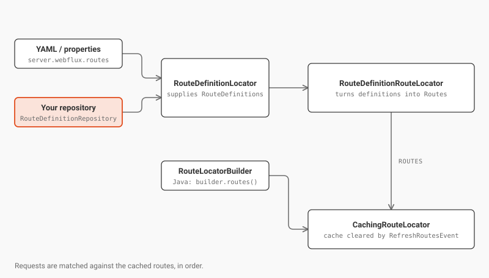

Static routes in `application.yml` are fine until the day routes become data: a new tenant gets its own backend, a service is moved, a partner is cut off. Then the question is whether you must redeploy the gateway for every routing change.

Spring Cloud Gateway offers three ways to define routes: configuration properties, a fluent Java API, and your own source of route definitions, such as a database. This post explains how they fit together, which interfaces to implement for a database-backed gateway, and how a route change reaches a running instance. It is written for Java developers and for architects deciding where routing rules should live. The content comes from the Spring Cloud Gateway reference and the project source code (release 5.1.0, checked 25 Nov 2026). We did not run a gateway against a database for this post, so the code in Part 3 is a sketch against the real interfaces and has not been compiled.

**After reading, you will know:**

- how `RouteLocator`, `RouteDefinitionLocator` and `RouteDefinitionRepository` relate,
- how to define routes in Java with `RouteLocatorBuilder`,
- what to implement for database-backed routes and how a refresh works,
- how to list the effective routes, and what differs on the WebMVC server.

## Background: three layers of "where routes come from"

Think of routing in layers:

- **`RouteDefinition`** is plain data: an id, a target URI, predicates, filters, an order and metadata. It is what you write in YAML.
- **`RouteDefinitionLocator`** produces definitions. Its single method returns a stream of them. The properties in your YAML are read by one locator (`PropertiesRouteDefinitionLocator` in the source), and others can be added.
- **`RouteLocator`** produces the executable `Route` objects that the gateway matches requests against. `RouteDefinitionRouteLocator` turns definitions into routes, and a caching locator keeps the result in memory.

{:class="blog-center"}

The Java API and the repository are two different entry points to the same result: a list of routes the gateway matches in order.

## The problem: routing changes need a deploy

With only YAML:

- every new route is a configuration change followed by a restart or a redeploy,
- routing knowledge sits in files that operations teams do not own,
- there is no single place that lists what is routed where, except the running gateway.

Which source fits depends on how often routing changes and who changes it.

| Source | Good for | Changes need |
| --- | --- | --- |
| YAML or properties | Stable, reviewed routing | Config change and refresh or restart |
| `RouteLocatorBuilder` (Java) | Routes with logic, custom filters | Code change and deploy |
| `RouteDefinitionRepository` | Routes as data (tenants, partners) | Write to the store and refresh |

## The solution: pick the source, then wire the refresh

### Part 1: routes in Java with `RouteLocatorBuilder`

The reference shows the fluent API. A `RouteLocatorBuilder` bean is available, and you return a `RouteLocator`:

```java
@Bean
public RouteLocator customRouteLocator(RouteLocatorBuilder builder) {
    return builder.routes()
        .route(r -> r.path("/image/webp")
            .filters(f -> f.addResponseHeader("X-AnotherHeader", "baz"))
            .uri("http://httpbin.org:80")
            .metadata("key", "value"))
        .route(r -> r.order(-1)
            .host("**.throttle.org").and().path("/get")
            .uri("http://httpbin.org:80"))
        .build();
}
```

Points from the reference: predicates defined this way are combined with logical `and`, and the fluent API also lets you use `and()`, `or()` and `negate()` on predicates. A route can carry `order` and `metadata`. Use this style when a route needs a custom filter bean or logic that YAML cannot express.

### Part 2: what a database-backed gateway implements

Three small interfaces, copied from the source:

```java
public interface RouteDefinitionLocator {
    Flux<RouteDefinition> getRouteDefinitions();
}

public interface RouteDefinitionWriter {
    Mono<Void> save(Mono<RouteDefinition> route);
    Mono<Void> delete(Mono<String> routeId);
}

public interface RouteDefinitionRepository extends RouteDefinitionLocator, RouteDefinitionWriter { }
```

By default, the auto-configuration registers an `InMemoryRouteDefinitionRepository`, guarded by `@ConditionalOnMissingBean(RouteDefinitionRepository.class)`. So defining your own `RouteDefinitionRepository` bean replaces it. The in-memory version is a synchronised map: `save` rejects an empty id with `IllegalArgumentException("id may not be empty")`, and `delete` of an unknown id fails with a `NotFoundException`. A database implementation should keep that contract.

### Part 3: a sketch of the database implementation

The code below shows the shape. It assumes a reactive repository that stores route definitions as JSON; it is an illustration, not tested code.

```java
@Component
class JdbcRouteDefinitionRepository implements RouteDefinitionRepository {

    private final RouteStore store;               // your reactive data access
    JdbcRouteDefinitionRepository(RouteStore store) { this.store = store; }

    @Override
    public Flux<RouteDefinition> getRouteDefinitions() {
        return store.findAll();                    // map rows to RouteDefinition
    }

    @Override
    public Mono<Void> save(Mono<RouteDefinition> route) {
        return route.flatMap(r -> r.getId() == null || r.getId().isBlank()
            ? Mono.error(new IllegalArgumentException("id may not be empty"))
            : store.upsert(r));
    }

    @Override
    public Mono<Void> delete(Mono<String> routeId) {
        return routeId.flatMap(store::deleteById);
    }
}
```

Two design points. First, the route definition must be serialisable: predicates and filters are strings with arguments, which is why they fit a JSON column. Second, the repository is read whenever routes are rebuilt, so `getRouteDefinitions()` must be fast and must not fail on one bad row.

### Part 4: refresh without a restart

The routes are cached. In the source, `CachingRouteLocator` listens for `RefreshRoutesEvent`; on the event it rebuilds all routes from the locators and replaces the cache, and it publishes a `RefreshRoutesResultEvent` when done. If building fails, it hands the error to its refresh error handler, so check your logs after a change.

There are two ways to trigger it:

- publish the event in your code after a write: `publisher.publishEvent(new RefreshRoutesEvent(this))`,
- call the actuator: the reference lists `POST /actuator/gateway/refresh` among the gateway endpoints, next to `GET /actuator/gateway/routes`, `GET /actuator/gateway/routedefinitions` and `POST` or `DELETE` on `/actuator/gateway/routes/{id}`.

Note the access levels. According to the reference, `management.endpoint.gateway.access=read-only` disables the ability to refresh, create and delete routes, and the reference warns to secure those endpoints if you enable them. So the actuator refresh needs a level above `read-only`. For a database-backed gateway, prefer your own admin API that writes the store and publishes the event, and keep the actuator at `read-only`.

### Part 5: list the effective routes

Two read-only calls answer "what is this gateway doing?":

```bash
curl http://localhost:8080/actuator/gateway/routes
curl http://localhost:8080/actuator/gateway/routedefinitions
```

The first lists executable routes, the second the definitions. Compare the two after a refresh: a definition without a route means the build failed for it. The reference also describes a more verbose format that shows predicates and filters.

### What differs on the WebMVC server

The sketch above is for the WebFlux server. The MVC server uses functional endpoints, for example:

```java
@Bean
public RouterFunction<ServerResponse> companiesRoute() {
    return route("companies")
        .GET("/companies/**", http())
        .before(uri("http://companies-service:8080"))
        .build();
}
```

as shown in the reference's rate-limiting example. In the source, the properties-based routes of the MVC server are held in a bean that is placed in the **refresh scope** when it is available, so a configuration refresh reloads them. We did not find an equivalent of `RouteDefinitionRepository` in the MVC reference, so for MVC, database-backed routing means building a `RouterFunction` yourself.

## The outcome

| Question | With YAML only | With a repository |
| --- | --- | --- |
| Add a route | Config change and deploy | Write a row, publish a refresh |
| Where is the routing truth | Files in several repos | One table |
| Inspect at runtime | `/actuator/gateway/routes` | Same, plus your own admin view |
| Risk | Slow change | A bad row breaks the rebuild; needs validation |

## Trade-offs

- A database makes routing a runtime dependency. Keep the last good set in memory and monitor the refresh result.
- Dynamic routes bypass code review unless you add one: validate definitions before they are saved and audit who changed them.
- `save` accepts any predicate or filter string, so an invalid name fails at refresh time. Validate against the known factory names.
- Keep the actuator write endpoints closed. A routing change is a security-relevant change.

## Apply it to your own gateway

- Start with YAML. Move to a repository only when routes change more often than you deploy.
- Implement `RouteDefinitionRepository`, keeping the in-memory contract for empty and unknown ids.
- Publish `RefreshRoutesEvent` after every write, and alert when a definition has no matching route.
- Log who changed which route and when.

## Key takeaways

- `RouteDefinition` is data, `RouteDefinitionLocator` supplies it and `RouteLocator` makes it executable.
- Defining your own `RouteDefinitionRepository` bean replaces the default in-memory one.
- Routes are cached; a `RefreshRoutesEvent` or `POST /actuator/gateway/refresh` rebuilds them.
- Keep the actuator at `read-only` (it then cannot refresh or edit routes) and write routes through your own, audited path.
- The MVC server uses `RouterFunction` and refresh scope; the repository interfaces belong to the WebFlux server.

## Related reading

- [Spring Cloud Gateway Path predicate: does /companies/** match /companies?](/blog/2026/11/30/spring-cloud-gateway-path-predicate/)
- [Spring Cloud Gateway rate limiting](/blog/2027/01/25/spring-cloud-gateway-rate-limiting/)
- [Moving routes to spring.cloud.gateway.server.webflux](/blog/2027/02/15/spring-cloud-gateway-server-webflux-properties/)
