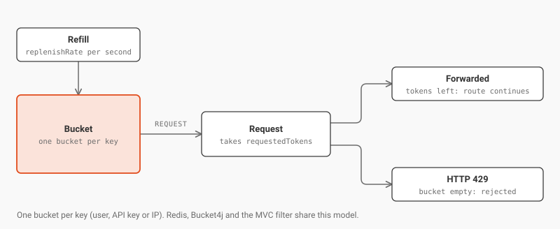

A rate limiter answers one question for every request: may this caller proceed now? Get it right and a traffic spike from one client does not take down everyone else. Get it slightly wrong and you either block honest users or discover during an outage that your limiter quietly stopped limiting.

Spring Cloud Gateway has three built-in answers, depending on the server flavour: a Redis limiter and a Bucket4j limiter on WebFlux, and a Bucket4j filter on WebMVC. This post compares them, explains the token-bucket settings with the exact semantics from the reference, and covers two behaviours that surprise teams in production: what happens when Redis fails, and what happens when no key can be found. It is written for developers and for architects who decide where limits live. Facts come from the reference documentation and the source code (release 5.1.0, checked 25 Nov 2026); we did not run a load test, so the numbers in the examples are illustrations.

**After reading, you will know:**

- how the token bucket works and what `replenishRate`, `burstCapacity` and `requestedTokens` mean,
- which limiter to use on WebFlux and on WebMVC,
- how to choose the key (user, IP, API key),
- which headers are returned, and what happens when Redis is unavailable,
- which gaps the documentation leaves open.

If you want the original Redis walkthrough, see [Protecting your APIs with RequestRateLimiter](/blog/2025/07/14/protect-api-with-requestratelimiter/).

## Background: the token bucket in one picture

All three limiters use the **token bucket algorithm**. Imagine a bucket that holds tokens. Each request takes tokens out; the bucket is refilled at a steady rate; an empty bucket means the request is rejected with HTTP 429 (Too Many Requests) by default. The size of the bucket allows short bursts, and the refill rate sets the long-run average.

{:class="blog-center"}

One bucket exists per **key**. The key is what you limit by: a user name, an API key, a client IP address. Without a key, there is no bucket to take tokens from, so the choice of key is a design decision, not a detail.

## The problem: limits that do not do what you think

Four typical surprises:

- **Burst versus rate:** a limit of "10 per second" with a burst of 20 lets a client send 20 requests in the first second, then 10 per second after.
- **Missing key:** requests without a user or API key are denied, not allowed.
- **Dependency failure:** when the limiter's store is unreachable, the gateway has to choose between blocking everyone and allowing everyone.
- **Wrong flavour:** the Redis limiter documented for WebFlux does not exist on the MVC server.

## The solution: choose the limiter, then set the bucket

### Part 1: which limiter on which server

| | WebFlux, Redis | WebFlux, Bucket4j | WebMVC, Bucket4j |
| --- | --- | --- | --- |
| Configured as | `RequestRateLimiter` filter with `redis-rate-limiter.*` | `RequestRateLimiter` filter with `bucket4j-rate-limiter.*` | `rateLimit(...)` filter function in the Java DSL |
| Needs | `spring-boot-starter-data-redis-reactive` | `bucket4j_jdk17-core` plus a persistence option | A Bucket4j dependency plus an `AsyncProxyManager` bean |
| Shared across instances | Yes, via Redis | Only with a distributed proxy manager | Only with a distributed proxy manager |
| Reference note | Based on work done at Stripe | The reference marks its in-memory example "not recommended for production" | In-memory Caffeine is described as "useful for testing" |

The Bucket4j limiter for WebFlux was added in release 4.3.0 (23 Jul 2025). The Redis limiter has no counterpart on the MVC server in the reference.

### Part 2: Redis on WebFlux

The reference defines three properties for `redis-rate-limiter`:

- `replenishRate`: how many requests per second are allowed without drops; the rate at which the bucket is filled.
- `burstCapacity`: the maximum number of requests in a single second; the number of tokens the bucket can hold. Zero blocks all requests.
- `requestedTokens`: how many tokens one request costs; default 1.

A steady rate means the same value in `replenishRate` and `burstCapacity`; a higher `burstCapacity` allows bursts, but, per the reference, two consecutive bursts result in dropped requests. For limits below one request per second, the reference gives a recipe: `replenishRate=1`, `requestedTokens=60` and `burstCapacity=60` yield one request per minute.

```yaml
spring:
  cloud:
    gateway:
      server:
        webflux:
          routes:
            - id: requestratelimiter_route
              uri: https://example.org
              filters:
                - name: RequestRateLimiter
                  args:
                    redis-rate-limiter.replenishRate: 10
                    redis-rate-limiter.burstCapacity: 20
                    redis-rate-limiter.requestedTokens: 1
```

The reference notes that `RequestRateLimiter` cannot use the shortcut notation (`RequestRateLimiter=2, 2, #{@userkeyresolver}` is invalid); use the full `name` and `args` form shown above, with `key-resolver: "#{@userKeyResolver}"` to reference a bean.

### Part 3: in-memory Bucket4j on WebFlux

If you run one gateway instance, or want a limiter without Redis, use the Bucket4j limiter. The reference's example uses a Caffeine-based, local `AsyncProxyManager` bean and these settings:

```yaml
filters:
  - name: RequestRateLimiter
    args:
      bucket4j-rate-limiter.capacity: 20
      bucket4j-rate-limiter.refillTokens: 10
      bucket4j-rate-limiter.refillPeriod: 1s
      bucket4j-rate-limiter.requestedTokens: 1
```

`capacity` is the bucket size, `refillTokens` per `refillPeriod` is the refill rate (`refillTokens` defaults to `capacity`), and `refillStyle` is `GREEDY` (default, adds tokens as soon as possible), `INTERVALLY` (waits for the whole period) or `INTERVALLY_ALIGNED` (with `timeOfFirstRefill`). **A local cache is per instance:** with three gateway replicas, each keeps its own buckets, so the effective limit is up to three times the configured one. For a shared limit, the reference points to Bucket4j's distributed persistence options.

### Part 4: WebMVC

On the MVC server, the filter is a Java function. From the reference:

```java
@Bean
public RouterFunction<ServerResponse> gatewayRouterFunctionsRateLimited() {
    return route("rate_limited_route")
        .GET("/api/**", http())
        .before(uri("https://example.org"))
        .filter(rateLimit(c -> c.setCapacity(100)
            .setPeriod(Duration.ofMinutes(1))
            .setKeyResolver(request -> request.servletRequest().getUserPrincipal().getName())))
        .build();
}
```

This is a bucket of 100 tokens per minute per user. In the source: `tokens` per request defaults to 1, the denial status defaults to 429, the remaining-tokens header defaults to `X-RateLimit-Remaining`, and the `timeout` for a distributed bucket is not set by default. The reference states that key resolvers are configured only through the Java DSL, not through external properties. Release 5.0.0 (24 Nov 2025) fixed a `ClassCastException` in `Bucket4jFilterFunctions.rateLimit()`, so use 5.0.0 or later with this filter.

### Part 5: choosing the key

| Key | How | Caution |
| --- | --- | --- |
| User | Default on WebFlux: `PrincipalNameKeyResolver` returns the `Principal` name | Needs authentication before the limiter |
| API key | A `KeyResolver` bean reading a header | Anonymous callers have no key |
| Client IP | A `KeyResolver` using the remote address | Behind a proxy, all callers can share one address; verify forwarded-header handling |

The reference's own `KeyResolver` example reads a `user` query parameter and notes "this is not recommended for production": a caller can change a query parameter at will. Use identity that the caller cannot choose.

**When no key is found:** on WebFlux, requests are denied by default; the properties `spring.cloud.gateway.filter.request-rate-limiter.deny-empty-key` and `empty-key-status-code` adjust that. On MVC, the source returns HTTP 403 for an empty key and has a comment that a configurable status is still to do.

### Part 6: response headers and a Redis outage

On WebFlux with Redis, the source defines these headers, included by default: `X-RateLimit-Remaining`, `X-RateLimit-Replenish-Rate`, `X-RateLimit-Burst-Capacity` and `X-RateLimit-Requested-Tokens`. On MVC, the filter sets only the remaining-tokens header, on both allowed and denied responses.

**What the Redis limiter does when Redis fails** is not in the reference, but it is in the source. If the Lua call errors, the code logs `Error calling rate limiter lua` and returns "allowed" with tokens left of -1. If the call throws, it logs `Error determining if user allowed from redis` and also allows the request. A code comment says the team does not want a hard dependency on Redis to allow traffic and tells operators to "set an alert". In other words, **the Redis limiter fails open**. If you need it to fail closed, you must write your own `RateLimiter` bean, which the reference supports (`rate-limiter: "#{@myRateLimiter}"`).

The reference does not mention Valkey. We did not test it, and recommend checking compatibility yourself before relying on it.

## The outcome

| Question | Answer |
| --- | --- |
| Shared limit across replicas, WebFlux | Redis limiter |
| No Redis, single instance | Bucket4j with Caffeine (not for production, per the reference) |
| WebMVC | Bucket4j filter function, Java DSL only |
| Behaviour when Redis fails | Requests are allowed; an error is logged |
| Behaviour with no key | Denied (WebFlux by default, 403 on MVC) |

## Trade-offs

- Failing open protects availability and gives up protection exactly when Redis is down. Alert on those log lines.
- Distributed limits cost a network call per request; local limits are cheap but per instance.
- Identity-based keys need authentication to run before the limiter; limit by IP only as a coarse outer layer.
- Limits at the gateway do not replace backpressure inside services.

## Apply it to your own gateway

- Decide the key first: user, API key, or IP, and what happens to anonymous traffic.
- Pick the server flavour's limiter from the table, and write the numbers as requests per second and burst.
- Add an alert on `Error calling rate limiter lua` if you use Redis.
- Test the 429 path and the missing-key path, not only the happy path.
- Run a load test before production, since the examples in the reference are illustrations.

## Key takeaways

- All three limiters are token buckets; `burstCapacity` allows bursts, the rate sets the average.
- The Redis limiter is WebFlux only and fails open when Redis errors, according to the source.
- Bucket4j covers in-memory use on WebFlux and the only limiter on WebMVC; local caches are per instance.
- Missing keys are denied: 403 on MVC, a configurable denial on WebFlux.
- Choose a key the caller cannot choose.

## Related reading

- [Protecting your APIs with RequestRateLimiter in Spring Cloud Gateway](/blog/2025/07/14/protect-api-with-requestratelimiter/)
- [Spring Cloud Gateway Path predicate](/blog/2026/11/30/spring-cloud-gateway-path-predicate/)
- [Moving routes to spring.cloud.gateway.server.webflux](/blog/2027/02/15/spring-cloud-gateway-server-webflux-properties/)
- [RequestRateLimiter reference](https://docs.spring.io/spring-cloud-gateway/reference/spring-cloud-gateway-server-webflux/gatewayfilter-factories/requestratelimiter-factory.html){:target="_blank"}{:rel="noopener nofollow"}
